# Nebula Architecture

This document describes the architecture of Nebula. Section 1 states its purpose and scope.

## Contents

- [1. Purpose and scope](#1-purpose-and-scope)
- [2. Architectural principles and hard constraints](#2-architectural-principles-and-hard-constraints)
- [3. System context and process topology](#3-system-context-and-process-topology)
- [4. Domain model](#4-domain-model)
- [5. Data contracts and schema](#5-data-contracts-and-schema)
- [6. Engine](#6-engine)
- [7. Plugin system](#7-plugin-system)
- [8. GPU platform layer](#8-gpu-platform-layer)
- [9. Core shared services](#9-core-shared-services)
- [10. Geometry and meshing](#10-geometry-and-meshing)
- [11. Physics modules](#11-physics-modules)
- [12. Optimization and studies](#12-optimization-and-studies)
- [13. Web application](#13-web-application)
- [14. Scheduling and compute adapters](#14-scheduling-and-compute-adapters)
- [15. Reproducibility, V&V and observability](#15-reproducibility-vv-and-observability)
- [16. Security](#16-security)
- [17. Build and repository](#17-build-and-repository)
- [18. Roadmap](#18-roadmap)
- [19. Risks and accepted tensions](#19-risks-and-accepted-tensions)
- [Appendix A. Decision log](#appendix-a-decision-log)
- [Appendix B. Glossary](#appendix-b-glossary)

## 1. Purpose and scope

Nebula is a single-user, web-based platform for designing magnetic-confinement fusion reactors. Users design parametric geometry, set up calculations as workflow graphs, run them on AMD or NVIDIA GPUs, and inspect results in the browser. The core assumes no particular confinement concept. Concepts, solvers and further calculation types arrive as modules behind fixed contracts (D2, D3, D58).

This document describes the architecture. Every design choice cites its entry in the decision log (Appendix A). Only the final form of each decision is stated.

### 1.1 Requirements traceability

Every bullet of `requirements.md` maps to the sections that satisfy it. Milestones refer to the roadmap in Section 18 (D93, D97, D99).

| `requirements.md` bullet | How it is satisfied | Sections |
|---|---|---|
| Modular and extensible fusion reactor design software | Fixed core extension points with sub-extension points published by core modules or plugins (D58, D111). dlopen-loaded C++ plugins (D19, D9). Concept plugins and capability traits; the core assumes no topology (D2, D6, D64). Calculation sub-contracts with adapters (D1, D55); further modules plug-and-play (D3). | 2.7, 2.8, 5.3, 7.1, 7.5, 7.7, 19.1 |
| UI: Web based | React + TypeScript browser UI served by `nebula serve` through the FastAPI server (D28, D21, D90) | 3, 13 |
| UI: Design geometry | Typed parametric components assembled into versioned geometries (D27, D88), built in the geometry worker over OCCT (D85), edited in three.js (D28) | 3.3, 4, 10, 13 |
| UI: Setup calculation | Typed-port node graph editor with forms generated from plugin `.proto` configs (D50, D87); regions (D89) and scenarios (D66) as project entities; study setup (D103) | 4.1, 6.2, 12.7, 13.3, 13.4, 13.5 |
| UI: View results | Fixed viewer catalogue chosen by output kind (D87); GPU post-processing operators produce compact vtk.js/glTF payloads (D39, D63); cross-run comparison (D104) | 3.5, 3.6, 4.5, 9.5, 13.6, 13.7, 14.4 |
| UI: Multiple projects | Self-contained per-project directories plus a global registry of projects (D100) | 4.1, 4.8, 13.2 (Project resource), 13.3 (Project browser) |
| UI: Single project with multiple calculations | Project owns many Workflows, Runs and Studies (D51) | 4.1, 13.2, 13.7 |
| UI: Can be full design to simulation or each separate step | Workflow DAG (directed acyclic graph) for full chains; a single step is a one-node DAG run from stored outputs of earlier Runs or from user-supplied input datasets (D22, D50, D144); concept templates provide default chains (D86) | 4.1, 6.1, 6.2, 13.4 |
| UI: Same or different geometry multiple calculation in a project | Workflows reference geometries as pinned versions, the latest version or the current draft (D107); many workflows may reference the same or different geometries (D51, D26, D101) | 4.1, 4.2, 13.2, 13.4 |
| Calculations: Magnet design | Coil shape design and optimization with engineering constraints, Lorentz forces and critical-current margin (D32); milestone M3 (D99) | 11, 11.2, 12, 18.2 |
| Calculations: Magnetic field in a region from magnets or current carrying wires defined | Biot-Savart field operator over filaments, finite coils and volume currents (D31, D65), evaluated on typed Region entities (D89). In v1, "magnets" means current-carrying coils; magnetized materials arrive through a field-source sub-extension point (D145). User-defined wires are filament components in closed circuits, with currents from a Scenario keyed by circuit (D27, D88, D114, D145); v1 (D93) | 4.1 (Region), 9.1, 11.1, 18.1 |
| Calculations: plasma equilibrium | Topology-tagged tiers T0-T3 (D33); T0, T1, T2 in v1 (D97) | 11.3, 18.1, 18.2 |
| Calculations: plasma stability | Local criteria, global ideal and resistive linear magnetohydrodynamics (MHD), linear gyrokinetics (D34, D69); local and global MHD in v1 (D97) | 11.4, 18.1, 18.2 |
| Calculations: time evolution, separate from plasma stability | Separate calculation type with its own contract: 1.5D/1D transport and 3D nonlinear MHD (D35, 11.5). Stability is a separate contract with its own methods: local criteria, a block-structured eigenvalue formulation solved with batched block-tridiagonal LU, and GPU shift-invert Krylov-Schur (D34, D69, D37, 11.4) | 5.3, 11.4, 11.5 |
| Calculations: NVIDIA and AMD GPU calculations (bullet part 1 of 2) | Single-source `gpu::` kernels compiled with HIP and CUDA (D13, D17); `la::` over vendor libraries (D37); supported targets (D75) | 2.2, 8.1, 8.2, 8.3, 17.2 |
| Calculations: no host side calculations (bullet part 2 of 2) | All physics and solver numerics sized by mesh, grid, particle or mode count run on GPU (D7, D82). Host work is limited to the categories of Section 2.1: design-space-sized optimizer math, OCCT B-rep evaluation and control-point sensitivities, Gmsh meshing and mesh partitioning, and file I/O, format conversion, hashing and orchestration. This is recorded as an accepted narrowing of the requirement (19.1) | 2.1, 8, 10.2, 12.4, 19.1 |
| Calculations: Multiple nodes and GPUs support | One MPI rank per GPU (D53); `comm::` over RCCL/NCCL; distributed-array descriptors (D74). In v1, multi-GPU means concurrent runs on disjoint GPUs plus multi-rank scaling of field evaluation and T1; other v1 steps run on one rank (D116). Multi-node adapter in M5 on a shared parallel filesystem (D4, D57, D99, D118) | 3.1, 6, 8.4, 14.2, 14.5, 18.2, 19.2 |

### 1.2 Goals

| Goal | Decisions |
|---|---|
| Explore custom confinement concepts; the core must not assume a tokamak | D2, D6, D64, D86 |
| Cover magnet design, magnetic field, equilibrium, stability, time evolution, wall loads and thermal-structural as first-class calculation types | D3, D31-D36, D72 |
| Offer reduced and high-fidelity solvers behind one contract family per calculation type | D1, D55 |
| Run all physics numerics on AMD and NVIDIA GPUs in FP64 | D7, D13, D17, D76, D82 |
| Scale from one GPU to many GPUs on one node in v1, and to many nodes later | D5, D53, D99 |
| Make every run reproducible and every result traceable to its inputs and build | D26, D43, D62, D77, D78 |
| Treat design optimization and parameter studies as first-class | D8, D67, D81, D103 |
| Let a user run a full design-to-simulation chain or any single step | D22, D49, D50 |
| Script everything the UI can do through a Python SDK | D38 |

### 1.3 Non-goals

| Non-goal | Consequence | Decisions |
|---|---|---|
| Multiple users, tenancy, authentication beyond local access | No identity in data or API; a per-launch token guards localhost only | D11, D16, D90 |
| Binary packaging and distribution | Built from source for personal use | D47 |
| Continuous integration | Tests run locally through the task runner and V&V through `nebula vv` (Section 15.5) | D48, D61, D157 |
| IMAS or other data-model interoperability | Nebula owns its versioned, concept-agnostic schema | D24 |
| Wrapping or calling third-party fusion codes, including for V&V | Native solvers only | D10 |
| FP32 or mixed-precision numerics | FP64 for all numerics and stored results; only view payloads are FP32 presentation data | D76, D156 |
| Out-of-process or multi-runtime plugins | Plugins run in-process on one mandated GPU stack | D9, D19 |
| Plugin conformance kit | Physics V&V suite is the only check | D96 |
| Streaming time-series edges | Deferred; time series pass as whole datasets | D92 |
| Engine on Windows or macOS | Engine assumed Linux-only because of ROCm/RCCL | D75 |
| GPL code linked into Nebula | Apache-2.0; GPL tools such as Gmsh run as separate executables | D12, D30 |

### 1.4 Release scope

v1 delivers geometry, the Biot-Savart field module, and plasma physics on a single multi-GPU node (D5, D93). Plasma tiers in v1 are T0, T1 and T2 equilibrium, local and global linear MHD stability, and 1.5D/1D transport (D97). Reference concepts are tokamak, simple mirror and stellarator (D98). Later milestones add high-fidelity plasma (M2), magnet design with optimizer and adjoints (M3), wall loads and thermal-structural (M4), and the multi-node adapter (M5). Each milestone freezes the contracts it introduces (D99). Section 18 holds the roadmap.

## 2. Architectural principles and hard constraints

The principles below are binding on core and plugin code alike. Each one is a direct consequence of a logged decision.

### 2.1 GPU-only numerics, with a size rule

All physics and solver numerics run on the GPU (D7). The line between host and GPU work is drawn by size (D82):

| Work | Where it runs | Decisions |
|---|---|---|
| Anything sized by mesh, grid, particle or mode count (assembly, solves, eigenproblems, field evaluation, post-processing, objective evaluation) | GPU | D7, D82, D39, D81 |
| Design-space-sized math (optimizer updates over parameter vectors, small scalar logic) | Host allowed | D82 |
| OCCT B-rep evaluation and parameter-to-control-point sensitivities (design-space sized; expanded to mesh nodes on the GPU) | Host, in the geometry worker | D82, D85, D83, D153 |
| CAD, meshing (Gmsh subprocess), mesh partitioning, discretization of geometry for the engine | Host, in the geometry worker | D7, D30, D112 |
| File I/O, format conversion (for example `.msh` to HDF5, Hierarchical Data Format 5), content hashing, orchestration | Host | D7, D108 |
| Optimizer drivers | Host orchestration, delivered as Optimizer extensions | D82, D67, D124 |

This table is the normative statement of the host/GPU line; other sections refer to it rather than restating it.

A mesh moves to the GPU once per run and stays resident (D7), within the memory budget of Section 8.5. Steps inside a run hand data to each other on the GPU; persistence to HDF5 runs in the background (D22, D68).

### 2.2 One GPU stack, single-source kernels

Nebula is C++20 with HIP for AMD and CUDA for NVIDIA (D13, D91). Kernels are single-source behind the `gpu::` portability header and compiled by each vendor's native compiler. Vendor-specific overrides exist only where profiling justifies them (D17). Linear algebra goes through `la::` (D37) and GPU-to-GPU data through `comm::` (D53). Every module, first-party or plugin, uses this one stack in-process (D9).

### 2.3 FP64 only

All numerics and stored results are FP64, real or complex (D76, D150). There are no FP32 or mixed-precision numeric paths. View payloads sent to the browser are an FP32 presentation format with a local origin offset; they are never inputs to computation (D156).

### 2.4 Determinism by default

Deterministic mode is the default and is enforced inside `gpu::`, `la::` and `comm::`; a faster nondeterministic mode is selectable per run (D77). Sections 15.1 and 15.2 are the normative home of the determinism rules and guarantees (D43, D77, D129).

### 2.5 Immutability at run submission

Geometries, components, regions, scenarios, conductor networks and workflows are mutable drafts while the user edits them. Submitting a run mints immutable versions keyed by content hash and pins them to the run (D56, D26); promotion and solved-scenario emission are the only other minting paths (D110). A run therefore never observes a later edit. Results are cached by cache key (Section 4.6; D26, D78).

### 2.6 One schema, SI units, fixed conventions

All interfaces are defined once in Protobuf and generated for C++, Python and TypeScript with Buf (D25, D21). Large arrays never travel inline; messages carry HDF5 dataset references (D25). The schema is Nebula's own and is concept-agnostic (D24).

Units, frames, signs and symmetry rules are fixed once in the schema (D46, D94); Section 5.7 lists them.

### 2.7 Concept-agnostic core

The core supports any magnetic-confinement topology: toroidal, open/linear and compact toroid (D6). Concepts declare topological capability traits such as `closed_field_lines`, `open_lines`, `field_reversal` and `nonzero_toroidal_field`; geometric traits (`axisymmetric`, `N_fp` symmetry) come from each geometry's symmetry metadata. Each project records the concept it uses. Solvers require traits, and the validator matches them before a run is accepted, failing if concept and geometry disagree (D64, D113, D134). Concept kits, first-party or plugin, carry traits, geometry templates, default workflows, default objectives and a starter project (D2, D86).

### 2.8 Multi-fidelity behind sub-contracts

Each calculation type has reduced and high-fidelity solvers (D1). Contracts are split by representation, for example `Equilibrium.Axisym2D` and `Equilibrium.Nested3D`, with explicit contract adapters (core service or plugin) between them (D55).

### 2.9 Native code, local use, open licence

| Constraint | Rule | Decisions |
|---|---|---|
| Physics code | Native solvers only; no third-party fusion codes | D10 |
| Gradients | Hand-written discrete adjoint and tangent operators, each checked against finite differences; gradients optional per module | D18, D8 |
| Licence | Apache-2.0; GPL tools only as separate executables | D12 |
| Tenancy | Single user on one workstation; no identity in data or API | D11, D16 |
| Platform | Engine assumed Linux-only | D75 |
| Distribution | Built from source; no packaging, no CI | D47, D48 |

## 3. System context and process topology

`nebula serve` starts the FastAPI server, the supervisor and the geometry worker on one workstation (D90, D147). The FastAPI server serves the browser UI bundle and the REST and WebSocket API (D21, D90). The supervisor is the compute adapter: it owns the run queue, assigns GPUs and launches runs (D4, D57).

### 3.1 Processes

| Process | Language | Role | Talks to | Decisions |
|---|---|---|---|---|
| browser UI | React + TypeScript | Geometry editing (react-three-fiber), node graph editor, forms, result viewers (vtk.js, Plotly), study dashboard | FastAPI server over REST and WebSocket | D28, D50, D87, D103 |
| `nebula` Python SDK | Python | Scripting over the same API as the browser UI; same validation, provenance and queue | FastAPI server over REST and WebSocket | D38, D137 |
| FastAPI server | Python | API, validation, draft storage, version minting, provenance, cache index, sole writer of SQLite; reads the core manifest and plugin manifests without dlopen | Supervisor and geometry worker over gRPC (remote procedure calls over HTTP/2); SQLite; HDF5 | D21, D57, D60, D85, D106, D111 |
| supervisor | C++ daemon | Compute adapter: gRPC endpoint, durable run-state event log and FIFO queue, Preparing phase, GPU subset assignment, `mpirun` launch per run, view-job launch, telemetry mapping, crash attribution, watchdog, resume from checkpoint; relays in-run geometry requests; loads fan-out Optimizer extensions | FastAPI server, run ranks, view jobs, geometry worker over gRPC | D4, D57, D90, D102, D105, D106, D119, D124 |
| geometry worker | C++ | Runs `nebula_geom` over OCCT; loads geometry plugins; builds B-reps, tessellations, STEP export, control-point sensitivities; meshes, partitions and discretizes geometry for the engine | FastAPI server and supervisor over gRPC; Gmsh subprocess | D27, D85, D83, D112, D147, D153 |
| run ranks | C++ (core + plugins) | One MPI rank per GPU for one Run; execute the workflow DAG on GPU; checkpoint; stream progress; report committed outputs | Supervisor over gRPC; each other over RCCL/NCCL via `comm::` and over MPI for Ginkgo and HDF5; HDF5 | D22, D53, D68, D41, D151, D152 |
| view job | C++ (core + PostOp plugins) | Single-rank GPU process that runs PostOps on committed outputs and writes view payloads; loads the plugin versions pinned in the result's provenance | Supervisor over gRPC; HDF5 | D39, D63, D122, D143 |
| Gmsh subprocess | Gmsh executable (GPL) | STEP plus size field in, `.msh` out | Its parent (the geometry worker) through files | D12, D30 |

`nebula serve` starts and supervises the FastAPI server, the supervisor and the geometry worker, and holds an exclusive installation lock so that a second instance refuses to start (D90, D119, D147). A Run is one engine session (D22): N run ranks, one per GPU, launched by the supervisor with `mpirun` on a disjoint GPU subset (Sections 8.4, 14.2). Run ranks never call the geometry worker directly: rank 0 sends `GeometryEval` and `Remesh` requests to the supervisor, which relays them to the worker (D105).

Every internal gRPC endpoint (supervisor, geometry worker, and the supervisor's channel for ranks and view jobs) requires the per-launch secret in gRPC metadata; ranks and view jobs receive per-run credentials (D136). Section 16.1 lists every listener.

### 3.2 Component diagram

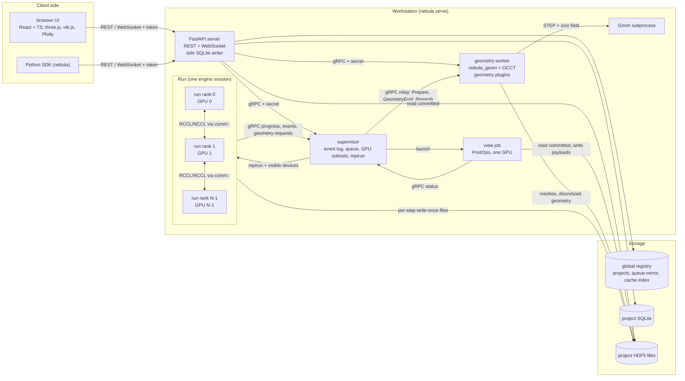

All inter-process messages are Protobuf types generated from `proto/` (D25). Arrays cross process boundaries as HDF5 dataset references, never inline (D25). The server binds to 127.0.0.1, checks Host and Origin headers, and requires a per-launch random token shared by the browser UI and the SDK (D90, D137). Remote use goes through SSH forwarding (D90). A single TOML file configures the installation (D90). Section 16 covers security.

### 3.3 Edit geometry

A geometry is a mutable draft until a run is submitted (D56). Edits flow from the browser UI through the FastAPI server to the geometry worker, which rebuilds the affected components and returns a tessellation (D27, D85, D88). Each draft carries a revision counter; updates are conditional on the revision the client last saw (D148).

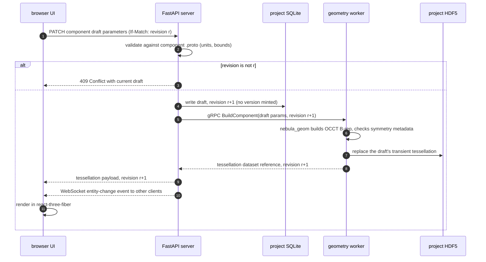

Validation uses the component's `.proto` field annotations (D81, D87) and symmetry metadata is mandatory on geometry (D94). Responses older than the current revision are discarded by the client (D148). Draft tessellations are transient: one per component draft, replaced on each build (D121). The editor receives tessellations only; B-reps leave the geometry worker only through STEP export (Section 13.2).

### 3.4 Submit run

Submission freezes every referenced draft, checks the cache, records provenance, and hands the run to the supervisor (D26, D56, D57, D78). The supervisor then prepares geometry, waits for GPUs and launches the ranks (D121, D142).

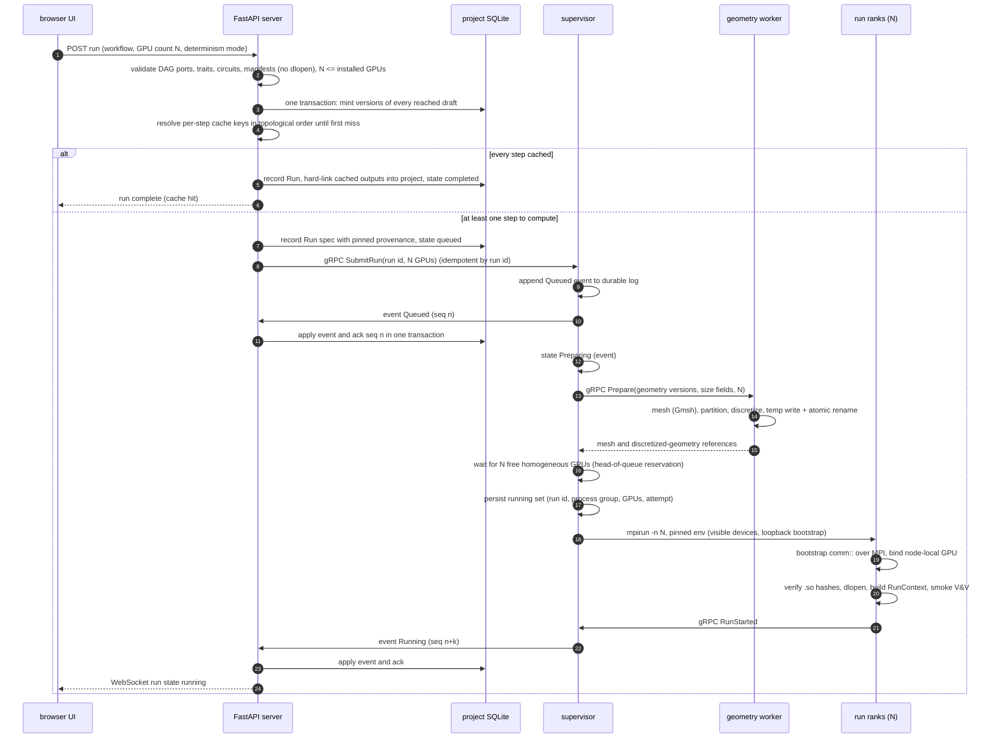

| Step | Rule | Decisions |
|---|---|---|
| Trait and port check | Solver required traits must match the project's concept traits and the geometry's symmetry metadata; edge types must match | D64, D50, D55, D113 |
| Circuit check | Scenario currents must name circuits present in the selected geometry version; filament circuits must be closed | D114, D145 |
| Manifest read | FastAPI server reads the core manifest and sidecar `plugin.toml` and `.proto` without dlopen; run ranks cross-check the embedded manifest | D60, D111 |
| Version minting | All reached drafts become immutable content-hashed versions in one transaction | D56, D26, D110, D148 |
| Cache | Keys are resolved in topological order until the first miss; unchanged steps are skipped; cache-hit outputs are hard-linked into the project; key defined in Section 4.6 | D78, D101, D117, D152 |
| GPU count | Default from the manifest hint, editable; must not exceed the installed GPU count or the solver's supported rank counts | D102, D116, D142 |
| Queue | FIFO; reorder and cancel allowed; state changes travel as acknowledged events | D102, D106 |
| Preparing | Supervisor asks the geometry worker for meshes, partition maps and discretized geometry before waiting for GPUs; failure is `geometry_failed` | D112, D121 |
| Plugin load | Sequence of Section 7.5; ABI fingerprint or hash mismatch rejects the plugin; smoke V&V cached per hardware and build | D45, D61, D140 |

Run ranks only read the prepared HDF5 mesh and discretized-geometry data and move them to the GPU once (D7, D112). Run ranks re-check each step's cache key at execution (D152).

When a step's outputs commit, rank 0 reports them through the supervisor and FastAPI records them; the Run completes after its last step (D152):

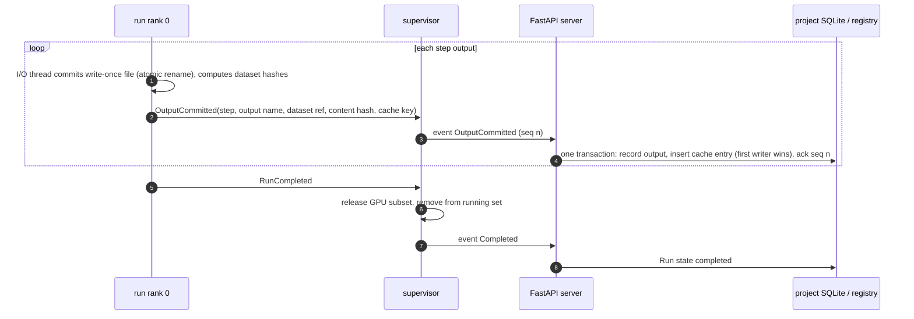

### 3.5 Live progress

Each run rank reports through the progress sink in its `RunContext` (D68). Progress, convergence and log events flow to the supervisor over gRPC and on to the browser UI over WebSocket (D44). Progress events are best-effort; state changes travel through the acknowledged event log (D106). The supervisor also samples GPU telemetry with amd-smi or NVML and maps devices to runs by GPU UUID (D44, D57, D149).

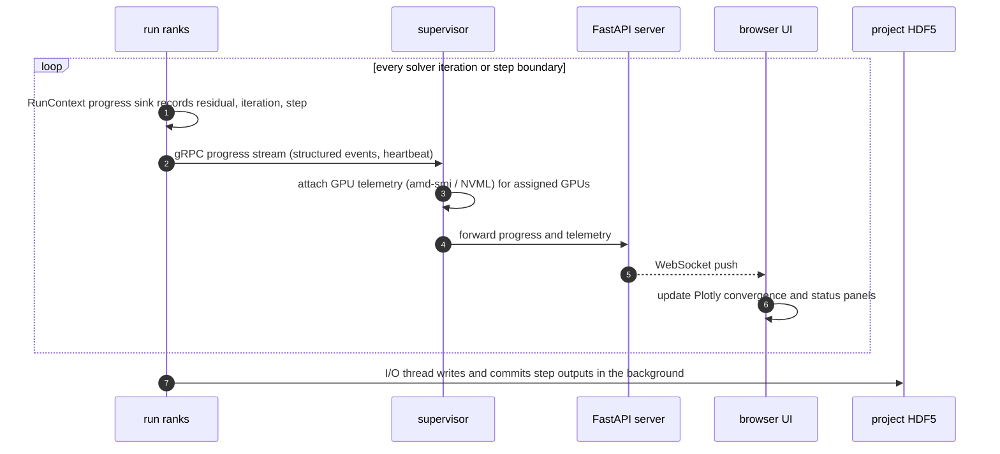

A live Run's committed outputs are viewable while it runs; views go through view jobs exactly as in Section 3.6, and run ranks never service view requests (D122). Logs are structured JSON (D44). Step outputs are immutable, ref-counted and event-tagged in `RunContext`, so background persistence does not block downstream steps unless the persistence backlog exceeds its memory budget (D22, D68, D122).

Implementation detail (not a decision): rank 0 aggregates per-rank progress before sending it to the supervisor.

### 3.6 View result

Views of committed outputs, whether the Run is live, paused, failed or finished, are high-priority supervisor view jobs that run GPU post-processing operators (D63, D39, D122, D143). Payloads are cached under the key of Section 4.6. Requests and replies are asynchronous over `/ws/views` (Section 13.2).

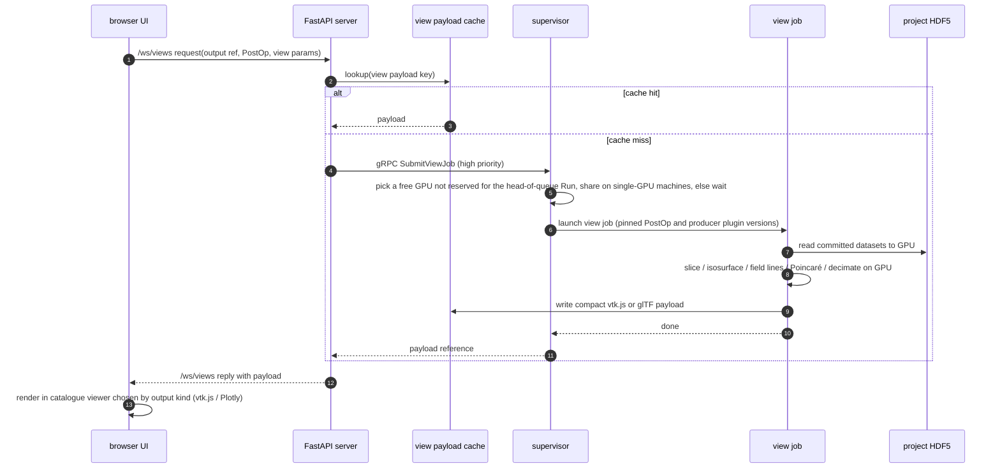

The browser UI picks a viewer from the fixed core catalogue by output kind (Section 13.6; D87, D146). Plugins may add view descriptors and GPU PostOps (D87). Cross-run comparison resamples and differences fields on a shared region on the GPU (D104).

### 3.7 Crash and resume

Ranks report typed failures to the supervisor; the supervisor also detects `mpirun` exit, missing heartbeats and kills, and records one typed reason per failed attempt (D44, D57, D119): `oom`, `nan`, `diverged`, `plugin_error`, `geometry_failed`, `crashed` (signal or exit code) or `supervisor_lost`. Checkpoints are engine-level epochs written on a wall-clock interval, at step boundaries, and on a stop signal, and include optimizer state (D41, D120). Pause uses the same path: checkpoint, then release GPUs (D102).

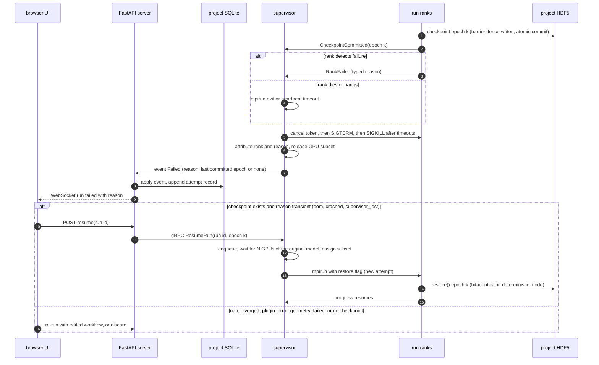

Resume follows D141. A resumed attempt may run on a newer engine build when the checkpoint format version matches; each attempt records its build and hardware, and a Run whose attempts differ is tagged "mixed builds" (D130). A resume on a different GPU model downgrades the Run's reproducibility class (D149). A resumed run requests the same GPU count as the original, because the distributed layout in the checkpoint is tied to the rank count (D74).

If the supervisor stops, its event log and running set survive. On restart it kills any orphaned run process groups, marks those Runs Failed with `supervisor_lost`, never reassigns GPUs before their processes are gone, and replays unacknowledged events to FastAPI (D106, D119). On shutdown, `nebula serve` pauses running Runs (checkpoint, release GPUs) before stopping the supervisor, and kills them after a timeout. Section 6 describes the checkpoint protocol and failure taxonomy.

## 4. Domain model

A Project owns all design entities, workflows, runs and studies (D51). Design entities are edited as drafts and frozen into content-hashed versions by the minting paths of D110 (D56, D26). Data contains no user identity (D16).

### 4.1 Entities

| Entity | Contents | Versioning | Decisions |
|---|---|---|---|
| Project | Name, settings (including the strict cache switch), concept reference (concept ID and version), all entities below | Not versioned; self-contained directory | D51, D78, D100, D113 |
| Component | Typed parametric shape: curve, spline, Fourier surface, filament, winding pack, or a plugin GeometryComponent; annotated numeric parameters; material reference, whose resolved content is part of the component hash | Individually versioned | D27, D58, D81, D88, D127 |
| Geometry | Assembly of component references plus mandatory symmetry metadata (source of geometric traits) and circuits: stable logical identities grouping current-carrying components with turns, series grouping and symmetry replication | Versioned | D88, D94, D113, D114 |
| Region | Typed sampling domain: points, line, plane, box grid, cylindrical or toroidal grid, component surface, mesh volume, or step-output surface (a surface emitted by an upstream step); the type sets output layout and viewers | Versioned | D89, D160 |
| Scenario | Currents and waveforms keyed by circuit, plasma targets, and a ConductorNetwork reference; equilibrium and evolution emit solved scenarios | Versioned | D66, D110, D114 |
| ConductorNetwork | Passive conductor elements (component references with electrical material data, thickness and discretization), circuit topology, power supplies and feedback, built on geometry circuits | Versioned | D71, D128 |
| Workflow | Typed-port DAG of steps with configs; composite `coupled` and `optimize` steps (`optimize` only in Study-created workflows); fan-out nodes; input-dataset nodes; references to geometry, region, scenario and conductor-network entities in one of the states of Section 4.2, and stored outputs of earlier Runs (run ID plus output name, pinned by content hash) | Versioned | D49, D50, D51, D92, D107, D123, D144 |
| Run | Spec: one execution of a Workflow version (plus an optional parameter-override vector and Study reference) on N GPUs with pinned provenance; immutable. Execution record: append-only attempts with state, failure reason, checkpoint epochs, hardware and build per attempt, and committed outputs | Spec immutable; record append-only | D22, D26, D51, D62, D109, D130 |
| Study | Scan or optimization over a base Workflow version: variables, bounds, objectives, constraints, optimizer; owns a set of Runs and an optimization-history table | Definition stored with the Study; each of its Runs is pinned like any Run | D51, D80, D81, D103, D109, D123 |

Component and material libraries exist per project and per user (global). Importing from a library copies the entry into the project and keeps a provenance link to its source (D88). Concept kits, first-party or plugin, supply geometry templates, a default workflow, default objectives and constraints, and a starter project; creating a project from a kit records the concept reference (D86, D113). A user can save any project as a template (D86).

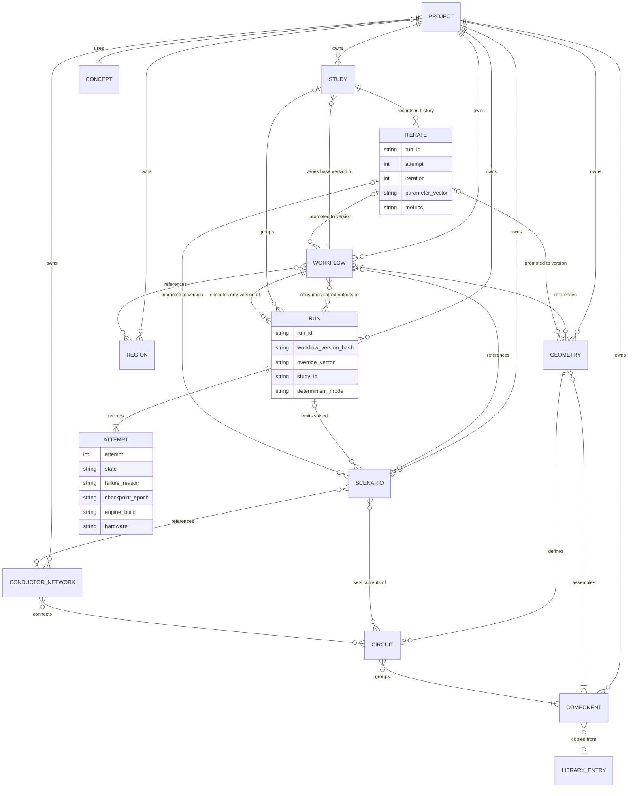

### 4.2 Drafts and versions

Geometry, Component, Region, Scenario, ConductorNetwork and Workflow exist as a mutable draft plus a list of immutable versions (D56). Editing changes only the draft. Versions are keyed by content hash (D26) and minted only by these paths (D110):

| Minting path | What is minted | Decisions |
|---|---|---|
| Run submission | A version of every draft the run reaches, in one transaction | D56, D148 |
| Promotion of an iterate | New Geometry, Scenario and/or Workflow versions carrying the iterate's geometry, scenario and config variable values | D80, D110 |
| Solved-scenario emission | A Scenario version per solved scenario emitted by equilibrium or evolution | D66, D110 |

Identical content produces the same hash, so resubmitting an unchanged draft reuses the existing version. Each entity has a head pointer to its most recently minted version.

| State | Mutable | Hash | Referenced by runs | Decisions |
|---|---|---|---|---|
| Draft | Yes, with a revision counter | None | Never directly; minted at submission | D56, D148 |
| Version | No | Content hash | Yes, pinned | D26, D56 |

A reference from one entity to another is in one of three states (D107):

| Reference state | Resolves to | Default |
|---|---|---|
| `pinned` | A specific version | For entities that have a version, when the reference is created |
| `latest` | The entity's head pointer at submission | Never; opt-in "track latest" (D101) |
| `draft` | The entity's current draft, minted at submission | For entities that have never been versioned |

When a version is minted, every `draft` and `latest` reference inside it is rewritten to `pinned`, so a version's content hash covers only pinned references. A Workflow may reference the same geometry as another workflow or a different one, which satisfies "same or different geometry, multiple calculations" (D51).

Concurrent edits from the browser UI and the SDK use conditional updates against the draft revision; a stale update is rejected with 409 and every client receives entity-change events (D148).

`coupled` steps record per-iteration outputs as versioned outputs of their run (D49). Optimizer iterates are different: they are ephemeral, and only their parameter vectors and metrics go to the Study's optimization-history table; an `optimize` step persists only its final iterate's outputs (D80, D123). The user can promote any iterate (D80, D110).

### 4.3 Provenance

Every Run pins the following at submission, and each attempt adds its own execution identity (D26, D62, D77, D78, D130):

| Pinned item | Purpose | Decisions |
|---|---|---|
| Geometry, component (including resolved material), region, scenario, conductor-network and workflow version hashes | Exact inputs | D26, D56, D127 |
| Concept reference of the project | Trait source | D113 |
| Parameter-override vector and base Workflow version (Study Runs) | Exact inputs of a study point | D109 |
| Step configs and input artifact hashes | Exact inputs per step | D26 |
| Stored-output and input-dataset references (run ID or dataset version, content hash) | Exact upstream inputs for single-step runs | D22, D26, D144 |
| Plugin versions and `.so` hashes of every plugin each step reaches | Exact code | D26, D78, D152 |
| Engine build identifier (engine binary hash + `spack.lock` hash) | Exact core | D26, D78, D126 |
| Engine and plugin source git commit hashes, compiler version, dirty-tree flag | Rebuild target for re-runs | D62, D126 |
| Determinism mode | Requested reproducibility class | D77 |
| Per attempt: engine build, runtime library versions (ROCm/CUDA, vendor libraries, RCCL/NCCL, MPI, driver), hardware (vendor, GPU model and UUIDs, GPU count, topology), achieved determinism class | Execution identity; not part of the cache key | D43, D125, D126, D129, D149 |
| Per cache-hit step: producer run ID, engine build and hardware | Where reused results came from | D125 |

Re-running a pinned run on a newer build tags the new run "rebuilt" and compares it with the original under the declared D43 tolerances (D62). Results remain readable across builds, and SQLite schema migrations are forward-only (D62). Reproducibility is judged per Run from its own attempts, never per project (D149).

### 4.4 Staleness

A run is stale when a newer version exists for one of its pinned inputs, that is, when an input's head pointer has moved past the pinned version (D101, D107). The browser UI shows staleness badges (D101). Draft edits alone do not make a run stale. One click re-runs the workflow against the newer inputs. Steps whose cache keys are unchanged are skipped (D101, D78). Inputs marked `latest` resolve to the head pointer at submission (D101, D107).

### 4.5 Comparison

Runs in one project can be compared side by side: scalar tables, overlaid 1D profiles, GPU resample-and-difference of fields on a shared region, and linked 3D views. Differences are flagged against D43 tolerances (D104).

### 4.6 Cache key

This section is the single normative definition of every cache key; other sections refer to it (D78). "Input hash" means the inputs part of a key; "cache key" means the whole key.

A step key has four parts (D78, D152):

| Key part | Contents | Decisions |
|---|---|---|
| Inputs | Step config in the canonical encoding plus content hashes of all input artifacts (geometry, discretized geometry, mesh, region, scenario, conductor network, input datasets, upstream outputs) and the parameter-override vector, if any | D26, D78, D109, D152 |
| Code identity | `.so` hashes of every plugin the step reaches, transitively, including producer plugins it links and sub-extension fillers, in canonical order | D78, D152 |
| Engine build | Engine binary hash + `spack.lock` hash | D78, D126 |
| Determinism mode | Deterministic or fast | D77, D78 |

Hardware and runtime library versions are not in the key; they are recorded per attempt and per cache entry (D125, D126). A hit produced on different hardware is reused without recomputation, on the strength of the D43 tolerance guarantee; no verification step runs. A per-project strict switch rejects hits whose producer hardware differs from the requested hardware class (D78, D125).

The canonical encoding resolves defaults and serializes deterministically (sorted map keys, explicit presence); Python and C++ implementations share test vectors (D152). At submission FastAPI resolves keys in topological order and stops at the first miss, because later keys depend on upstream output hashes (D152).

The shared cache is an index in the global registry plus content-addressed blobs. Each entry stores its key, the committed dataset references and hashes, and producer run ID, engine build and hardware (D100, D117, D125). The first committed result for a key wins; a later identical key does not replace it (D152). On a hit the outputs are hard-linked (copied if linking fails) into the consuming project, so every project holds its own results (D117). Results from imported projects never enter the shared cache until reproduced locally (D117).

Derived artifacts have their own keys. Each includes code identity:

| Artifact | Key | Decisions |
|---|---|---|
| Discretized geometry | Geometry version hash + discretization settings + engine build + geometry plugin hashes | D112, D126 |
| Mesh | Geometry version hash + size field + rank count (partition) + Gmsh version and deterministic options + engine build | D30, D112, D121 |
| Flux coordinates | Equilibrium output hash + coordinate options + engine build | D70 |
| Sampled field grids | Field output hash + Region version hash + engine build | D65, D115 |
| View payloads | Output content hash + PostOp plugin hash + view parameters + engine build | D39, D143 |
| Smoke V&V results | `.so` hash + engine build + GPU model + mode | D140 |

### 4.7 Retention

| Data | Policy | Decision |
|---|---|---|
| Metadata and provenance (SQLite rows) | Kept forever | D79 |
| Derived artifacts: meshes, discretized geometry, flux coordinates, view payloads | Evictable under a size cap | D79 |
| Checkpoints | Kept while the Run is Queued, Running, Paused or Failed; evictable once it is Completed, Cancelled or discarded | D79, D141 |
| Shared-cache blobs | Evictable under a size cap unless pinned by a queued or running Run; eviction never affects project copies | D117 |
| Study derived artifacts | Per-study retention setting | D79 |
| Primary results (committed run outputs, including copied meshes) | Deleted only by the user, after a dependency check covering stored-output references within the project | D79, D121 |
| Optimizer iterates | Never stored as artifacts; history table only (final iterate per D123) | D80, D123 |
| Logs (per run and per installation) | Rotated; per-run logs kept with the Run, installation logs by size and age | D158 |

### 4.8 Storage layout on disk

Each project is a self-contained directory holding its SQLite metadata database and its HDF5 files (D23, D100). A global registry holds the project list, a mirror of the run queue, and the shared cache index (D100, D90). The supervisor's durable event log and running set are the source of truth for queue and Run state; FastAPI, the only SQLite writer, applies their events (D57, D106). Run ranks write each step output to its own write-once HDF5 file, using parallel HDF5 within the file (D23, D53, D108). `~/.nebula` and project directories are created with mode 0700 (D139).

Implementation detail (not a decision): the directory names below are illustrative. Only the split between per-project data and the global registry is decided.

```text
~/.nebula/                          global registry (D100)
  nebula.toml                       single configuration file (D90)
  nebula.lock                       exclusive installation lock (D119)
  registry.sqlite                   project list, run-queue mirror, cache index (FastAPI) (D100, D117)
  supervisor/                       event log and running set (D106, D119)
  cache/                            shared content-addressed blobs (D78, D117)
  library/                          user-global component and material library (D88)
  plugins/                          installed plugins: .so, plugin.toml, descriptors (D60, D139)
  logs/                             installation logs, rotated (D158)

<project-dir>/                      self-contained project (D100)
  project.sqlite                    entities, versions, runs, studies, provenance,
                                    optimization history (D23, D26, D80)
  library/                          per-project component and material library (D88)
  runs/<run-id>/
    outputs/<step>/<output>.h5      committed write-once step outputs (D108)
    meshes/                         copies of meshes referenced by outputs (D121)
    checkpoints/<epoch>/            checkpoint epochs (D120), evictable per 4.7
    logs/                           per-run logs (D158)
  inputs/<dataset-hash>.h5          ingested input datasets (D144)
  derived/
    tessellations/<component-draft>/  transient draft tessellations (D121)
    meshes/<mesh-key>/              Gmsh output and HDF5 mesh data (D30, D121)
    discretized/<key>/              discretized geometry (D112)
    views/<view-key>/               vtk.js / glTF payloads (D39)
  build-manifest                    written on export (D100, D149)
```

Section 5.10 defines the HDF5 layout inside output files.

Exporting a project is a FastAPI operation: it snapshots `project.sqlite` with the SQLite online backup API, copies committed outputs only, and writes a build manifest listing the union of the build identities its Runs reference, plus the snapshot point (D100, D148, D149). On import, reproducibility is judged per Run: a Run whose build does not match the local build is "viewable, not reproducible here" (D100, D149). Imports are untrusted: symlinks and paths outside the project root are rejected, HDF5 files are opened read-only with external links and virtual datasets confined to the project, the SQLite schema is validated before migration, and `derived/views` is dropped and regenerated (D117, D139). Results stay readable (D62).

The project list can be rebuilt by rescanning project directories, and `nebula backup` / `nebula restore` copy the registry and user library consistently while the server runs (D158).

## 5. Data contracts and schema

Every value that crosses a process, step, or plugin boundary has a type defined in Nebula's own versioned, concept-agnostic schema (D24). Nebula does not implement IMAS or any other external data standard (D24). Protobuf `.proto` files under `proto/` are the single source. Buf generates the C++, Python, and TypeScript bindings (D21, D25).

### 5.1 Schema source and code generation

| Consumer | Generated artifact | Transport |
|----------|-------------------|-----------|
| run ranks, supervisor, geometry worker (C++) | Protobuf C++ classes, gRPC stubs | gRPC (D21, D57, D85) |
| FastAPI server (Python) | Protobuf Python classes, gRPC stubs | gRPC to supervisor and geometry worker; REST/WebSocket to clients (D21) |
| `nebula` SDK (Python) | Protobuf Python classes | REST/WebSocket to the FastAPI server only (D38) |
| browser UI (TypeScript) | Protobuf TS types | REST/WebSocket from FastAPI server (D21, D28) |

The browser UI, the `nebula` SDK, and the engine therefore share one definition of every request, config, and result type (D21, D38). The thin task runner drives Buf codegen alongside pnpm (D91).

### 5.2 Arrays live in HDF5, messages carry references

Protobuf messages never carry bulk arrays inline (D25). A message field of array type holds an HDF5 dataset reference into a project HDF5 file: a committed run output, an ingested input dataset, a mesh or discretized geometry, or a view payload (D23, D25, D108). Metadata goes to SQLite; numeric payloads go to HDF5 (D23). Parallel HDF5 serves multi-rank runs (D23, D53).

A dataset reference has three parts: the owner (run ID or artifact key), the file path relative to the project directory, and the dataset path inside the file. It also carries the dataset's content hash, used for verification and in cache keys; the hash is never used to locate the file. References stay valid when the project folder is exported (D100, D108). Only committed files are referenceable (D108).

The output content hash is computed per dataset at commit, over a canonical encoding: dtype, shape, unit tag and the array bytes in C order, little-endian, independent of chunking, compression and partitioning (D108).

Clients that cannot open the project directory, such as a remote SDK, read datasets through a token-checked REST endpoint that streams a dataset or slice by reference (D137).

All floating-point fields and datasets of numerics and results are FP64, real or complex128 (D76, D150). The schema has no FP32 variants. View payloads are a separate FP32 presentation format (D156).

### 5.3 Calculation contracts and sub-contracts

Each calculation type offers reduced and high-fidelity solvers (D1). Its contract is split into sub-contracts, one per output representation (D55). Solvers that emit the same sub-contract can be swapped without rewiring. Moving between sub-contracts (for example a T1 `Equilibrium.Axisym2D` solver and a T2 `Equilibrium.Nested3D` solver) requires an explicit contract adapter step (D55, D58).

| Contract | Example sub-contracts / payload | Notes |
|------------------|--------------------------------|-------|
| Magnetic field | Lazy field operator (B, A, ∇B) linear in per-circuit currents (D65, D114) | Sources: filaments, finite coils, volume J on grid or mesh; persisted as discretized sources plus the current-to-circuit map (D115); sampled grids are cached derived products with divergence-free interpolation (D65) |
| Equilibrium | `Equilibrium.Axisym2D` (including anisotropic p_par/p_perp for open lines), `Equilibrium.Nested3D` (D55, D134) | Tier chosen by capability traits (D33, D64) |
| Flux coordinates | Nested-coordinate sub-contract (closed lines) and field-line-following sub-contract (open lines) produced by the core flux-coordinate service (D70, D134) | Acts as an adapter; key in Section 4.6 |
| Stability | Local criteria and global eigenmode results, complex FP64 (D34, D150) | |
| Time evolution | Transport profiles, 3D MHD state (D35) | |
| Conductor network | Input: a ConductorNetwork version (D128). Output: mutual-inductance matrix, circuit state (D71) | Shared by stability, evolution, electromagnetic (EM) load export (D71) |
| Wall loads | Surface heat flux and force density on components (D72) | |
| Thermal-structural | Temperature, displacement, stress on Gmsh meshes (D36) | |
| Magnet design | Coil shapes, forces, critical-current margin (D32) | |

Flux coordinates, conductor network and discretized geometry are core-service contracts (Sections 9 and 10), not calculation types. Discretized geometry carries filament segments, winding-pack quadrature points and frames, Fourier coefficients, and surface and volume meshes with their partition map (D112).

Section 11 gives example sub-contracts per module; the identifiers are fixed at each milestone freeze (D99).

Two non-step entity types also cross step boundaries as typed inputs:

- **Scenario**: a separate versioned artifact holding circuit currents and waveforms, plasma targets and a ConductorNetwork reference. Equilibrium and evolution steps emit solved scenarios; magnet and thermal-structural checks run per scenario point (D66, D114, D128).
- **Region**: a typed, versioned project entity (points, line, plane, box grid, cylindrical/toroidal grid, component surface, mesh volume, step-output surface). The region type fixes the output layout and the eligible viewers (D89, D160).

### 5.4 Plugin-owned types

Plugins ship their own `.proto` descriptors and matching C++ type headers (D54). Descriptors are shipped as a FileDescriptorSet that excludes core files. The FastAPI server builds one descriptor pool per plugin version, layered over the pool of core descriptors (including core custom options), and the browser UI builds the same registry from `/plugins`; neither recompiles the core (D54, D60, D133). Proto packages are namespaced by plugin ID and major version, so a plugin's v1 and v2 descriptors coexist during migration (D132, D133). A consumer plugin depends on a producer plugin's types by version (D54). Section 7.4 covers the linking and version resolution this implies (D84, D131).

### 5.5 Distributed-array descriptor

A run uses one MPI rank per GPU (D53), so a step output may be partitioned across ranks. Contracts carry a distributed-array descriptor with three parts: global shape, partition map, and owning rank (D74). When a producer's partition differs from what a consumer declares, the engine inserts a `comm::` redistribution between the two steps (D74). RCCL/NCCL carry `comm::` data; Ginkgo distributed and parallel HDF5 communicate over MPI (D53, D151). The partition map of an unstructured Gmsh mesh is produced by the geometry worker in the Preparing phase for the Run's rank count (D112, D121).

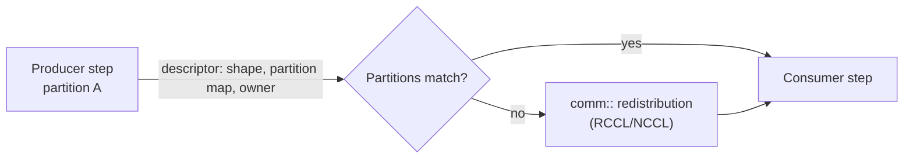

### 5.6 Time-series edges

An edge may be time-series typed with a declared time base (D92). Scenario waveforms and evolution outputs use this edge type. A core fan-out node maps a downstream step over selected time slices (D92, Section 6.4). Streaming edges are deferred (D92).

### 5.7 Units, frames, signs, symmetry

| Rule | Content | Decision |
|------|---------|----------|
| Units | SI internally; temperatures in eV; every numeric field carries a unit tag in the schema | D46 |
| Global frame | Right-handed Cartesian | D46 |
| Derived coordinates | Flux, Boozer, cylindrical and field-line-following coordinates are declared derived coordinates; any non-Cartesian representation declares its coordinate system and its mapping to the global Cartesian frame | D46, D70 |
| Sign and normalization | Fixed once in the schema: generalized COCOS-11-like convention, poloidal flux psi in Wb | D94 |
| Symmetry metadata | Mandatory on every geometry (e.g. N_fp, axisymmetry); the source of geometric traits | D94, D113 |
| Verification | Sign-flip V&V tests check the convention | D94 |

### 5.8 Annotated numeric fields

A numeric field may carry annotations for bounds, units, and scale. Any annotated field is selectable as a design variable in a study (D81). Config fields may also carry UI-hint options that drive generated forms (D87). Both annotation sets live as Protobuf field options in the `.proto` source.

Implementation detail (not a decision): annotations use custom Protobuf field options defined once in `proto/` and imported by plugin `.proto` files.

### 5.9 Schema evolution

| Scope | Rule | Decision |
|-------|------|----------|
| Core and plugin `.proto` within a major version | Additive only on the wire; Buf breaking-change check enforces it, in the core task runner for core and in plugin-sdk against the installed descriptor set for plugins | D95, D133 |
| Generated C++ types | Any change to a generated type, additive or not, bumps the Nebula ABI version (core) or the producer's ABI version (plugin); dependency matching requires an exact ABI match | D131 |
| Major-version bump | Core: migration functions run by the FastAPI server. Plugins: declarative migrations (renames, moves, defaults) in manifest data, applied by the FastAPI server | D95, D133 |
| SQLite metadata | Forward-only migrations; stored results always readable | D62 |
| Frozen contracts | Each milestone freezes the contracts it introduces | D99 |

Implementation detail (not a decision): Buf's breaking check runs locally from the thin task runner, since there is no CI pipeline (D48).

### 5.10 HDF5 layout

Each step output is one write-once HDF5 file (D108). The I/O thread of the run ranks writes it under a temporary name and renames it atomically on commit; references are published only after the rename (Section 3.4). A crash cannot damage committed files, and readers never open a file that is still being written.

| Item | Location | Decisions |
|---|---|---|
| Step output | `runs/<run-id>/outputs/<step>/<output>.h5`; root attributes: sub-contract, schema version, run ID, attempt, step, unit tags | D108 |
| Time-series output | One file per output; datasets carry a leading time dimension and a `time` dataset holding the declared time base | D92, D108 |
| Fan-out output | One file per fan-out output, with a leading slice dimension matching the time base | D92, D108 |
| Per-iteration outputs of `coupled` steps | `runs/<run-id>/outputs/<step>/iter-<k>/<output>.h5` | D49, D108 |
| Final iterate of `optimize` steps | Ordinary step outputs of the `optimize` step | D123 |
| Distributed outputs | One file per output written collectively with parallel HDF5; the distributed-array descriptor is stored as attributes | D74, D151 |
| Meshes referenced by outputs | Copied into `runs/<run-id>/meshes/` | D121 |
| Draft tessellations | `derived/tessellations/<component-draft>/`, replaced on each build | D121 |
| Complex data | complex128 compound type (`r`, `i`) | D150 |

## 6. Engine

The engine executes one workflow run (D22). A Run is N run ranks, one per GPU, launched by the supervisor with `mpirun` on a disjoint GPU subset (Sections 8.4, 14.2). The engine code lives in `core/` together with the first-party physics modules (D59, D91). In this document "engine" means the run-rank processes and the `core/` library they execute; "engine build" is defined in Section 4.3 (D126).

### 6.1 Run session lifecycle

A run starts when the user submits a workflow. Submission mints immutable, content-hashed versions of every draft the run reaches (D26, D56, D110). The run pins its inputs, plugin versions, engine build, and the git commit hashes of engine and plugin sources (D26, D62). A single calculation is a one-node DAG run from stored outputs or input datasets, using the same path (D22, D50, D144). Section 3.4 is the normative sequence from submission to `RunStarted` and through completion; the diagram below shows the ranks' side of it.

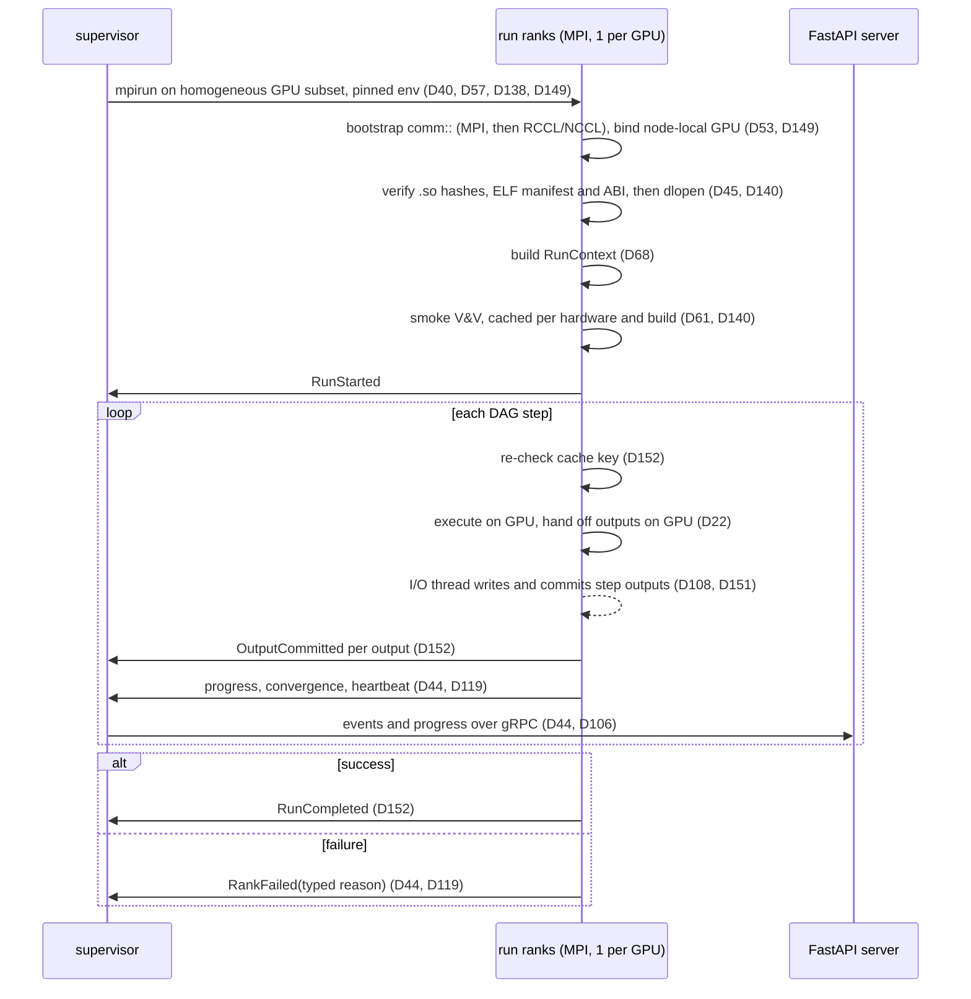

### 6.2 Workflow DAG

A workflow is a top-level DAG (directed acyclic graph) of steps connected by typed ports (D49, D50). Each step instance names a solver for one sub-contract (D55, D58). Before launch, the validator matches the capability traits each solver requires against the project's concept traits and the geometry's symmetry metadata (D64, D113). Where a consumer port expects a different sub-contract than the producer emits, the workflow includes an explicit contract adapter step (D55). The flux-coordinate service is one such adapter (D70).

Steps whose cache key matches a committed result are skipped; Section 4.6 defines the key (D26, D78). The one-click re-run of a stale run uses this skip path (D101).

In a Run with N ranks, each step runs on as many ranks as its solver's manifest declares it supports (D116). A step that supports one rank runs on rank 0 while the other ranks wait at the step boundary; its output is owned by rank 0 and redistributed if a consumer needs another layout (D74, D116). In v1, field evaluation and T1 scale across ranks; other v1 steps run on one rank (D116).

### 6.3 Composite steps: `coupled` and `optimize`

The top-level DAG is acyclic. Iteration happens only inside two composite step kinds (D49).

| Composite | Semantics | Decision |
|-----------|-----------|----------|
| `coupled` | Fixed-point iteration over an inner sub-graph until declared convergence criteria hold | D49 |
| `optimize` | Wraps a sub-workflow and drives it with an in-run gradient Optimizer; exists only in Workflow versions compiled from a gradient Study | D49, D67, D123, D124 |

Per-iteration outputs of `coupled` steps are versioned outputs of the run (D49). Optimizer iterates are ephemeral: the parameter vector and metrics of each iterate go to the Study's optimization-history table, keyed by (run, attempt, iteration), and the `optimize` step persists only its final iterate's outputs (D80, D123). Any iterate can be promoted on request (D80, D110).

Gradient chaining follows a DAG-level JVP/VJP (Jacobian-vector and vector-Jacobian product) protocol (D67). Each step that supplies gradients provides hand-written discrete adjoint and tangent operators, each checked against finite differences (D18). At `coupled` nodes the engine forms the gradient by implicit-function-theorem adjoints rather than differentiating through the iterations (D67). Finite-difference Jacobians fill gaps where a step has no adjoint (D67). A study whose chain lacks a needed shape gradient falls back to derivative-free drivers (D8, D83).

When an `optimize` step's variables include geometry parameters, rank 0 obtains rebuilt geometry, control-point sensitivities and remeshes from the geometry worker through the supervisor relay (D105, D153); Section 10.4 gives the loop.

Derivative-free, surrogate, and scan drivers do not run inside the engine. The supervisor runs them; each proposed point becomes a Run created by FastAPI from the Study's base Workflow version and a parameter-override vector (D67, D109). Section 12 covers both paths.

Time-dependent equilibrium-transport coupling is not expressed with `coupled`: the transport solver re-solves equilibrium internally at each time step through the equilibrium-call interface of Section 11.5 (D154).

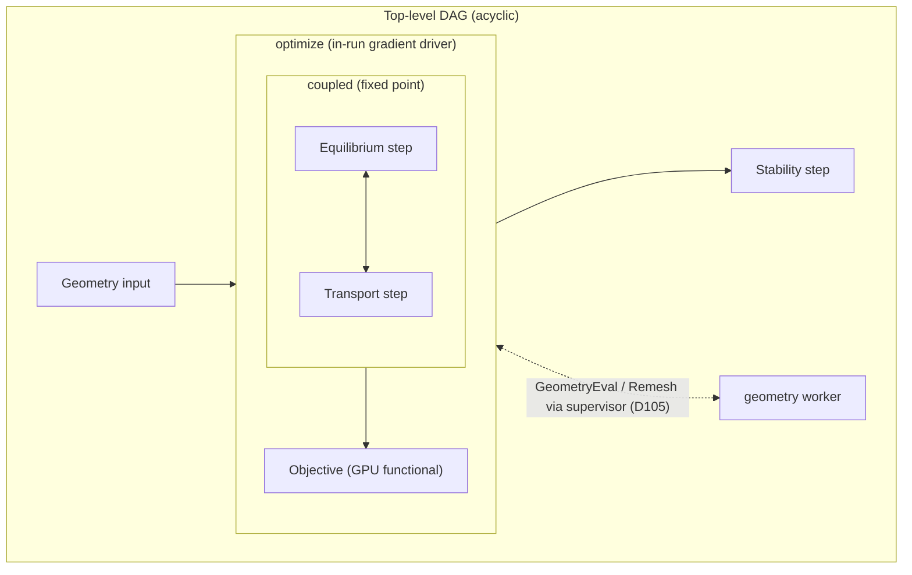

### 6.4 Fan-out node

A core fan-out node maps one step over selected slices of a time-series edge (D92). Typical use: run a stability or magnet check at each scenario point of a solved scenario (D66, D92). The fan-out output is itself time-series typed on the same time base (D92). Slices are scheduled inside the existing run ranks, at most a configured number at a time, so fan-out never requests extra GPUs and stays within the memory budget of Section 8.5 (D122).

### 6.5 RunContext

The core owns all GPU resources through `RunContext`, passed to every step (D68). Section 8.5 is the normative description of its members and memory budget; determinism rules are in Sections 15.1 and 15.2.

### 6.6 GPU handoff and background persistence

Steps hand off outputs on the GPU (D22). A consumer waits on the producer output's event, not on a host copy (D68). Section 2.1 states which work may run on the host.

Outputs are persisted to HDF5 in the background while downstream steps proceed (D22, D23). One I/O thread per rank writes each step output to its own write-once file and commits it by atomic rename (D108). Multi-rank outputs are written collectively with parallel HDF5; the I/O thread issues the collective calls in step order on a duplicated MPI communicator, and MPI runs at `MPI_THREAD_SERIALIZED` with the I/O thread and the main thread never inside MPI at the same time (D151). Reference counting keeps an output alive until both its consumers and its writer release it (D68). When the persistence backlog exceeds its memory budget, producing steps wait (D122).

Run ranks do not serve view requests; views of committed outputs go through view jobs (D122, D143).

### 6.7 Checkpoint and restore

Every solver implements `checkpoint()` and `restore()` (D41). The engine wraps them in a checkpoint epoch protocol (D120):

1. A trigger (wall-clock interval, step boundary, or a stop signal from the supervisor) is agreed collectively: rank 0 picks the epoch and the iteration at which all ranks checkpoint.
2. Each rank fences its pending output writes, so every step the epoch records as complete has committed outputs.
3. Each rank writes solver and optimizer state into `checkpoints/<epoch>/` under a temporary name.
4. After a barrier, rank 0 writes the epoch manifest and renames the epoch atomically, then sends `CheckpointCommitted(epoch)` to the supervisor.
5. The previous epoch is deleted only after the new one commits.

The epoch manifest records the checkpoint format version, completed steps with their committed output references, composite and fan-out iteration counters, and the current attempt (D120, D130). Restore behavior in deterministic mode is described in Section 15.1. The supervisor uses checkpoints to pause a run and release its GPUs (D102) and to resume after a transient failure (D57, D141). Work replayed after a restore re-emits history rows with the same (run, iteration) and a new attempt; FastAPI inserts them idempotently and supersedes rows past the restored iteration (D123). Checkpoint retention follows Section 4.7 (D79, D141).

### 6.8 Failure taxonomy

Failures are typed, not free-text (D44, D119, D121).

| Failure reason | Detected by | Resumable | Decision |
|----------------|-------------|-----------|----------|
| `oom` | Pool allocator in `RunContext`; host OOM kill reported by the supervisor | Yes, if a checkpoint exists | D44, D68, D141 |
| `nan` | Step output checks | No; re-run with edited workflow | D44, D141 |
| `diverged` | Solver and `coupled` convergence monitors | No; re-run with edited workflow | D44, D49, D141 |
| `plugin_error` | Plugin call boundary; hash, ABI or smoke V&V rejection at load | No | D44, D45, D61, D140 |
| `geometry_failed` | Geometry worker during Preparing or a relayed geometry request (Gmsh or OCCT failure) | No | D121 |
| `crashed` | Supervisor: a rank exited on a signal or non-zero code without a typed report (core SIGSEGV, GPU reset, MPI or RCCL abort), or was killed after a heartbeat timeout | Yes, if a checkpoint exists | D119, D141 |
| `supervisor_lost` | Supervisor restart found the Run's processes orphaned and killed them | Yes, if a checkpoint exists | D119, D141 |

The supervisor attributes every failure to the Run, rank and step (D57). Ranks send a heartbeat with their progress; when a heartbeat is missing past a timeout, or a cancel or pause is not honoured, the supervisor escalates from the cancel token to SIGTERM to SIGKILL of the run's process group (D119).

Implementation detail (not a decision): "cancelled" and "paused" are run states, not failure reasons.

Logs are structured JSON (D44). GPU telemetry comes from amd-smi or NVML and is mapped to the run by GPU UUID (D44, D57, D149).

## 7. Plugin system

Nebula's extensibility goal is plug-and-play modules beyond the first-party set (D3), with custom confinement concepts as the main use (D2). First-party modules are compiled into `core/` with privileged access; only additional modules are plugins (D59). First-party modules are declared in a core manifest that uses the plugin manifest schema, so the FastAPI server sees first-party and plugin extensions through one registry (D111). Plugins run in-process on the one mandated GPU stack and runtime (D9). Each is a shared library loaded with `dlopen` behind a C++ ABI (D19). `plugin-sdk/` and `examples/plugin/` in the monorepo provide the author toolchain and the reference plugin (D91).

### 7.1 Extension points and nesting

The core defines a fixed set of top-level extension kinds (D58, D124).

| Kind | Provides | Loaded in |
|------|----------|-----------|
| Concept | Topological capability traits, geometry templates, default workflow DAG, objectives/constraints, starter project (D64, D86) | FastAPI server (manifest only), run ranks |
| Solver | Implementation of one sub-contract (D55, D58) | run ranks |
| Adapter | Contract adapter between sub-contracts (D55) | run ranks |
| PostOp | GPU post-processing operator for views (D39, D87) | view jobs (D143) |
| Objective | GPU functional with optional adjoint (D81) | run ranks |
| GeometryComponent | Parametric component type; must emit the core discretized-geometry representations (D27, D112) | geometry worker (D85) |
| Optimizer | Optimization driver: in-run gradient drivers or fan-out derivative-free, surrogate and scan drivers (D67, D124) | run ranks (in-run), supervisor (fan-out) |

First-party implementations of these kinds are declared in the core manifest; a plugin cannot register an ID that the core manifest already declares (D111).

Core modules and plugins may publish named sub-extension points inside their own domain, such as turbulence closures in first-party transport, quench, AC-loss and cryogenic models in magnet design, and field sources in the field operator (D58, D111, D145). Core sub-extension points are declared in the core manifest. Other plugins fill those points. A sub-extension filler is part of the code identity of every step that uses it (D152).

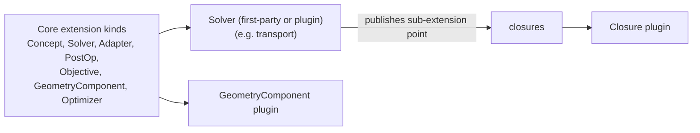

Solvers declare the capability traits they require, such as `closed_field_lines`, `axisymmetric`, `open_lines`, `field_reversal`, `nonzero_toroidal_field`, and N_fp symmetry (D64, D134). The core assumes no topology; toroidal, open/linear, and compact-toroid concepts are all expressible (D6, D64).

### 7.2 Manifest: sidecar and embedded

Each plugin ships a sidecar `plugin.toml` plus its descriptors as a FileDescriptorSet (D54, D60, D133). The FastAPI server reads the sidecar and the core manifest without `dlopen`, so it can build forms and validate workflows while staying pure Python (D60, D85, D111). The same manifest is embedded in the shared library as an ELF note. At load, the engine reads the embedded copy before `dlopen` and rejects a mismatch with the sidecar (D60, D140).

Manifest contents drawn from the log:

| Field group | Decision |
|-------------|----------|
| Extension kinds, sub-contracts implemented, sub-extension points published | D55, D58 |
| Required or declared capability traits | D64 |
| Config `.proto` with UI-hint field options; optional view descriptors | D87 |
| ABI fingerprint and the plugin's own ABI version | D45, D131 |
| Dependencies on other plugins with exact ABI versions | D54, D84, D131 |
| Default GPU count hint and supported rank counts per solver | D102, D116 |
| Gradient availability per solver (tangent, adjoint, none) | D8, D18 |
| Declarative migrations for major-version bumps | D133 |

Implementation detail (not a decision): the TOML layout and field names are defined in `plugin-sdk/` and validated by the FastAPI server on project open.

### 7.3 ABI fingerprint

The plugin boundary stays a C++ ABI (D45). `plugin-sdk/` pins the toolchain: plugins build with the core's compiler, standard library, and ROCm/CUDA versions (D19, D45). The build uses the same CMake presets (`rocm`, `cuda`) and Spack environment as the core (D52).

The manifest carries an ABI fingerprint of four parts: compiler, standard library, ROCm/CUDA version, and Nebula ABI version (D45). The Nebula ABI version is bumped on any change to a generated core type, including additive `.proto` changes, because those change C++ class layout (D131). The loader rejects any plugin whose fingerprint differs from the running engine (D45).

### 7.4 Plugin-to-plugin linking and dependency versions

Plugins call each other by direct linking against each other's libraries (D84). A consumer compiles against the producer's C++ type headers and `.proto` descriptors at a specific version (D54). Producer schemas evolve additively on the wire within a major version (D95), but any change to a producer's generated types bumps its ABI version, and consumers must match it exactly (D131). Such changes force rebuilds of dependent plugins; Section 19 records this accepted tension.

The loader resolves dependency versions before loading. It orders plugins so each producer loads before its consumers. It rejects a plugin whose declared dependency is absent or has a different ABI version, and it rejects any dependency set that needs two major versions of one plugin in the same process (D84, D131, D132).

Plugin builds follow these rules, enforced by `plugin-sdk/` CMake and the loader (D132):

- compile with hidden symbol visibility and export only a namespace that carries the plugin ID and major version;
- put the major version in the soname;
- keep generated Protobuf code only in the library that owns the `.proto`; consumers link it rather than compiling their own copy;
- link libprotobuf dynamically;
- namespace proto packages by plugin ID and major version.

Implementation detail (not a decision): the loader passes `RTLD_GLOBAL` for plugins that other plugins declare as dependencies, so their symbols resolve.

### 7.5 Loading sequence

Each process loads only the plugins it needs (D140):

| Process | Loads | Version selection |
|---|---|---|
| FastAPI server | Core manifest and sidecars only, never `dlopen` | Installed versions |
| run ranks | Plugins the pinned workflow reaches, including in-run Optimizers | Pinned at submission, verified by `.so` hash |
| supervisor | Fan-out Optimizer plugins of running Studies | Pinned in the Study's base provenance, verified by `.so` hash |
| view jobs | PostOp and producer plugins of the viewed output | Pinned in the output's provenance, verified by `.so` hash |
| geometry worker | GeometryComponent plugins | Pinned versions for geometry versions; installed versions for drafts; restarts on plugin install or upgrade (D143) |

Plugins resolve only by (name, version, hash) inside the installed plugin directory: a user-owned directory that is not group- or world-writable. The loader refuses files that are group- or world-writable and sanitizes `LD_LIBRARY_PATH` and RUNPATH lookups to the plugin directory and core libraries (D139).

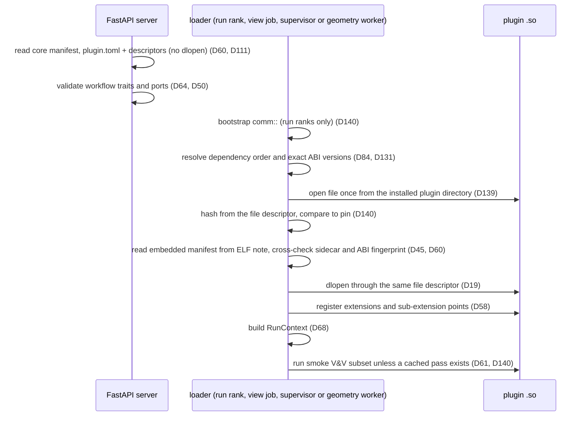

The hash check applies wherever a pin exists; geometry-worker loads for drafts have no pin. Any failing check aborts the load with the typed reason `plugin_error` (D44).

### 7.6 Smoke V&V at load

A quick smoke subset of the V&V suite runs at plugin load (D61). Smoke always runs in deterministic mode with the cases' declared tolerances, whatever mode the run selected. A pass is cached under the key of Section 4.6 (`.so` hash, engine build, GPU model, mode), so it is not repeated on every rank, run, study point or resume (D140). The full suite runs on demand through `nebula vv` (D42, D61); Section 15.3 lists its case classes. Gating is a local command; there is no CI (D48). No third-party fusion code serves as a reference (D10). There is no separate plugin conformance kit; the physics V&V suite is the only check (D96).

### 7.7 Concept kits

A Concept extension bundles everything needed to start a design for one confinement concept (D2, D86):

- topological capability traits (D64, D113)
- geometry templates (D27, D86)
- a default workflow DAG (D86)
- default objectives and constraints (D81, D86)
- a starter project (D86)

Users can save any project as a template (D86). Creating a project from a kit records the kit's concept reference on the project (D113). The v1 reference concepts are tokamak, simple mirror, and stellarator (D98). They ship as first-party concept kits compiled into the core and declared in the core manifest (D59, D111).

### 7.8 Plugin UI hints and view descriptors

Plugins do not ship frontend code. The browser UI generates config forms from the plugin's config `.proto`, guided by UI-hint field options (D50, D87). Results render in a fixed core viewer catalogue chosen by output kind (D87); Section 13.6 lists the viewers.

A plugin may add optional view descriptors that select and configure catalogue viewers for its outputs (D87). A plugin may also add GPU PostOps that produce new view payloads (D87). View payloads are compact vtk.js or glTF, cached under the key of Section 4.6 (D39).

## 8. GPU platform layer

All physics and solver numerics run on GPUs (D7); Section 2.1 gives the host/GPU line (D82). Every module, first-party or plugin, uses one mandated GPU stack and runtime in-process (D9). The platform layer in `core/` gives modules three namespaces, `gpu::`, `la::` and `comm::`, plus the core-owned `RunContext` (D68). Modules never call vendor APIs directly except through approved vendor overrides (D17).

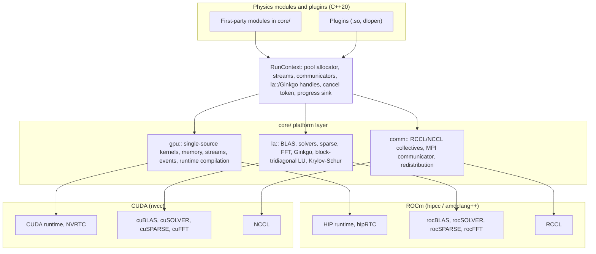

### 8.1 Language, compilers and targets

Kernels are written in C++ (C++20, D91) against HIP on AMD and CUDA on NVIDIA (D13). One source tree serves both vendors through the `gpu::` portability header; each vendor build uses its native compiler (D17). Vendor-specific kernel overrides are allowed only where profiling justifies them (D17). Objective expressions are compiled at run time with hipRTC or NVRTC (D156). CMake presets `rocm` and `cuda` select the vendor; ROCm or CUDA comes from the system, not from Spack (D52).

All arithmetic is FP64, real or complex; there are no FP32 numeric paths (D76, D150). The supported targets are (D75):

| AMD (`gfx` ISA targets) | NVIDIA (`sm` compute capabilities) |
|-----|--------|
| gfx90a, gfx942, gfx950 | sm_80, sm_90, sm_100 |

No other targets are supported. V&V runs on these targets. The engine is assumed Linux-only because of ROCm/RCCL (D75). The plugin ABI fingerprint records the ROCm or CUDA version, so plugins must match the core's GPU stack exactly (D45).

### 8.2 `gpu::` portability layer

`gpu::` is the single-source header that hides HIP versus CUDA differences (D17). It covers:

| Facility | Purpose | Decision |
|----------|---------|----------|
| Kernel launch and device qualifiers | One kernel source compiled by hipcc/amdclang++ or nvcc | D17 |
| Runtime compilation | hipRTC / NVRTC for objective expressions; per-process kernel cache | D156 |
| Device memory | Allocation only through the `RunContext` pool allocator | D68, D122 |
| Streams and events | Streams are injected by `RunContext`; outputs carry event tags | D68 |
| Deterministic primitives | Reductions, scans and sorts with fixed ordering in deterministic mode | D77 |
| Cancellation and progress | Modules check the cancel token and report to the progress sink | D68, D44 |

In deterministic mode, module kernels must not use floating-point atomics; deterministic reductions go through `gpu::` primitives (D129).

Implementation detail (not a decision): long-running kernel loops poll the cancel token.

Implementation detail (not a decision): `gpu::` exposes vendor-neutral type aliases (stream, event, device pointer) and a launch helper; vendor overrides live in per-vendor source files selected by the CMake preset.

### 8.3 `la::` linear algebra

`la::` wraps vendor math libraries and adds the solvers Nebula needs on top of them (D37). All `la::` routines keep data GPU-resident (D7) and support real and complex FP64 (D150).

| `la::` capability | AMD backend | NVIDIA backend | Decision |
|-------------------|-------------|----------------|----------|
| Dense BLAS | rocBLAS | cuBLAS | D37 |
| Dense factorizations | rocSOLVER | cuSOLVER | D37 |
| Batched dense LU | rocBLAS/rocSOLVER `getrfBatched`/`getrsBatched` | cuBLAS `getrfBatched`/`getrsBatched`; cuSOLVER `getrf` for large blocks | D37, D69, D159 |
| Sparse matrix operations | rocSPARSE | cuSPARSE | D37 |
| FFT | rocFFT | cuFFT | D37 |
| Krylov solvers and AMG preconditioners | Ginkgo (HIP executor) | Ginkgo (CUDA executor) | D37 |
| Distributed sparse solves | Ginkgo distributed over MPI | Ginkgo distributed over MPI | D53, D151 |
| Block-tridiagonal LU | Native block cyclic reduction over batched dense LU | Native block cyclic reduction over batched dense LU | D69, D159 |
| Shift-invert Krylov-Schur eigensolver | Native, GPU-resident, complex shifts | Native, GPU-resident, complex shifts | D37, D150 |

The block-tridiagonal LU serves the high-fidelity stability discretizations, which are block-structured (radial finite elements times Fourier harmonics) (D69). It eliminates blocks by cyclic reduction, so each reduction level is one batched dense LU over the independent block pairs of that level (D159). It is the inner solve of the shift-invert Krylov-Schur eigensolver. Wall and circuit unknowns enter as a trailing block (Section 11.4; D128). A general GPU sparse LU is deferred (D69). `la::` and Ginkgo handles are owned by `RunContext` and injected into modules (D68).

Where an `la::` operator participates in a gradient chain and provides an adjoint, the adjoint is hand-written and checked against finite differences (D18). This includes transposed solves for adjoint linear systems.

In deterministic mode `la::` refuses any call that has no deterministic path, failing the step with `plugin_error` for plugins or a core error for first-party code, rather than silently running nondeterministically (D129). Known gaps and their fallbacks:

| Gap | Deterministic fallback |
|---|---|
| Transposed sparse SpMV for adjoint solves (atomics in vendor kernels) | Explicitly transposed matrix, stored once, with a non-transposed SpMV |
| Vendor BLAS handles shared across injected streams (shared workspace) | One handle and workspace per stream |
| Ginkgo kernels and strategies that use atomics | Classical (non-atomic) Ginkgo strategies |
| Vendor routines without a deterministic variant | Refused; the module must use a deterministic alternative |

### 8.4 `comm::` and the rank-per-GPU model

Each run launches one MPI rank per GPU, using MPI even on a single node (D53). The supervisor launches all ranks of a Run with a single `mpirun` (D57). RCCL on AMD and NCCL on NVIDIA carry `comm::` data; Ginkgo distributed and parallel HDF5 communicate over MPI, which must be GPU-aware (D53, D151). MPI is initialized at `MPI_THREAD_SERIALIZED`; `RunContext` exposes an MPI communicator for Ginkgo and a duplicated one for the HDF5 I/O thread (D151).

The supervisor gives each run a disjoint, homogeneous GPU subset through `ROCR_VISIBLE_DEVICES` (AMD) or `CUDA_VISIBLE_DEVICES` (NVIDIA), identifying GPUs by UUID or PCI bus ID, so concurrent runs never share a GPU (D40, D149). Each rank selects the device matching its node-local rank before creating communicators, and each run gets a disjoint, GPU-affine CPU set (D149). The only exception to exclusive GPUs is view jobs on single-GPU machines (D63).

On a single node the supervisor pins MPI, PMIx and RCCL/NCCL bootstrap to loopback or shared memory (for example `NCCL_SOCKET_IFNAME=lo`, Open MPI `tcp_if_include=lo`, PMIx sockets in a 0700 directory), so no launch listener is reachable from the network (D138).

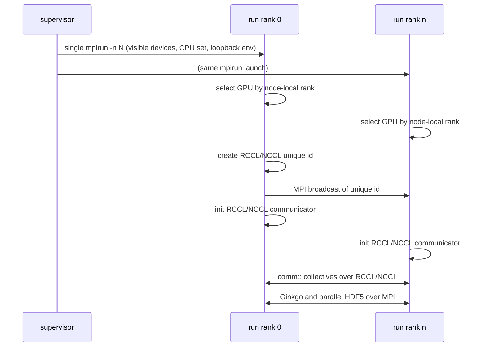

`comm::` provides:

- Collectives and point-to-point transfers over RCCL/NCCL (D53). Determinism follows Sections 15.1 and 15.2 (D43, D77).
- The distributed-array descriptor (global shape, partition map, owning rank) carried in contracts (D74).
- Redistribution: when a producer's partition differs from a consumer's, the engine inserts a `comm::` redistribution at the handoff (D74).
- Communicators handed to modules through `RunContext` (D68).

v1 ships a single-node compute adapter with multiple GPUs (D5, D116). The M5 multi-node adapter (D99) reuses the same `comm::` code. It additionally requires a shared parallel filesystem for project directories, a remote rank-to-supervisor transport with authentication, and launch traffic kept on a trusted network; these are adapter duties (Section 14.5; D118, D138).

### 8.5 `RunContext` and memory

`RunContext` is the core-owned resource object passed to every module in a run (D68). Modules do not create their own GPU resources.

| Member | Behavior | Decision |
|--------|----------|----------|
| Pool allocator | All device allocations; memory is reused across DAG steps | D68, D122 |
| Step outputs | Immutable, reference-counted, tagged with the GPU event that completes them | D68 |
| Streams | Injected per step | D68 |
| Communicators | RCCL/NCCL communicators from `comm::`; MPI communicators for Ginkgo and HDF5 | D53, D68, D151 |
| `la::` and Ginkgo handles | Pre-created `la::` vendor handles (one per stream) and Ginkgo executors | D37, D68, D129 |
| Cancel token | Cooperative stop for cancel, pause and checkpoint | D68, D102, D41 |
| Progress sink | Structured progress, convergence and heartbeat events to the supervisor | D44, D68, D119 |
| Determinism mode | Deterministic by default; fast nondeterministic mode selectable per run; enforced in `gpu::`, `la::`, `comm::` | D77 |

Immutable event-tagged outputs let DAG steps hand data off on the GPU without copies while background persistence writes HDF5 (D22). Out-of-memory in the pool is reported as the typed failure reason `oom` (D44).

GPU memory is bounded by these rules (D122):

| Rule | Content |
|---|---|
| Pool sizing | Each process sizes its pool at start from the device memory, minus a reserve; on single-GPU machines the reserve is headroom for one co-resident view job |
| View jobs | Allocate only from their own pool within the reserved headroom; a view that cannot fit waits rather than evicting a Run's memory |
| Persisted outputs | An output whose persistence has committed and whose consumers have released it is freed at once |
| Persistence backpressure | The background write queue has a memory budget; when it is full, producing steps wait for the I/O thread |
| Fan-out | At most a configured number of slices are in flight at once |
| Meshes | Resident meshes count against the pool like any other allocation |

### 8.6 Determinism enforcement

Deterministic mode is on by default and is enforced inside `gpu::`, `la::` and `comm::` rather than by each module (D77). The mechanisms are fixed-order `gpu::` primitives, deterministic vendor variants, refusal of calls with no deterministic path, and the ban on floating-point atomics in module kernels (D129). Sections 15.1 and 15.2 are the normative statement of modes and guarantees (D43, D77).

## 9. Core shared services

Six services live in `core/` and are shared by several physics modules. They are first-party code with privileged access (D59). Each runs on the GPU through the Section 8 layer (D7, D82). Where a service sits on a gradient path, its adjoint is decided per service (D70, D73, D135) and is hand-written and checked against finite differences (D18).

| Service | Main consumers | Decisions |
|---------|----------------|-----------|
| Field operator | Field, magnets, equilibrium, wall loads, regions | D31, D65, D89 |
| Flux coordinates | Equilibrium, stability, evolution | D70, D55 |
| Remap library | Field grids, load transfer, cross-run comparison | D73, D104 |
| Conductor network | Stability, evolution, EM-load export | D71, D128 |
| GPU post-processing operators | Viewers, comparison | D39, D63, D87 |
| Objective expression language | Optimizer and studies | D81, D67 |

### 9.1 Field operator

The field operator is a lazy GPU operator that returns B, A and ∇B at requested points (D65). It is linear in per-circuit currents (D65, D114), so changing currents across scenario points (D66) does not re-run geometry integration. Its inputs are the discretized geometry of Section 10 (filament segments, winding-pack quadrature points and frames), so run ranks never load geometry plugins (D112).

Circuits map currents to sources: each circuit names its member components, their turns and series grouping, and how sources replicate over N_fp periods (D114). Scenario currents are keyed by circuit.

Implementation detail (not a decision): per-circuit contributions are stored and currents applied at evaluation time.

Sources:

| Source | Method | Decision |
|--------|--------|----------|
| Filaments | Biot-Savart line integral (reduced tier); filaments must form closed circuits with explicit leads | D31, D65, D145 |
| Finite-cross-section coils and winding packs | Biot-Savart quadrature over the cross-section (high-fidelity tier) | D31, D65 |
| Volume current density on a grid or mesh | Volume Biot-Savart; equilibrium plasma current J is registerable as a source for downstream consumers | D65 |
| Further source types | Field-source sub-extension point, for example linear magnetization expressed as equivalent volume and surface currents | D145 |

Evaluation uses direct summation for small problems and a GPU fast multipole method (FMM) for large ones; the crossover is a tunable default (D31). Targets inside or near sources, as in Lorentz-force and critical-current-margin evaluation on winding packs, use singular and near-singular quadrature; filament self-fields use a regularized model; the FMM near-field threshold and accuracy are part of the contract's declared tolerances (D150). Nonlinear magnetic materials arrive later through the field-source sub-extension point (D31, D145).

The field operator has an analytic GPU derivative with respect to filament and finite-build curve, spline and Fourier parameters (D135), and is exactly linear in circuit currents (D65).

Evaluation targets are Regions: typed, versioned project entities such as points, line, plane, box grid, cylindrical or toroidal grid, component surface and mesh volume (D89). The Region type sets the output layout and the viewer (D89). Consumers evaluate the operator on demand at their own points; sampled grids are materialized only for Region outputs. Sampled grids are derived products: they are cached and interpolated with divergence-free interpolation from the remap library (D65, D73). Coordinates are global right-handed Cartesian in SI units (D46).

A field output is persisted as its discretized sources plus the current-to-circuit map, with a content hash; a consumer in another Run rebuilds the lazy operator from it, so stored-output reuse and caching work for the field step (D115).

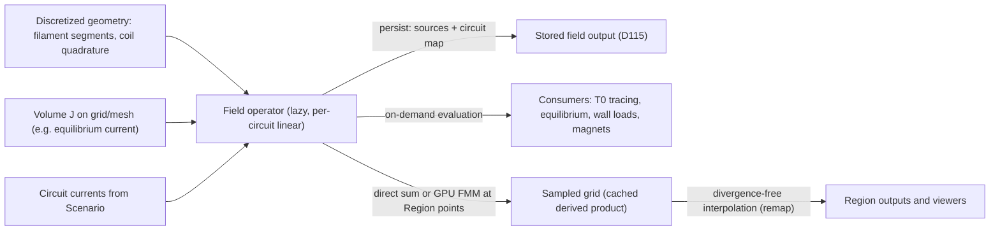

### 9.2 Flux coordinates

The flux-coordinate service builds Boozer, PEST and field-line-following coordinates with their metric coefficients (D70). Results are cached under the key of Section 4.6 (D70). The service has a discrete adjoint (D70, D18).

It also acts as an adapter in the sense of D55. It consumes an equilibrium sub-contract and produces either the nested-coordinate sub-contract (Boozer, PEST) for closed-line equilibria or the field-line-following sub-contract for open-line equilibria (D70, D55, D134). Boozer and PEST coordinates require `closed_field_lines` and `nonzero_toroidal_field`; field-line-following coordinates for open lines require `open_lines` (D64, D134). Coordinate declarations follow Section 5.7 (D46). Sign and normalization follow the fixed generalized COCOS-11-like convention with psi in Wb (D94).

### 9.3 Remap library

The remap library transfers fields between discretizations on the GPU (D73). It provides three operations, each with a discrete adjoint (D73):

| Operation | Use |
|-----------|-----|
| Point-to-mesh | Sampling a source at mesh nodes or quadrature points, for example loads onto Gmsh meshes for thermal-structural (D36) |
| Conservative L2 projection | Transfer between meshes or grids that preserves integrals |
| Divergence-free interpolation | Interpolation of B on sampled grids (D65) |

The cross-run comparison feature uses the remap library to resample two runs' fields onto a shared region and difference them on the GPU (D104). Differences are flagged against D43 tolerances (D104).

### 9.4 Conductor network

The conductor network is a core contract for passive conductors and circuits (D71). Its input is a ConductorNetwork version: passive elements (component references tagged with electrical resistivity, thickness and discretization), circuit topology built on geometry circuits, power supplies and feedback (D128). It represents thin-shell and volume passive elements, assembles a mutual-inductance matrix on the GPU, and solves the circuit equations, in which circuit currents may be unknowns (D71, D128). Stability (resistive wall), time evolution and electromagnetic-load export share one instance of this contract (D71). The ConductorNetwork version hash is part of the inputs of every step that uses it (Section 4.6). A 3D eddy-current finite-element (FEM) solver arrives later behind the same contract (D71).

Implementation detail (not a decision): mutual inductances between coils and passive elements reuse the field operator's Biot-Savart kernels.

### 9.5 GPU post-processing operators

PostOps reduce large results to viewable payloads on request (D39). PostOp is a fixed core extension kind, so plugins may add their own GPU PostOps (D58, D87).

| Core PostOp | Output |
|-------------|--------|
| Slice | 2D cut through a 3D field |
| Isosurface | Triangle surface |
| Field lines | Traced line set |
| Poincaré | Puncture points on a section |
| Decimation | Reduced mesh or point set |

PostOps run in view jobs on committed outputs, for live and finished runs alike (D122, D143); on single-GPU machines a view job may share the GPU within the reserved headroom of Section 8.5 (D63). They produce compact vtk.js or glTF payloads, cached under the key of Section 4.6 (D39). Payloads are an FP32 presentation format: coordinates are stored relative to a local origin offset carried in the payload, so large global-Cartesian coordinates keep their precision (D156). These payloads are derived artifacts and are evictable under the size cap (D79). The browser UI picks a viewer from the fixed core catalogue by output kind (D87).

### 9.6 Objective expression language

Objectives and constraints combine quantities through a small typed expression language (D81). Expressions are compiled and evaluated on the GPU with chained gradients (D81). Operands are any annotated numeric field (bounds, units, scale) and plugin GPU functionals, which may provide optional adjoints (D81). Objective is a fixed core extension kind (D58).

Gradients of an expression chain into the workflow-level JVP/VJP protocol (D67). Where a term lacks an adjoint, finite-difference Jacobians fill the gap (D67). The FastAPI server parses and type-checks every expression before submission, using the schema's unit tags, so unit mismatches fail before a run is queued (D46, D156).

Run ranks lower each expression to a GPU kernel plus its reverse-mode kernel, compiled with hipRTC or NVRTC (D156). Compiled kernels are cached per process, keyed by expression hash, GPU architecture, engine build, determinism mode and the hashes of the functional plugins the expression references (D156).

## 10. Geometry and meshing

Geometry is a set of typed parametric components whose parameters are optimizer design variables (D27). The B-rep kernel is OpenCascade (OCCT), used for solids, STEP export and meshing input (D27). Geometry code lives in `geom/` as the `nebula_geom` C++ library (D85, D91).

### 10.1 Parametric components and assemblies

| Component type | Examples | Decision |
|----------------|----------|----------|
| Curves and splines | Coil centerlines, limiter profiles | D27 |
| Fourier surfaces | Plasma boundaries, stellarator coil winding surfaces | D27 |
| Filaments | Current-carrying wires for the field operator | D27, D65 |
| Winding packs | Finite-cross-section coils | D27, D31 |
| OCCT solids | Vessel, structure, blanket bodies | D27 |
| Plugin component types | Registered through the GeometryComponent extension kind; must emit core discretized-geometry representations | D58, D112 |

A Geometry is an assembly of individually versioned Component references plus circuits (D88, D114). Components and materials come from a per-project library or a user-global library; import copies the item and keeps a provenance link (D88). A component's content hash includes the resolved content of the material it references, so a material edit changes every dependent hash (D127). Geometry carries mandatory symmetry metadata, which is the source of the geometric capability traits (D94, D113). Units are SI in the global right-handed Cartesian frame (D46). Concept kits ship geometry templates and starter projects (D86).

Geometry is edited as a mutable draft. Immutable, content-hashed versions are minted by the paths of D110: run submission, promotion of an optimizer iterate, and solved-scenario emission for Scenarios (D56, D26, D80, D110).

### 10.2 Geometry worker

`nebula_geom` runs in a geometry worker process started and supervised by `nebula serve` (D85, D147). The geometry worker loads geometry plugins (D85), choosing versions as in Section 7.5 and restarting when a geometry plugin is installed or upgraded (D143). The FastAPI server calls it over gRPC for draft builds and STEP export and stays pure Python (D85). The supervisor calls it for the Preparing phase and relays in-run `GeometryEval` and `Remesh` requests from run ranks (D105, D121). Running OCCT on the host is allowed under the Section 2.1 size rule (D82). If the worker crashes, `nebula serve` restarts it; in-flight draft builds return an error to the client, and a Preparing Run or a relayed in-run request fails with `geometry_failed` (D121, D147).

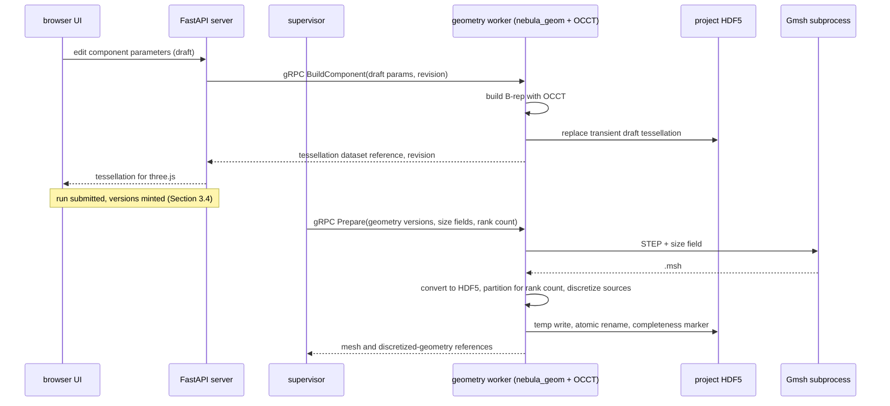

The browser UI never runs OCCT. It receives tessellations and renders them with three.js through react-three-fiber (D28). Draft tessellations are transient: one per component draft, replaced on each build and stored as in Section 5.10 (D121).

### 10.3 Meshing with Gmsh

Gmsh runs as a separate subprocess of the geometry worker: STEP plus a size field go in, a `.msh` file comes out (D30). Running it as a separate executable keeps the GPL tool outside the Apache-2.0 code (D12). Meshing happens in the Run's Preparing phase, before the Run waits for GPUs; the supervisor initiates it, and the size field comes from the step configs that consume the mesh (D121). Gmsh runs with deterministic settings (fixed seeds, single-threaded or deterministic meshing options) so a regenerated mesh is identical (D121). The geometry worker converts the `.msh` to HDF5 mesh data and computes the partition map for the Run's rank count with Gmsh's built-in METIS partitioner (D112).

Meshes are cached under the key of Section 4.6 (geometry version hash, size field, rank count, Gmsh version and options, engine build) (D30, D121). A mesh is written under a temporary name and renamed atomically with a completeness marker, so a partial mesh is never a cache hit (D121). Meshes in the derived cache are evictable under the size cap (D79); a mesh that a primary result or a Region version references is copied into the Run's committed outputs, so eviction never strands a kept result (D121). Spack pins OCCT and Gmsh versions (D52).

The geometry worker also produces the discretized geometry consumed by run ranks: filament segments, winding-pack quadrature points and frames, and Fourier coefficients (D112).

Each run moves its mesh and discretized geometry to the GPU once; all subsequent mesh-sized work stays there (D7, D82). Thermal-structural FEM runs on these Gmsh meshes (D36). Mesh-volume and component-surface Regions reference them (D89).

### 10.4 Shape sensitivities and mesh morphing

Shape gradients for mesh-based modules use fixed-topology GPU mesh morphing driven by `nebula_geom` sensitivities (D83, D135). The geometry worker returns parameter-to-control-point sensitivities, which are sized by the design space; the GPU expands them to boundary-node displacements and morphs the mesh without remeshing (D153). When mesh quality falls below a threshold, rank 0 requests a Gmsh remesh through the supervisor relay (D105). After a remesh, the optimizer re-evaluates the current iterate on the new mesh, resets its quasi-Newton history, and restarts the line search (D83, D153). The gradient chain includes the adjoint of the mesh-motion operator (D153).

Filament coils and spectral boundaries do not use mesh morphing: field gradients with respect to curve, spline and Fourier parameters come from the analytic Biot-Savart derivatives of Section 9.1, and T2 takes boundary Fourier coefficients directly through its adjoint (D135). Modules without any shape gradient fall back to derivative-free optimization (D83, D8). Shape gradients arrive with the optimizer and adjoints in M3 (D99).

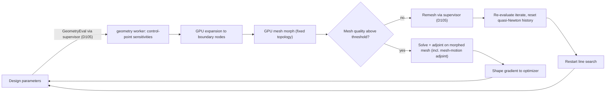

## 11. Physics modules

This section covers the seven first-class calculation types. The requirements list five calculations. Thermal-structural is added as first-class (D3), and wall loads is added as its own calculation type (D72). All seven are first-party modules compiled into `core/` with privileged access (D59, D91). Plugins add further solvers per sub-contract, concepts, closures and field sources through the extension points in Section 7 (D3, D58, D111). Materials are library data, not extensions (D88).

Every module follows the same rules:

- **Contracts.** Each calculation type is one contract split into representation-specific sub-contracts. Explicit contract adapters (core service or plugin) connect sub-contracts (D1, D55). Reduced and high-fidelity solvers exist per calculation type (D1); solvers that share a representation implement the same sub-contract, and tiers with different representations are connected by adapters (D55).
- **Traits.** Solvers declare the capability traits they require. The project's concept provides topological traits and the geometry's symmetry metadata provides geometric traits. The validator matches them before a run is accepted (D6, D64, D113). The core assumes no particular confinement concept (D2).
- **GPU numerics.** Section 2.1 fixes what runs on GPU and host (D7, D82). Arithmetic is FP64, real or complex (D76, D150). Deterministic mode is on by default (D77). Kernels are single-source `gpu::` code (D17). Linear algebra goes through `la::` (D37). GPU data exchange between run ranks goes through `comm::` (D53).
- **Run environment.** Solvers receive a core-owned `RunContext` with the pool allocator, streams, communicators, `la::`/Ginkgo handles, cancel token and progress sink (D68). Distributed outputs carry a distributed-array descriptor (D74). Solvers implement `checkpoint()`/`restore()` within the engine's checkpoint epochs (D41, D120). Each solver's manifest declares its supported rank counts (D116).
- **Gradients.** Gradients are optional per module (D8). Where a module provides them, they are hand-written discrete adjoint/tangent operators checked against finite differences (D18). Where a module lacks them, the engine fills the gap with finite-difference Jacobians (D67) or the study falls back to derivative-free or surrogate drivers (D8).
- **Conventions.** Quantities are SI, with temperatures in eV (D46). Signs and normalization follow the fixed generalized COCOS-11-like convention, with psi in Wb (D94).
- **V&V.** Each module carries analytic, manufactured-solution, digitized-benchmark, cross-tier, cross-vendor and adjoint-vs-FD cases. A smoke subset runs at load and the full suite runs under `nebula vv` (D42, D61). There are no third-party fusion codes, including for V&V (D10).

**Module overview.**

| Module | Sub-contracts (examples) | Tiers in v1 | Later tiers | Adjoint | Milestone |
|---|---|---|---|---|---|
| Magnetic field | Field operator (D65) | Filament + finite-cross-section Biot-Savart (D31) | Further sources through the field-source sub-extension point (D145) | Exact in circuit currents by linearity (D65); analytic in curve, spline and Fourier parameters (D135) | v1 (D93) |
| Magnet design | Coil design (D32) | None | Shape design, forces, margin (D32); quench, AC loss and cryo as plugins | Coil shape through analytic Biot-Savart derivatives (D135); other terms FD fill (D67) | M3 (D99) |
| Equilibrium | `Equilibrium.Axisym2D`, `Equilibrium.Nested3D` (D55) | T0, T1 (including the open-line anisotropic form, D134), T2 (D97) | T3 (D99) | T2 discrete adjoint (D33) | v1 T0-T2; M2 T3 |
| Stability | Local, global MHD, gyrokinetic (D34) | Local criteria + global linear ideal/resistive MHD (D97) | Linear gyrokinetic ITG/TEM/ETG (D99) | Not fixed by the log; FD fill (D67) | v1; M2 gyrokinetics |
| Time evolution | Transport, nonlinear MHD (D35) | 1.5D flux-surface + 1D along-field transport (D97) | 3D nonlinear resistive/extended MHD (D99) | Not fixed by the log; FD fill (D67) | v1; M2 3D MHD |
| Wall loads | Surface heat flux + force density (D72) | None | Reduced: field-line tracing + radiation projection (D72); nuclear heating as plugin | Not fixed by the log | M4 (D99) |
| Thermal-structural | Thermo-elastic FEM (D36) | None | Steady/transient heat conduction + linear elasticity (D36) | Not fixed by the log | M4 (D99) |

Implementation detail (not a decision): sub-contract identifiers other than `Equilibrium.Axisym2D` and `Equilibrium.Nested3D` are fixed when each milestone freezes its contracts (D99).

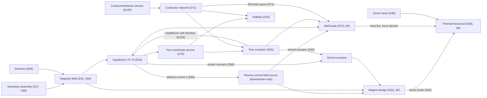

Data moves between modules on GPU inside one run (D22). It crosses discretizations through the core remap library, which provides point-to-mesh transfer, conservative L2 projection, divergence-free interpolation and discrete adjoints (D73).

### 11.1 Magnetic field

**Purpose.** This module computes B, A and ∇B in a user-defined region. The sources are magnets, current-carrying wires, or plasma current. It covers the "magnetic field in a region" requirement and is in v1 (D93).

**Sub-contracts consumed.**

- Discretized geometry of components typed as filaments (including standalone user-defined current-carrying wires, which must form closed circuits) and winding packs (D27, D112, D145). These come from versioned component references in the geometry assembly (D88).
- Circuit currents or waveforms from a Scenario, keyed by the geometry's circuits (D66, D114).
- A Region: points, line, plane, box grid, cylindrical/toroidal grid, component surface, mesh volume, or step-output surface. The Region type sets the output layout and the viewers (D89, D160).
- Optionally, a volume current density J on a grid or mesh. Equilibrium current can be registered as such a source (D65).

**Sub-contracts produced.**

- A lazy GPU field operator returning (B, A, ∇B). It is linear in the per-circuit currents (D65, D114). It is persisted as its discretized sources plus the current-to-circuit map (D115).
- Sampled grids on a Region. These are cached derived products, interpolated in a divergence-free way (D65, D73), and cached under the key of Section 4.6.

**Required traits.** None. The field module serves every topology (D6, D64).

**Tiers and methods (D31).**

| Tier | Source model | Summation |
|---|---|---|
| Reduced | Filament Biot-Savart | Direct sum for small problems; GPU FMM for large problems |
| High-fidelity | Finite-cross-section quadrature over the winding pack | Direct sum or GPU FMM |
| Later (plugin) | Magnetization and nonlinear magnetic materials | Plugins filling the field-source sub-extension point (D31, D145) |

**GPU numerics.** Direct-sum and FMM kernels are written in `gpu::` (D17). Evaluation points are distributed across run ranks through the distributed-array descriptor; field evaluation is one of the v1 steps that scale across ranks (D74, D116). Near-source evaluation follows Section 9.1 (D150). Determinism follows Section 15.1 (D77).

**Adjoint availability.** The operator is linear in circuit currents, so derivatives with respect to currents are exact by construction (D65). Derivatives with respect to filament and finite-build curve, spline and Fourier parameters are analytic GPU kernels (D135). Other parameters use FD Jacobians (D67) or derivative-free drivers (D8).

**Milestone.** v1 (D93).

### 11.2 Magnet design

**Purpose.** This module designs and optimizes coil shapes under engineering constraints. It evaluates Lorentz forces and HTS/LTS critical-current margin, and hands stress to thermal-structural (D32). It is a first-party core module (D59) delivered in M3 together with the optimizer and adjoints (D99).

**Sub-contracts consumed.**

- Parametric coil components: curves, splines, Fourier surfaces, filaments and winding packs. Their parameters are optimizer design variables (D27, D81).
- The field operator (D65), including the field contribution from plasma current registered by equilibrium.
- Scenario points. Magnet checks run at each scenario point (D66), and the core fan-out node maps the step over the selected time slices (D92).
- Conductor and material data from the per-project and user-global libraries, resolved into each component's content hash (D88, D127).

**Sub-contracts produced.**

- Lorentz force density on winding packs.
- Critical-current margin per scenario point.
- Engineering constraint values exposed as objectives/constraints (D58, D81).
- Stress loads handed one-way to thermal-structural (D32, D36).
- Optimized coil iterates. These are ephemeral, and any iterate can be promoted to new Geometry and Scenario versions (D80, D110).

**Required traits.** None. Magnet design operates on coil geometry, independent of plasma topology (D64).

**Tiers and methods.**

| Scope | Content | Delivery |
|---|---|---|
| Core | Coil shape design/optimization, engineering constraints, Lorentz forces, HTS/LTS critical-current margin (D32) | M3 |
| Later plugins | Quench, AC loss, cryogenics, filling sub-extension points that the core magnet-design module publishes in the core manifest (D32, D58, D111) | After M3 |

**GPU numerics.** Forces and margins are evaluated by GPU kernels on top of the field operator, using its near-source quadrature for targets inside winding packs (D65, D150). Constraint and objective functionals run as GPU functionals or compiled expressions (D81). Optimizer logic is host orchestration over design-space-sized vectors (D82, D124). Gradient optimizers run in-run, while scans and derivative-free studies fan out as separate Runs created by FastAPI (D67, D109).

**Adjoint availability.** Coil-shape gradients come from the analytic Biot-Savart derivatives of the field operator with respect to curve, spline and Fourier parameters (D135); mesh morphing applies only where a mesh-based module is in the chain (D83). Remaining gaps use FD Jacobians (D67) or derivative-free drivers (D8).

**Milestone.** M3 (D99).

### 11.3 Equilibrium (T0-T3)

**Purpose.** This module computes the magnetic equilibrium for any magnetic-confinement topology. The tier is selected by the concept's capability traits (D33, D64). It covers the "plasma equilibrium" requirement and is in v1 for T0-T2 (D93, D97).

**Sub-contracts consumed.**

- The field operator for coil and vacuum fields (D65).
- A Scenario supplying circuit currents and plasma targets (D66, D114).
- Geometry with mandatory symmetry metadata (D94).
- Profiles from time evolution, through the equilibrium-call interface when transport re-solves equilibrium per time step (D154), or through a `coupled` step for steady-state coupling (D49).

**Sub-contracts produced.**

- `Equilibrium.Axisym2D` from T1, carrying anisotropic p_par/p_perp fields for open-line equilibria (D55, D134).
- `Equilibrium.Nested3D` from T2 (D55).
- A field-line/Poincaré result from T0.
- A solved Scenario, minted as a Scenario version (D66, D110).
- Equilibrium current registerable as a field source for downstream consumers (D65).

The flux-coordinate service is a core adapter that consumes these outputs. It produces Boozer and PEST coordinates for closed-line equilibria and field-line-following coordinates for open-line equilibria, with metrics, cached under the key of Section 4.6 (D70, D134). Conversions between sub-contracts are explicit contract adapters (D55).

**Tiers, traits and methods (D33).**

| Tier | Method | Required traits (D64) | Milestone |
|---|---|---|---|
| T0 | Vacuum field-line tracing | None; all topologies | v1 (D97) |
| T1 | 2D free-boundary Grad-Shafranov; isotropic p(psi) for closed lines; anisotropic p_par/p_perp(psi, B) with end-plate boundary conditions for `open_lines` | `axisymmetric`; covers `closed_field_lines`, `open_lines` and `field_reversal` configurations (D134) | v1 (D97) |
| T2 | 3D nested-surface spectral equilibrium with adjoints | `closed_field_lines`, nested surfaces; `N_fp` symmetry used | v1 (D97) |
| T3 | 3D island-capable relaxation | `closed_field_lines`, 3D | M2 (D99) |

The v1 reference concepts exercise these tiers (D97, D98). The tokamak (closed, axisymmetric) uses T1. The simple mirror (open lines, axisymmetric) uses T1 in its anisotropic open-line form (D134). The stellarator (closed, 3D) runs T0 and T2 (D98).

**GPU numerics.**

- T0 integrates field lines in GPU kernels against the field operator (D65). Poincaré sections are GPU post-processing operators (D39).
- T1 uses `la::` sparse solvers with Ginkgo Krylov + AMG, distributed across ranks with Ginkgo distributed (D37, D116).
- T2 uses `la::` FFTs (rocFFT/cuFFT) and dense batched solves on one rank in v1 (D37, D116).
- T3 uses the same `la::` stack.

Implementation detail (not a decision): the assignment of Ginkgo to T1 and of FFTs to T2 follows from the method types, not from a separate decision.

**Adjoint availability.** T2 ships hand-written discrete adjoints in v1 (D18, D33). Nothing consumes them until the optimizer arrives in M3; this is an accepted tension (D97, D99). The flux-coordinate service has a discrete adjoint (D70). Coupling nodes use implicit-function-theorem adjoints (D67). The log does not fix adjoints for T0, T1 and T3; FD Jacobians fill the gaps (D67).

**Milestone.** T0, T1 and T2 in v1 (D97); T3 in M2 (D99).

### 11.4 Stability

**Purpose.** This module evaluates MHD stability and microstability of a given equilibrium. It runs separately from time evolution and uses methods suited to stability analysis (requirements; D34).

**Sub-contracts consumed.**

- `Equilibrium.Axisym2D` or `Equilibrium.Nested3D` (D55), through the flux-coordinate adapter: nested coordinates for closed-line tiers, field-line-following coordinates for open-line interchange (D70, D134).
- The conductor network for wall and passive-structure response, built from the Scenario's ConductorNetwork version: thin-shell and volume passive elements, a GPU mutual-inductance matrix, and the circuit solver (D71, D128).
- Scenario points (D66) and time slices through fan-out (D92).

**Sub-contracts produced.**

- Local stability criteria profiles.
- Global eigenvalues and mode structures, complex FP64, shown in the mode-structure and spectrum viewers (D87, D150).
- Linear growth rates and frequencies for gyrokinetic microstability (M2).

**Tiers, traits and methods (D34).**

| Tier | Methods | Required traits (D64) | Milestone |
|---|---|---|---|
| Reduced | Local criteria: Mercier, ballooning, interchange, rigid vertical | `closed_field_lines` + `nonzero_toroidal_field` for Mercier/ballooning; interchange applies to `closed_field_lines` and to `open_lines` (via field-line-following coordinates); rigid vertical needs `axisymmetric` + `closed_field_lines` | v1 (D97, D134) |
| High-fidelity | Global linear ideal + resistive MHD eigenmodes with wall | `closed_field_lines` + `nonzero_toroidal_field` (nested flux surfaces) | v1 (D97, D134) |
| Microstability | Linear gyrokinetic ITG/TEM/ETG (ion/trapped-electron/electron temperature gradient modes) | `closed_field_lines` | M2 (D99) |

Implementation detail (not a decision): the per-criterion trait column restates where each named criterion applies physically. Each solver's manifest carries the authoritative trait list (D60, D64).

**GPU numerics.**

- Global MHD uses block-structured discretizations: radial finite elements × Fourier modes (D69).
- The inner solve is the `la::` block-tridiagonal LU: block cyclic reduction over batched dense LU (rocBLAS/cuBLAS `getrfBatched`/`getrsBatched`). General GPU sparse LU comes later (D69, D159).
- Eigenvalues come from the native GPU-resident shift-invert Krylov-Schur eigensolver, with complex shifts and complex LU for non-Hermitian resistive problems (D37, D150).
- Wall coupling: passive-conductor and circuit unknowns from the conductor network enter (A - σB)⁻¹B as a trailing block coupled to the plasma-edge block through the vacuum response. The trailing block may be dense and of a different size from the plasma blocks; it is eliminated by a dense Schur complement after the block cyclic reduction of the plasma blocks. 3D walls enlarge only the trailing block (D71, D128, D159).
- In v1 stability runs on one rank (D116).

**Adjoint availability.** The log does not fix a stability adjoint. Gradients of stability objectives use FD Jacobians (D67) or derivative-free drivers (D8).

**Milestone.** Local and global ideal/resistive MHD in v1 (D97). Linear gyrokinetics in M2 (D99).

### 11.5 Time evolution

**Purpose.** This module advances the plasma state in time and produces solved scenarios. It is separate from stability, as the requirements state (D35).

**Sub-contracts consumed.**

- Equilibrium sub-contracts and flux coordinates: nested coordinates for 1.5D transport, field-line-following coordinates for 1D open-line transport (D55, D70, D134).
- The equilibrium-call interface: 1.5D transport re-solves the equilibrium at each time step by calling the selected equilibrium solver in-process, rather than through a `coupled` step (D154).
- Scenario circuit waveforms and plasma targets (D66, D114).
- The conductor network for passive currents and circuits, built from the Scenario's ConductorNetwork version (D71, D128).
- Turbulence closures through a sub-extension point that the first-party transport module publishes in the core manifest (D35, D58, D111).

**Sub-contracts produced.**

- Time-series profiles on edges with a declared time base (D92).
- A solved Scenario, minted as a Scenario version (D66, D110).
- Plasma heat and particle source data consumed by wall loads in M4 (D72).

**Tiers, traits and methods (D35).**

| Tier | Method | Required traits (D64) | Milestone |
|---|---|---|---|
| Reduced | 1.5D flux-surface transport with equilibrium re-solved per time step (D154) | `closed_field_lines` + `nonzero_toroidal_field` | v1 (D97) |
| Reduced | 1D along-field models for open systems | `open_lines` | v1 (D97) |
| Closures | Turbulence closures as plugins | Declared by the closure plugin | Plugin (D35) |
| High-fidelity | 3D nonlinear resistive/extended MHD | Declared by the solver | M2 (D99) |

**GPU numerics.**

- Transport time stepping uses `la::` sparse and batched solves on one rank in v1 (D37, D116).
- The equilibrium-call interface runs the equilibrium solver on the transport step's ranks, inside the same `RunContext`, warm-started from the previous time step. Its state is part of the transport step's checkpoint, so a restore resumes mid-time-series (D120, D154). Its gradient contribution enters the transport step's adjoint through implicit-function-theorem adjoints of the equilibrium solve at each time step, when the equilibrium solver supplies them; otherwise FD Jacobians apply (D67, D154).
- 3D nonlinear MHD uses Ginkgo distributed Krylov over MPI across run ranks (D37, D53, D151), preconditioned by physics-based field-split / block-Jacobi preconditioning that applies the D69 block solver per Fourier block (D155). Redistribution goes through `comm::` (D74).
- Long runs checkpoint through the engine's checkpoint epochs (D41, D120).

**Adjoint availability.** The log does not fix a time-evolution adjoint. Gradients through the equilibrium-call interface follow D154. A `coupled` node uses implicit-function-theorem adjoints when its members supply JVP/VJP operators (D67). Otherwise, FD Jacobians (D67) or derivative-free drivers (D8) apply.

**Milestone.** 1.5D and 1D transport in v1 (D97). 3D nonlinear MHD in M2 (D99).

### 11.6 Wall loads

**Purpose.** This module computes surface heat flux and force density on geometry components. It is a first-class calculation type (D72), delivered as a first-party core module (D59) in M4 (D99).

**Sub-contracts consumed.**

- The field operator and equilibrium for field-line tracing (D65, D55).
- Time-evolution outputs for plasma power and radiation sources (D35, D92).
- The conductor network's EM-load export for force density from induced currents (D71).
- Component-surface Regions (D89).

**Sub-contracts produced.**

- Surface heat flux and force density on components, remapped onto component meshes through the remap library (D73).
- These loads flow one-way into thermal-structural (D36).

**Required traits.** The reduced tier requires no traits beyond those of the equilibrium it consumes. Field-line tracing works for every topology (D33, D64).

**Tiers and methods (D72).**

| Tier | Method | Delivery |
|---|---|---|
| Reduced | Field-line tracing for parallel heat flux + radiation projection onto surfaces | M4 |
| Plugin | Nuclear heating | After M4 |

**GPU numerics.** Field-line tracing and radiation view-factor projection run as `gpu::` kernels (D17).

Implementation detail (not a decision): surface remap uses the conservative L2 projection of the remap library (D73).

**Adjoint availability.** The log does not fix a wall-load adjoint. FD Jacobians (D67) or derivative-free drivers (D8) apply.

**Milestone.** M4 (D99).

### 11.7 Thermal-structural

**Purpose.** This module solves linear thermo-elastic finite-element (FEM) problems on GPU: steady and transient heat conduction plus linear elasticity on Gmsh meshes (D36). It is first-class (D3), delivered as a first-party core module (D59) in M4 (D99).

**Sub-contracts consumed.**

- Volume meshes from the Gmsh subprocess, cached under the key of Section 4.6 (D30, D121).
- Materials from the component/material libraries, resolved into component hashes (D88, D127).
- One-way loads from three sources:
  - Magnet stress and Lorentz forces (D32).
  - Plasma heat flux and force density from wall loads (D72).
  - Time-evolution loads (D35).
- Scenario points through fan-out (D66, D92).

**Sub-contracts produced.**

- Temperature, displacement and stress fields on the mesh; the mesh is copied into the Run's committed outputs so the result keeps its topology (D121).
- Mesh-volume Region outputs viewed in the 3D field viewer (D87, D89).

**Required traits.** None. The module operates on component meshes, independent of plasma topology (D64).

**Tiers and methods (D36).**

| Analysis | Method |
|---|---|
| Heat conduction | Steady and transient linear FEM |
| Structural | Linear elasticity FEM |
| Coupling | One-way: loads in, no feedback to plasma or magnets |

**GPU numerics.** The mesh is moved to GPU once (D7). Assembly runs in `gpu::` kernels (D17), and solves use Ginkgo Krylov + AMG through `la::` (D37). Loads are transferred from source discretizations by the remap library (D73).

**Adjoint availability.** The log does not fix a thermal-structural adjoint. FD Jacobians (D67) or derivative-free drivers (D8) apply. Shape changes to meshed components follow D83 mesh morphing with control-point sensitivities, with a Gmsh remesh when the quality threshold is crossed (D153).

**Milestone.** M4 (D99).

## 12. Optimization and studies

Optimization is a first-class layer above the physics modules (D8). A Study is a set of Runs produced by one scan or optimization over a base Workflow version (D51, D109). Optimizer drivers are Optimizer extensions, first-party or plugin (D124). Studies place the optimizer in one of two places. Gradient-based drivers run inside a Run, in an `optimize` step the Study compiles into its workflow. Derivative-free, surrogate and scan drivers run in the supervisor and propose points that FastAPI turns into Runs (D67, D109, D123). The optimizer and adjoint consumers arrive with magnet design in milestone M3 (D99).

### 12.1 Design variables

Any annotated numeric field can become a design variable (D81). The annotation carries bounds, units and a scale factor. Units follow the schema's SI unit tags (D46).

| Source of variable | Example | Gradient path |
|---|---|---|
| Geometry component parameter, mesh-based consumers | Fourier surface coefficient or spline control point of a meshed component (D27) | Control-point sensitivity from `nebula_geom`, GPU expansion and mesh morphing (D83, D153) |
| Geometry component parameter, filament and finite-build coils | Filament node, coil spline control point, coil Fourier coefficient (D27) | Analytic Biot-Savart derivatives in the field operator (D135) |
| Plasma boundary Fourier coefficient for T2 | Boundary Fourier surface (D27) | T2 adjoint directly in the coefficients (D135) |
| Scenario circuit current | Coil current (D66, D114) | Exact for the field operator, which is linear in circuit currents (D65); downstream steps chain through the D67 JVP/VJP protocol, with FD fill |
| Other Scenario field | Waveform knot, plasma target (D66) | D67 JVP/VJP chain; FD where a step lacks an adjoint |
| Solver or plugin config field | Any `.proto` field annotated as a variable (D81, D54) | Adjoint if the owning module provides one, else finite differences (D67) |

Geometry parameters are design variables by construction (D27). A Study Run receives variable values as a parameter-override vector applied to the base Workflow version; the vector is recorded in provenance and in the cache key (D109). Values reach the design only through promotion, which mints new Geometry, Scenario or Workflow versions (Section 12.6; D110). Iterates never mutate a version (D56, D80).

### 12.2 Objectives, constraints and the expression language

Objectives and constraints are GPU functionals (D81). Plugins register them through the `Objective` extension point (D58). Each functional may supply an adjoint; the adjoint is optional (D8, D81).

A small typed expression language composes functionals into objectives and constraints (D81). The FastAPI server type-checks each expression before submission; run ranks compile it with hipRTC or NVRTC and evaluate it on the GPU (D156). Gradients chain through the expression to the functionals it references (D81). The language implementation lives with the other core shared services (Section 9.6).

Example (illustrative): `max(B_ripple(region=lcfs)) - 0.01`, where `lcfs` is a Region of type step-output surface bound to the last closed flux surface emitted by the upstream equilibrium step (D160). The expression type-checks against the units and output kinds of the referenced functionals before the Run is submitted.

Concept kits ship default objectives and constraints for their concept (D86). Magnet engineering limits (Lorentz force, HTS/LTS critical-current margin) are constraints supplied by the magnet module (D32).

### 12.3 Gradient mechanism

Gradient-capable modules provide hand-written discrete adjoint and tangent operators (D18). Each operator is checked against finite differences in the V&V suite (D18, D42). The workflow DAG exposes a JVP/VJP protocol so that gradients chain step to step (D67).

| Gradient source | Where it is used | Decision |
|---|---|---|
| Module discrete adjoint/tangent | Any step that implements it, e.g. T2 equilibrium (D33), flux coordinates (D70), remap (D73) | D18, D67 |
| Implicit function theorem (IFT) adjoint | Composite `coupled` steps at their converged fixed point (D49); equilibrium re-solves inside transport (D154) | D67, D154 |
| Expression-language chain rule | Objective and constraint expressions | D81 |
| Analytic Biot-Savart shape derivatives | Filament and finite-build coil parameters | D135 |
| Control-point sensitivity + mesh morphing | Geometry parameters of mesh-based modules, fixed mesh topology | D83, D153 |
| Finite-difference Jacobian | Steps without an adjoint (D67) | D67 |
| None (derivative-free fallback) | Shape variables when no shape gradient exists (D83) | D8, D83 |

At a `coupled` step the engine differentiates the converged fixed-point condition rather than the iteration history. This is the IFT adjoint (D67). Finite-difference Jacobians fill gaps where a step lacks an adjoint (D67).

Shape gradients and mesh morphing are described in Section 10.4 (D83, D153).

### 12.4 Driver placement

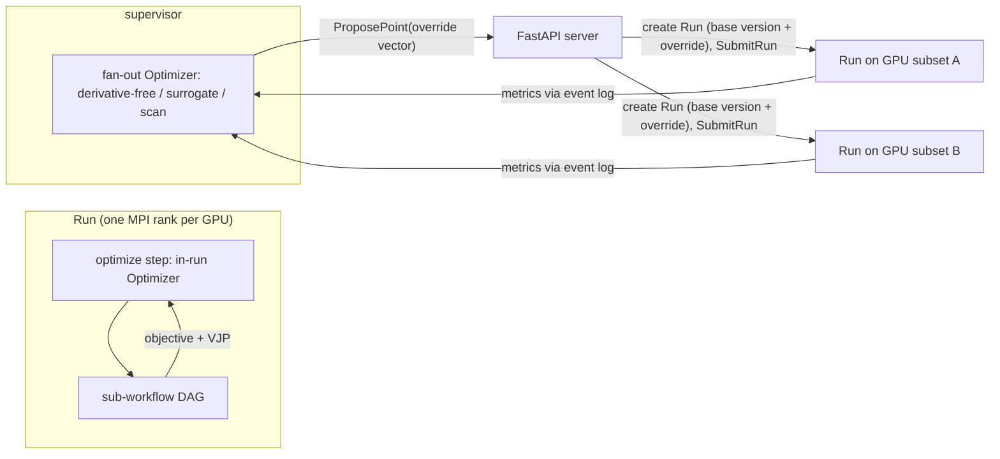

| Aspect | In-run gradient driver | Supervisor fan-out driver |
|---|---|---|
| Driver kinds | Gradient Optimizers (D67, D124) | Derivative-free, surrogate, parameter-scan Optimizers (D67, D124) |
| Workflow form | The Study compiles a pinned Workflow version rooted at an `optimize` step wrapping the base workflow (D49, D123) | One Run per evaluation point: base Workflow version + parameter-override vector, grouped in a Study (D51, D109) |
| Run creation | FastAPI, at Study start | FastAPI, on each `ProposePoint` from the supervisor (D109) |
| GPU use | The Run's own GPU subset; data stays on GPU between iterations (D22) | Disjoint GPU subsets per concurrent Run, up to the per-study concurrency limit, interleaved with other Runs in FIFO order (D40, D142) |
| Checkpoint | Optimizer state included in the Run's checkpoint epoch (D41, D120) | Each Run checkpoints itself (D41). Driver state is persisted through the supervisor event log after every proposal and result, and restored after a supervisor restart (D106, D109) |
| History | Iterates keyed by (run, attempt, iteration), reported through the event log (D123) | One history row per point Run (D109) |
| Persisted outputs | Final iterate's outputs only (D123) | Every point Run's outputs, as ordinary Runs |
| Cache | The `optimize` step is cached like any step | Points with identical cache keys reuse results (D26, D78, D109) |

Host math is allowed for Optimizers because the work is sized by the design space, not by mesh, grid, particle or mode count (Section 2.1; D82). All functional and adjoint evaluation stays on the GPU (D7, D82). Fan-out Optimizer plugins are loaded by the supervisor with the same loader, ABI check and smoke V&V as other plugins (D124, D140).

### 12.5 Iterates and the optimization history

Optimizer iterates are ephemeral (D80). The optimization-history table in the project SQLite database stores each iterate's base Workflow version, parameter vector and metrics, keyed by (run, attempt, iteration) (D80, D23, D109, D123). Rows arrive as acknowledged events and are inserted idempotently; after a resume, rows past the restored iteration are superseded by the new attempt's rows (D106, D123). An `optimize` step persists only its final iterate's outputs (D123). Per-iteration outputs of `coupled` steps are versioned within the Run (D49). Each Study has its own retention policy for its derived artifacts (D79).

### 12.6 Promoting an iterate

The user can promote any iterate (D80, D110). Promotion applies the iterate's parameter vector to its base Workflow version and mints the versions it changes: new component and Geometry versions for geometry variables, a new Scenario version for scenario variables, and a new Workflow version for config variables (D110). It records the source Study and iterate in provenance. Promotion is one of the three minting paths of D110. Workflows that pin the old versions show a staleness badge (D101).

### 12.7 Study authoring

The browser UI has a study editor (D103). It selects the base Workflow version, variables and bounds, objectives, constraints and the Optimizer (D103, D109, D124). Starting a gradient Study compiles the `optimize` workflow (D123). A live convergence dashboard shows objective and constraint history during the Study (D103, D44). The same operations exist in the Python SDK (D103, D38). Section 13.7 describes the UI.

## 13. Web application

The web application has two parts: a Python FastAPI server and a React + TypeScript browser UI (D21, D28). `nebula serve` starts the FastAPI server, the supervisor and the geometry worker; FastAPI serves the UI bundle (D90, D147). For compute, FastAPI talks over gRPC only to the supervisor (runs, queue, view jobs; D57); for draft builds and STEP export it calls the geometry worker (`nebula_geom`; D85). It is the sole SQLite writer (D57) and stays pure Python (D85). The system is single-user with no identity in data or API (D11, D16).

### 13.1 FastAPI server responsibilities

| Responsibility | Mechanism | Decision |
|---|---|---|
| REST and WebSocket API for UI and SDK | FastAPI | D21, D38 |
| Message types | Python classes generated by Buf from `proto/` | D25 |
| Plugin config and output types | Plugin FileDescriptorSets loaded into one pool per plugin version, layered over the core pool | D54, D133 |
| Extension discovery | Reads the core manifest and sidecar `plugin.toml` + descriptors without dlopen; one registry, no shadowing of first-party IDs | D60, D111 |
| Metadata persistence | Sole writer of project SQLite and the global registry | D57, D23, D100 |
| Draft editing, version minting | Drafts mutable with revision counters; hashed immutable versions minted by the D110 paths in one transaction | D56, D26, D110, D148 |
| Validation before submit | Typed ports, sub-contracts, capability traits (concept and geometry), circuits, GPU count, expressions | D50, D55, D64, D113, D114, D142, D156 |
| Run and view job control | gRPC to supervisor; applies and acknowledges supervisor events; creates Study point Runs | D57, D63, D106, D109 |
| Cache index and output registration | Records committed outputs and cache entries in one transaction; hard-links cache hits into the project | D117, D152 |
| Geometry edits and tessellations | gRPC to geometry worker | D85 |
| Plugin schema migrations | Declarative migrations from plugin manifests on major-version bump | D95, D133 |
| SQLite schema migrations | Forward-only | D62 |
| Security | 127.0.0.1 bind, Host/Origin allowlist, per-launch token; untrusted-import checks | D90, D137, D139 |
| Project export and import | SQLite online-backup snapshot of committed state; import validation | D100, D139, D148 |

Arrays never travel inline in API messages. Messages carry HDF5 dataset references (D25). Bulk results reach the browser as compact vtk.js or glTF payloads from GPU post-processing (D39).

### 13.2 API surface

Every request carries the per-launch token shared by UI and SDK (D90). REST requests send it in a header; WebSocket handshakes send it as a subprotocol value. Cookies and query-string tokens are not accepted (D137). REST and WebSocket channels serve both clients identically (D38). Draft updates are conditional on the draft revision and return 409 on conflict (D148).

Implementation detail (not a decision): the paths below are illustrative names; the resource set follows the entity model (D51) and the decisions cited.

**REST resources**

| Resource | Path (illustrative) | Operations | Decision |
|---|---|---|---|
| Project | `/projects`, `/projects/{p}` | List (global registry), create from a concept (records the concept reference), open, export snapshot + build manifest, import with validation | D100, D51, D113, D139, D148 |
| Project template | `/templates` | Create project from concept starter or saved template; save project as template | D86 |
| Geometry draft / version | `/projects/{p}/geometries/{g}` | Edit draft assembly and circuits, list versions | D56, D88, D114 |
| Component | `/projects/{p}/components`, `/library/components` | CRUD in project; import from user-global library by copy with provenance link | D88, D27 |
| Material | `/projects/{p}/materials`, `/library/materials` | Same as components | D88 |
| Tessellation | `/projects/{p}/geometries/{g}/tessellation` | Fetch browser mesh from geometry worker | D85 |
| STEP export | `/projects/{p}/geometries/{g}/step` | Export solids | D27 |
| Region | `/projects/{p}/regions` | Edit drafts, list versions of typed Regions | D89, D160 |
| Scenario | `/projects/{p}/scenarios` | Edit drafts, list versions including solved scenarios | D66 |
| Conductor network | `/projects/{p}/conductor-networks` | Edit drafts, list versions | D128 |
| Input dataset | `/projects/{p}/inputs` | Upload a schema-conforming HDF5 dataset; validated, hashed, versioned | D144 |
| Workflow | `/projects/{p}/workflows/{w}` | Edit DAG draft, validate, instantiate from template | D50, D49 |
| Run | `/projects/{p}/runs` | Submit (mints versions), get provenance and attempts, re-run, cancel, pause, resume (transient failures with a checkpoint), discard | D56, D26, D101, D102, D130, D141 |
| Run outputs | `/projects/{p}/runs/{r}/outputs` | List committed outputs with HDF5 references and output kinds | D25, D87, D108 |
| Dataset | `/projects/{p}/datasets/{ref}` | Stream a committed dataset or slice by reference (for clients without local project access) | D137 |
| Comparison | `/projects/{p}/comparisons` | Create comparison of Runs on a shared Region | D104 |
| Study | `/projects/{p}/studies` | Create, start, stop, history, promote iterate | D103, D80, D110 |
| Queue | `/queue` | List, reorder, cancel | D102 |
| Plugins | `/plugins` | List core and plugin manifests, descriptor sets, UI hints, view descriptors, smoke status | D60, D87, D61, D111 |
| Version | `/version` | API version and build identity; the SDK and UI check it at connect | D137 |
| Retention | `/projects/{p}/storage` | Size cap, evict derived artifacts, delete primary result with dependency check | D79, D141 |
| Settings | `/settings` | Read single TOML config; per-project strict cache switch | D90, D78 |

**WebSocket channels**

| Channel | Path (illustrative) | Payload | Decision |
|---|---|---|---|
| Run progress | `/ws/runs/{r}` | Step state, convergence residuals, typed failure reasons, structured log lines | D44, D119 |
| Entity changes | `/ws/projects/{p}/entities` | Draft and version changes made by any client, with revisions | D148 |
| Queue | `/ws/queue` | Queue order, GPU subset assignment, run state changes | D102, D40 |
| Study | `/ws/studies/{s}` | Iterate parameters and metrics for the convergence dashboard | D103, D80 |
| Telemetry | `/ws/telemetry` | GPU telemetry from amd-smi/NVML mapped to Runs | D44, D57 |
| Views | `/ws/views` | View requests (output reference, PostOp, view parameters) and asynchronous replies with the payload | D39, D63, D143 |

### 13.3 React app structure

The browser UI uses React + TypeScript (D28). TypeScript types come from the same `.proto` sources through Buf (D25). The app lives in `web/` and builds with pnpm (D91).

| Area | Content | Rendering | Decision |
|---|---|---|---|
| Project browser | Project list, create from template, import/export | React | D100, D86 |
| Geometry editor | Assembly tree, component parameter forms, 3D editing | three.js via react-three-fiber | D28, D27, D88 |
| Libraries | Project and user-global component/material libraries | React | D88 |
| Regions, scenarios, circuits | Region editors with 3D placement; circuit editor; scenario waveform editors keyed by circuit; conductor-network editor | react-three-fiber, Plotly | D89, D66, D114, D128 |
| Workflow editor | Typed-port node graph and config forms | React | D50, D87 |
| Runs and queue | Queue, run status, live logs and convergence | Plotly | D102, D44 |
| Results | Viewer catalogue for run outputs | vtk.js, Plotly | D87, D39 |
| Comparison | Scalar tables, overlays, difference fields, linked 3D | vtk.js, Plotly | D104 |
| Studies | Study editor and convergence dashboard | Plotly | D103 |
| Plugins | Installed plugins, ABI fingerprint and smoke status | React | D45, D61 |

Staleness badges appear wherever a pinned reference has a newer version. One click re-runs the Workflow, skipping unchanged steps through the cache (D101). A reference in the `latest` state follows new versions automatically (D101, D107). Runs re-executed on a newer build carry a "rebuilt" tag (D62); Runs resumed across builds carry "mixed builds" (D130). Imported Runs with a mismatched build show as "viewable, not reproducible here" (D100, D149). Edits from other clients arrive on the entity-change channel (D148).

### 13.4 Node graph editor

Workflows are authored in a typed-port node graph editor (D50). Ports are typed by sub-contract, for example `Equilibrium.Axisym2D` or `Equilibrium.Nested3D` (D55). Connecting mismatched sub-contracts requires an explicit adapter node (D55). The validator matches solver-required capability traits against the project's concept traits and the geometry's symmetry metadata (D64, D113).

| Node kind | Purpose | Decision |
|---|---|---|
| Solver step | One solver for one sub-contract | D58, D55 |
| Adapter | Contract adapter between sub-contracts | D55, D58 |
| `coupled` composite | Fixed-point iteration with convergence criteria | D49 |
| `optimize` composite | Wraps a sub-workflow with a gradient Optimizer; generated by a gradient Study, not placed by hand | D49, D67, D123 |
| Fan-out | Maps a step over selected time slices of a time-series edge | D92 |
| PostOp | GPU post-processing operator | D58, D87 |
| Objective | GPU functional or expression | D81 |
| Stored output | Feeds a pinned output of an earlier Run (by run ID, output name and content hash) into a typed port, so a single step can run without its upstream chain | D22, D50, D26 |
| Input dataset | Feeds an ingested, schema-conforming user HDF5 dataset into a typed port | D144 |

Each workflow input port bound to a Geometry, Region, Scenario or ConductorNetwork shows a reference picker with the three states of Section 4.2: a pinned version (default once a version exists), `latest`, or the current draft (default for entities never versioned) (D101, D107). Several workflows in one project may pick the same or different geometries (D51).

Time-series edges show their declared time base (D92). Templates provide standard chains, and concept kits supply a default workflow DAG (D50, D86). A single calculation is a one-node graph run from stored outputs or input datasets (D50, D22, D144). This serves both the full design-to-simulation chain and each separate step.

Implementation detail (not a decision): the editor renders the distributed-array descriptor (D74) only in a run's diagnostics view, not on edges, since redistribution is inserted by the engine.

### 13.5 Forms from proto

Configuration forms are generated from each extension's config `.proto`, found through the core manifest or the plugin sidecar (D87, D50, D111). UI-hint field options in the `.proto` control widgets, grouping and defaults (D87). Unit tags from the schema drive unit labels (D46). Fields annotated as design variables expose bounds and scale for the study editor (D81). First-party modules use the same mechanism because their types also live in `proto/` and their traits, hints and starters are declared in the core manifest (D25, D59, D111).

The run submission form sets the number of GPUs. The default comes from the manifest hint and is editable, up to the installed GPU count and the solvers' supported rank counts (D102, D116, D142). The form also selects deterministic or fast nondeterministic mode; deterministic is the default (D77).

### 13.6 Viewer catalogue

A fixed core viewer catalogue renders outputs. The viewer is chosen by output kind (D87). Region type sets output layout and the available viewers (D89).

| Viewer | Typical output | Library | Decision |
|---|---|---|---|
| 1D profile | Transport profiles, safety factor, field along a line | Plotly | D87 |
| 2D contour | Flux surfaces, field on a plane | vtk.js | D87 |
| 3D field | Field on box/cylindrical/toroidal grid, isosurfaces, field lines | vtk.js | D87, D39 |
| Spectrum | Eigenvalue spectra, Fourier spectra | Plotly | D87 |
| Poincaré | Field-line puncture plots | vtk.js | D87, D39 |
| Mode structure | Stability eigenfunctions | vtk.js | D87 |
| Time trace | Scalars or profiles versus time from time-series outputs | Plotly | D146 |

Every catalogue viewer shows a time slider when its output is time-series typed (D146). Plugins may add optional view descriptors that configure catalogue viewers for their outputs (D87). Plugins may add GPU PostOps but not new viewer components (D87).

Large results are never shipped raw. The UI requests a view; a GPU PostOp in a view job produces a compact vtk.js or glTF payload (D39, D143). Payloads are cached under the key of Section 4.6 and served with a fixed Content-Type, `X-Content-Type-Options: nosniff` and a restrictive Content-Security-Policy; glTF payloads may not reference external URIs (D117). Views of live and finished Runs alike read committed outputs (D122). Section 14.4 covers scheduling of view jobs.

### 13.7 Comparison and study UI

Cross-run comparison works within a project (D51). It offers four views (D104):

- scalar tables across Runs,
- overlaid 1D profiles,
- GPU resample-and-difference of fields on a shared Region,
- linked 3D views with synchronized cameras.

Differences are flagged against the declared per-quantity tolerances (D104, D43). The difference field is a GPU job, like any other view (D39, D7).

The study editor selects variables with bounds, objectives, constraints and the optimizer (D103). The convergence dashboard streams iterate metrics over the Study WebSocket channel (D103, D80). Each iterate row has a "promote" action that mints the Geometry, Scenario or Workflow versions the iterate changes (D80, D110).

### 13.8 Python SDK

The `nebula` Python SDK in `sdk/` is a client over the same REST and WebSocket API as the browser UI (D38, D91). It goes through the same validation, provenance and queue (D38). It authenticates with the same per-launch token: locally from the token file, remotely from an environment variable or argument that the user copies from `nebula serve` (D90, D137). It checks `/version` at connect (D137). Studies can be defined and run from the SDK with the same capabilities as the study editor (D103). For remote machines, the user forwards the `nebula serve` port over SSH (D90).

The SDK reads committed outputs directly from the project directory when it is local, and otherwise through the dataset streaming endpoint (D137).

Implementation detail (not a decision): the SDK uses the Buf-generated Python message classes (D25).

## 14. Scheduling and compute adapters

The supervisor is a long-lived C++ daemon in `supervisor/`. It is the compute adapter for v1 (D57, D4). It owns the run queue and Run state through its durable event log, prepares geometry, assigns GPU subsets, launches each Run with `mpirun`, launches view jobs, maps telemetry, attributes crashes and resumes from checkpoints (D57, D106, D119, D121). It relays in-run geometry requests to the geometry worker, whose lifecycle belongs to `nebula serve` (D105, D147). v1 runs on a single node with multiple GPUs (D5, D116); multi-node arrives through later adapters in milestone M5 (D99, D118).

### 14.1 Run queue

The queue is FIFO (D102). Its source of truth is the supervisor's durable event log; FastAPI applies each event to SQLite and to the registry mirror and acknowledges it in the same transaction. Unacknowledged events are replayed after either side restarts, and at startup the two reconcile by sequence number (D106). The queue is shared across projects (D100).

| Operation | Behavior | Decision |
|---|---|---|
| Submit | Run requests N GPUs; default from the manifest hint, editable; N above the installed GPU count is rejected; `SubmitRun` is idempotent by run ID | D102, D106, D142 |
| Prepare | Supervisor asks the geometry worker for meshes, partitions and discretized geometry before the GPU wait | D121 |
| Wait | Run waits until N free GPUs of one model are available. GPUs freed while the head-of-queue Run is blocked are reserved for it; there is no backfill | D102, D142, D149 |
| Study points | Each Study runs at most a configured number of point Runs at once (default: the GPU count); its points take FIFO places like other Runs | D142 |
| Reorder | User changes queue order | D102 |
| Cancel | Removes a queued or preparing Run, discards a paused Run, or stops a running one (cancel token, then SIGTERM, then SIGKILL after timeouts) | D102, D68, D119 |
| Pause | Checkpoint, then release GPUs | D102, D41 |
| Resume | Requeue; restore from the last committed checkpoint epoch; allowed for Paused Runs and for Failed Runs with a transient reason and a checkpoint | D41, D57, D141 |
| Discard | A Failed Run is closed without resuming; its checkpoints become evictable | D141 |
| Cache hit | Steps whose cache key matches reuse stored results | D26, D78, D101 |

```mermaid
stateDiagram-v2
    [*] --> Queued: submit
    [*] --> Completed: every step cached
    Queued --> Preparing: dequeued for preparation
    Queued --> Cancelled: cancel
    Preparing --> Queued: prepared, waiting for GPUs
    Preparing --> Failed: geometry_failed
    Preparing --> Cancelled: cancel
    Queued --> Running: N GPUs free and prepared
    Running --> Paused: pause (checkpoint, release GPUs)
    Paused --> Queued: resume
    Paused --> Cancelled: cancel
    Running --> Completed: RunCompleted
    Running --> Failed: typed failure, crashed or supervisor_lost
    Running --> Cancelled: cancel
    Failed --> Queued: resume (transient reason, checkpoint exists)
    Failed --> Discarded: discard
    Completed --> [*]
    Cancelled --> [*]
    Discarded --> [*]
```

Failed Runs carry a typed failure reason from Section 6.8 (D44, D119, D121). The supervisor attributes rank failures to the Run, rank and step (D57). Before launching a Run, the supervisor persists the running set entry (run ID, process group, GPU subset, attempt); after a supervisor restart, any Run still in the running set has its process group killed and is marked Failed with `supervisor_lost`, and its GPUs are reassigned only after its processes are gone (D119).

### 14.2 GPU subsets

Each Run gets a disjoint GPU subset. Concurrent Runs never share a GPU (D40). Subsets are homogeneous: all GPUs of a Run have the same model (D149). The supervisor identifies GPUs by UUID or PCI bus ID, sets `ROCR_VISIBLE_DEVICES` (AMD) or `CUDA_VISIBLE_DEVICES` (NVIDIA) per Run, and gives each Run a disjoint, GPU-affine CPU set (D40, D149). It launches all ranks of a Run with one `mpirun`, one rank per GPU, even on a single node (D53). The launch environment pins MPI, PMIx and RCCL/NCCL bootstrap to loopback or shared memory (D138). RCCL or NCCL carries `comm::` data; Ginkgo distributed and parallel HDF5 use GPU-aware MPI (D53, D151). The engine inserts redistribution where producer and consumer partitions differ (D74).

```mermaid
flowchart TB
    SUP["supervisor"]
    SUP -->|"mpirun, visible devices = GPU 0,1, CPU set A"| RA["Run A: rank 0 (GPU 0), rank 1 (GPU 1)"]
    SUP -->|"mpirun, visible devices = GPU 2, CPU set B"| RB["Run B: rank 0 (GPU 2)"]
    SUP -->|"view job"| VJ["view job (GPU 3)"]
    SUP -->|"gRPC relay"| GW["geometry worker (host, OCCT)"]
```

Supervisor-side fan-out Optimizers propose points; FastAPI creates a Run per point, and those Runs go through this same queue (D67, D109, D142).

### 14.3 Telemetry and progress

The supervisor maps GPU telemetry from amd-smi or NVML to the Run that owns each GPU, matching devices by UUID or PCI bus ID rather than by index (D44, D57, D149). Run ranks send progress, convergence and heartbeats over gRPC to the supervisor, which forwards progress to FastAPI and the browser UI and uses missing heartbeats to detect hangs (D44, D119). Logs are structured JSON (D44).

### 14.4 Priority view jobs

Every view request, for a live or a finished Run, reads committed outputs and runs as a high-priority view job (D63, D122, D143). A view job is a single-rank process that runs a GPU PostOp against committed HDF5 outputs and caches the payload (D39). On a multi-GPU machine it takes a free GPU that is not reserved for a blocked head-of-queue Run; when every GPU is busy or reserved, it waits (D142, D143). On single-GPU machines a view job may share the GPU with a running Run, within the headroom of Section 8.5 (D63, D122). This is the only exception to D40's no-sharing rule.

### 14.5 Compute adapter interface

The compute backend sits behind an adapter interface (D4). The v1 supervisor implements it for one node (D5, D57). Later adapters target multi-node execution in M5 (D99). For compute, FastAPI talks only to the supervisor's gRPC endpoint (D57), so adapters change without changes to the server or UI. The geometry worker is not part of the compute adapter: `nebula serve` starts and supervises it, and any adapter reaches it as a client for preparation and in-run geometry requests (D85, D105, D147).

| Adapter duty | v1 single-node supervisor | Later multi-node adapter (M5) |
|---|---|---|
| Queue and Run state | Durable event log acknowledged by FastAPI (D102, D106) | Same contract (D4, D106) |
| Preparing | Geometry-worker requests before the GPU wait (D121) | Same contract (D121) |
| Resource allocation | Disjoint homogeneous local GPU subsets (D40, D149) | GPUs across nodes (D99) |
| Launch | `mpirun`, one rank per GPU, loopback bootstrap (D53, D138) | MPI launch across nodes; same rank-per-GPU model; launch traffic on a trusted network (D53, D138) |
| Data placement | Local project directory (D23) | Shared parallel filesystem holding project directories and the cache (D118) |
| Rank-to-supervisor transport | Local gRPC with per-run credentials (D136) | Remote gRPC with authentication (D118) |
| GPU data transport | RCCL/NCCL via `comm::` (D53) | Unchanged (D53) |
| Result I/O | Per-step write-once files, parallel HDF5 within a file (D108, D151) | Same, on the shared filesystem (D118) |
| Distributed solvers | Ginkgo distributed over MPI (D53, D151) | Unchanged (D53) |
| Checkpoint/resume | Engine checkpoint epochs (D41, D120) | Same API (D41, D120) |
| Failure handling | Heartbeats, watchdog, escalation, running-set recovery (D119) | Same contract across nodes (D119) |
| Telemetry | amd-smi/NVML (D44) | Per-node collection mapped to Runs (D44) |
| Crash attribution | Per rank and step (D57) | Same (D57) |
| Fan-out Optimizers | Loaded in the supervisor (D124) | Same contract (D124) |

The adapter interface is a gRPC service defined in `proto/` with operations for submit, cancel, pause, resume, reorder, discard, event stream with acknowledgement, status stream, view job, telemetry stream, and the supervisor-to-FastAPI `ProposePoint` callback for fan-out drivers (D106, D109). The v1 supervisor is its only implementation.

Because v1 already uses one rank per GPU under MPI (D53), the engine's parallel model does not change when multi-node adapters arrive. Resource allocation, launch, data placement and remote transport extend as listed above (D118).

## 15. Reproducibility, V&V and observability

This section covers three guarantees. A run can be repeated and compared (D43, D62, D77, D78). Every physics module is verified before use (D42, D61). Every process reports what it is doing and why it failed (D44). Sections 15.1 and 15.2 are the normative home of the determinism rules; other sections refer to them.

### 15.1 Determinism modes

Deterministic mode is on by default (D77). The run ranks enforce it in the three platform layers (D77, D129):

| Layer | Deterministic-mode obligation |
|---|---|
| `gpu::` | Kernels and reductions produce bit-identical results for identical inputs; module kernels must not use floating-point atomics (D129) |
| `la::` | Vendor BLAS/solver/sparse/FFT calls and Ginkgo solves use reproducible algorithm paths; calls without one are refused (Section 8.3; D129) |
| `comm::` and MPI | RCCL/NCCL collectives and Ginkgo's MPI reductions produce bit-identical results for a fixed rank count, rank-to-GPU mapping and interconnect topology (D43, D151) |

Plugins inherit these rules only for work they route through `gpu::`, `la::` and `comm::`; a plugin's own kernels must obey the floating-point atomics ban, which the cross-vendor and determinism V&V cases check (D129). Each attempt records its achieved determinism class: deterministic only if every step ran on deterministic paths (D129).

Implementation detail (not a decision): `gpu::` meets this with fixed reduction trees; `la::` selects the reproducible algorithm variant of each vendor call.

A run may select fast nondeterministic mode instead (D77). The mode is recorded in provenance and is part of the cache key (D77, D78). In deterministic mode, `restore()` after `checkpoint()` continues bit-identically (D41, D77, D120).

### 15.2 Reproducibility guarantees

Nebula states these levels of reproducibility (D43):

| Condition | Guarantee (D43) |
|---|---|
| Deterministic mode, same vendor, engine build, GPU model, GPU count, interconnect topology and rank-to-GPU mapping | Bitwise-identical results |
| Deterministic or fast mode, any change of vendor, GPU model, GPU count, engine build or topology | Each output quantity agrees within its declared tolerance |
| Fast nondeterministic mode, same everything | Each output quantity agrees within its declared tolerance; no bitwise guarantee |

The bitwise condition also assumes identical runtime library versions (ROCm/CUDA, vendor libraries, RCCL/NCCL, MPI, driver), which provenance records per attempt but which are not part of the engine build identifier (D126).

Implementation detail (not a decision): each output quantity declares its tolerance as a field option in its `.proto` contract (D25, D54).

Every Run pins the items listed in Section 4.3 (D26, D62, D78). Reproducibility is judged per Run from its attempts: an attempt on a different GPU model or engine build downgrades the Run to the tolerance level, and a Run resumed across builds is tagged "mixed builds" (D130, D149).

Re-running an old Run on a newer build tags the new Run "rebuilt". Nebula compares it with the original under the D43 tolerances (D62). Old results stay readable, and SQLite migrations are forward-only (D62).

Cache hits from different hardware are reused under the D43 tolerance guarantee without recomputation; a per-project strict switch disables them (D78, D125). An imported Run whose build does not match the local build is "viewable, not reproducible here" (D100, D149). Cross-run comparison flags differences that exceed D43 tolerances (D104).

### 15.3 V&V suite and `nebula vv`

The V&V suite lives in `vv/` (D91). A quick smoke subset gates plugin loads (D61, D140); the full suite runs on demand through `nebula vv` and, with the platform tests of Section 15.5, gates release (D42, D61, D157). It runs locally, because Nebula has no CI (D48). It contains only native solvers checked against non-code references, because Nebula uses no third-party fusion codes, not even for V&V (D10).

| Case class | What it checks | Decision |
|---|---|---|
| Analytic | Closed-form solutions (for example, the field of a circular loop) | D42 |
| Manufactured solutions | Observed convergence order matches the discretization order | D42 |
| Digitized published benchmarks | Agreement with figures and tables from the literature | D42, D10 |
| Cross-tier | Reduced and high-fidelity solvers of one sub-contract agree where both apply | D42, D1, D55 |
| Cross-vendor | AMD and NVIDIA results agree within declared tolerances | D42, D43, D75 |
| Adjoint-vs-FD | Each hand-written adjoint/tangent operator matches finite differences | D42, D18 |
| Sign-flip | Results transform correctly under convention and symmetry flips | D94 |

Two entry points run the suite:

| Trigger | Scope | Decision |
|---|---|---|
| Plugin load in a run rank, view job or the supervisor | Quick smoke subset declared for that plugin, in deterministic mode, skipped when a cached pass exists for the same `.so` hash, engine build, GPU model and mode | D61, D140 |
| `nebula vv` command | Full suite, on demand; required before a release | D61, D42 |

Nebula ships no separate plugin conformance kit (D96). Plugin obligations such as `checkpoint()`/`restore()`, determinism and adjoint correctness are checked only by the V&V cases that exercise them; V&V cases exist for first-party code only (D161, Section 19.1).

Implementation detail (not a decision): a release is a git tag created after `nebula vv` and the platform tests pass on the developer's machine. Nebula has no packaging (D47).

```mermaid
flowchart LR
  A["Plugin .so + plugin.toml"] --> P["Installed-directory and permission check (D139)"]
  P -->|fail| R["Reject load (plugin_error)"]
  P -->|pass| DP["Dependency order and exact ABI versions (D84, D131)"]
  DP -->|fail| R
  DP -->|pass| H["Hash from fd vs pin (D140)"]
  H -->|mismatch| R
  H -->|match| B["Embedded manifest (ELF note): ABI fingerprint (D45) and sidecar cross-check (D60)"]
  B -->|mismatch| R
  B -->|match| DL["dlopen via fd, register, build RunContext"]
  DL --> SC{"Cached smoke pass? (D140)"}
  SC -->|yes| E["Plugin available"]
  SC -->|no| D["Smoke V&V subset, deterministic mode (D61)"]
  D -->|fail| R
  D -->|pass| E
  F["nebula vv (D61)"] --> G["Full suite in vv/ (D42)"]
  T["Platform tests (D157)"] --> G2["All pass"]
  G --> H2["Release tag"]
  G2 --> H2
```

### 15.4 Observability

The FastAPI server, supervisor, geometry worker, view jobs and run ranks emit structured JSON logs (D44).

Live progress and convergence data flow from the run ranks to the browser UI (D44):

```mermaid
sequenceDiagram
  participant RR as run ranks
  participant SV as supervisor
  participant FA as FastAPI server
  participant UI as browser UI
  RR->>SV: progress sink events and heartbeats via gRPC (D68, D44, D119)
  SV->>FA: progress, telemetry, and state changes as acknowledged events (D57, D106)
  FA->>UI: WebSocket push (D21)
  UI->>FA: cancel / pause request
  FA->>SV: cancel / pause (D102)
  SV->>RR: cancel token set (D68)
  SV->>RR: SIGTERM, then SIGKILL if not honoured in time (D119)
```

Plugins report through the progress sink and cancel token in `RunContext` (D68). They never open their own channels.

Failures carry a typed reason (D44). Failure reasons are listed in Section 6.8 (D119, D121).

The supervisor attributes a failed run rank to its Run and step. It can resume the Run from its last committed checkpoint epoch when the reason is transient (D57, D41, D141).

The supervisor reads GPU telemetry through amd-smi (AMD) and NVML (NVIDIA). It maps each device, by UUID or PCI bus ID, to the Run that owns it (D44, D57, D40, D149).

JSON logs for a Run are written into that Run's directory inside the project directory (D100). Logs for the supervisor, FastAPI server, geometry worker and view jobs go to a per-installation log directory named in the TOML config (D90). Installation logs are rotated by size and age; per-run logs are kept with the Run (D158).

### 15.5 Platform tests

Non-physics code is tested by platform tests that run locally through the task runner (D157):

| Test kind | Scope |
|---|---|
| Unit tests per language | C++ (core, supervisor, geometry worker), Python (FastAPI server, SDK), TypeScript (browser UI) |
| Integration tests | FastAPI server and supervisor with a stub launcher in place of `mpirun`: submission, event log and acknowledgement, queue and state machine, crash and restart reconciliation |
| Migration tests | Forward-only SQLite migrations and declarative plugin migrations on fixture databases |
| Hash-stability tests | Shared Python/C++ canonical-encoding test vectors, version hashes and cache keys (D152) |
| Codegen tests | Buf generation and descriptor-pool layering |

A release requires both `nebula vv` and the platform tests to pass (D157).

## 16. Security

Nebula is a single-user workstation application with no authentication beyond local access (D11). It holds no identity in data or API (D16). Security therefore means three things: keep every endpoint unreachable from other hosts, other web origins and other local OS users; treat imported projects as untrusted data; and state what loading a plugin trusts. The threat model includes other local users on the same machine: they can reach loopback sockets but cannot read files under the user's 0700 directories (D136, D139).

### 16.1 Network exposure

`nebula serve` starts the FastAPI server, which also serves the UI bundle, the supervisor and the geometry worker (D90, D147). `~/.nebula` and project directories are created with mode 0700, and Nebula processes run with umask 077 (D139).

| Control | Mechanism | Decision |
|---|---|---|
| Bind address | FastAPI server binds `127.0.0.1` only | D90 |
| Request authentication | Per-launch random token, required on every REST and WebSocket request; shared by the browser UI and the `nebula` Python SDK | D90, D38 |
| Token bootstrap | The browser receives the token in the URL fragment that `nebula serve` prints, keeps it in memory and sends it as a header or WebSocket subprotocol; the local SDK reads it from a file readable only by the user; a remote SDK takes it from an environment variable or argument. Cookies and query-string tokens are rejected | D137 |
| Cross-origin and DNS-rebinding defense | Host must be `127.0.0.1:<port>` or `localhost:<port>` for the configured port or a configured forwarded port; Origin must be absent (SDK) or the same origin; anything else is rejected with 403 | D90, D137 |
| Remote access | SSH port forwarding; Nebula exposes no remote listener | D90 |
| Internal endpoints | Supervisor and geometry worker gRPC endpoints on loopback require the per-launch secret in gRPC metadata; ranks and view jobs present per-run credentials issued by the supervisor | D136 |
| Launch listeners | MPI, PMIx and RCCL/NCCL bootstrap pinned to loopback or shared memory; PMIx sockets in a 0700 directory | D138 |
| View payloads | Fixed Content-Type, `nosniff`, restrictive Content-Security-Policy; no external URIs in glTF | D117 |
| Configuration | One TOML config file | D90 |

Every listener:

| Listener | Process | Bound to | Authentication |
|---|---|---|---|
| REST and WebSocket API | FastAPI server | `127.0.0.1` TCP | Per-launch token (D90, D137) |
| Supervisor gRPC (FastAPI, ranks, view jobs) | supervisor | loopback TCP | Per-launch secret; per-run credentials (D136) |
| Geometry worker gRPC (FastAPI, supervisor) | geometry worker | loopback TCP | Per-launch secret (D136) |
| MPI/PMIx out-of-band | `mpirun` and ranks | loopback or Unix sockets in a 0700 directory | Directory permissions (D138) |
| RCCL/NCCL bootstrap and proxy | run ranks | loopback | None; loopback only (D138) |

In M5, launch and rank traffic crosses nodes; it must stay on a trusted network, and the adapter adds authenticated remote transport (D118, D138).

```mermaid
flowchart LR
  subgraph Host["Workstation"]
    UI["browser UI"] -->|"HTTP/WS + token, 127.0.0.1"| FA["FastAPI server"]
    SDK["nebula Python SDK"] -->|"HTTP/WS + token, 127.0.0.1"| FA
    FA -->|"gRPC + secret"| SV["supervisor"]
    FA -->|"gRPC + secret"| GW["geometry worker"]
    SV -->|"gRPC + secret"| GW
    RR["run ranks"] -->|"gRPC + run credential"| SV
    VJ["view jobs"] -->|"gRPC + run credential"| SV
    RR <-->|"MPI / RCCL, loopback"| RR
    GW --> GM["Gmsh subprocess"]
  end
  Remote["Remote laptop"] -->|"SSH port forward"| FA
```

Imported projects are untrusted data (D139). On import, Nebula rejects symlinks and paths that resolve outside the project root, validates the SQLite schema before migrating it, opens HDF5 read-only with external links and virtual datasets confined to the project, and drops `derived/views` so payloads are regenerated. Pins read from an imported project resolve only inside the installed plugin directory (D139). Imported results never enter the shared cache (D117).

### 16.2 Plugin trust model

Plugins are native shared libraries loaded with `dlopen` into run ranks, view jobs, the supervisor (fan-out Optimizers) and the geometry worker (D9, D19, D85, D124, D143). They run in-process with the user's full privileges. Nebula does not sandbox them. Installing a plugin means placing it in the installed plugin directory: a user-owned directory that is not group- or world-writable. The loader enforces this, and installing a plugin means trusting its code (D139).

| Check | What it protects | What it does not protect | Decision |
|---|---|---|---|
| Sidecar and core manifest read by the FastAPI server without `dlopen`; plugin migrations are declarative data | Listing, configuring and migrating plugins runs no plugin code | Code that runs later at load | D60, D111, D133 |
| Installed-directory ownership and permissions; sanitized `LD_LIBRARY_PATH` and RUNPATH | Libraries planted by other users or by imported projects | A plugin the user chose to install | D139 |
| `.so` hash from the file descriptor, compared to the pin before `dlopen` | Substitution of a plugin or any plugin it reaches, without time-of-check/time-of-use gap | Malicious code that was pinned | D140, D152 |
| ABI fingerprint and exact ABI versions, read from the embedded manifest before `dlopen` | Crashes from binary incompatibility | Malicious code | D45, D131 |
| Embedded manifest cross-check | A `.so` that does not match its sidecar | Malicious code | D60 |
| Symbol and linking rules | Symbol interposition between plugins, version diamonds, duplicate protobuf registration | Malicious code | D132 |
| Smoke V&V at load | Physically wrong results | Malicious code | D61 |

### 16.3 External executables and licensing

GPL tools run only as separate executables (D12). Gmsh runs as a subprocess of the geometry worker, with STEP and a size field in and `.msh` out (D30). Nebula itself is Apache-2.0 (D12).

## 17. Build and repository

Nebula is built from source for personal use. It has no packages (D47) and no CI (D48).

### 17.1 Repository layout

Nebula is a monorepo; its native code is C++20 (D91):

```text
nebula/
├── CMakePresets.json        # presets: rocm, cuda (D52)
├── spack.yaml               # pinned third-party deps (D52)
├── buf.yaml, buf.gen.yaml   # Protobuf lint, breaking check, codegen (D25, D95)
├── pnpm-workspace.yaml      # web/ dependencies (D91)
├── <task runner file>       # thin wrapper over Buf + pnpm + CMake + platform tests (D91, D157)
├── proto/                   # single-source .proto contracts (D25)
├── core/                    # gpu::, la::, comm::, engine, RunContext, core services,
│                            #   first-party physics modules (D59, D17, D37, D68)
├── geom/                    # nebula_geom over OCCT, geometry worker (D27, D85)
├── supervisor/              # C++ supervisor daemon = compute adapter (D57, D4)
├── server/                  # Python FastAPI server (D21, D90)
├── sdk/                     # nebula Python client SDK (D38)
├── web/                     # React + TypeScript browser UI (D28)
├── vv/                      # V&V suite, run by `nebula vv` (D42, D61)
├── plugin-sdk/              # headers, CMake package, toolchain pin, symbol rules,
│                            #   buf breaking against installed descriptors (D45, D132, D133)
└── examples/plugin/         # example out-of-core plugin (D91, D161)
```

Implementation detail (not a decision): subdirectory names inside `core/` (for example `core/gpu/`, `core/la/`, `core/comm/`, `core/engine/`, `core/services/`, `core/physics/`) mirror the namespaces. The task runner tool is chosen at implementation time.

### 17.2 CMake presets and GPU targets

CMake presets select the vendor (D52):

| Preset | Compiler (D17) | Vendor libraries (D37) | Collectives (D53) |
|---|---|---|---|
| `rocm` | Native ROCm HIP compiler | rocBLAS, rocSOLVER, rocSPARSE, rocFFT | RCCL |
| `cuda` | Native CUDA compiler | cuBLAS, cuSOLVER, cuSPARSE, cuFFT | NCCL |

GPU targets are listed in Section 8.1 (D75).

Kernels are single-source behind the `gpu::` portability header (D13, D17). Vendor-specific overrides exist only where profiling justifies them (D17). All numerics are FP64, real or complex (D76, D150). The engine is assumed Linux-only because of ROCm/RCCL (D75).

ROCm and CUDA, including hipRTC and NVRTC for runtime compilation of objective expressions, come from the system, not from Spack (D52, D156).

### 17.3 Spack environment

`spack.yaml` pins the third-party libraries (D52):

| Package | Used by |
|---|---|
| OCCT | `nebula_geom` in `geom/` (D27) |
| Ginkgo | `la::` Krylov + AMG, distributed solves (D37, D53) |
| HDF5 | Run outputs; parallel HDF5 (D23, D53) |
| gRPC | supervisor, geometry worker, run ranks (D21, D57, D85) |
| Protobuf | Generated C++ types (D25) |
| Gmsh | Gmsh subprocess (D30) |

Implementation detail (not a decision): the MPI implementation used to launch run ranks (D53) is taken from the system alongside ROCm/CUDA unless a later change adds it to `spack.yaml`. It must be GPU-aware and support `MPI_THREAD_SERIALIZED` (D151).

The engine build identifier is the hash of the engine binary plus the hash of the resolved `spack.lock` (D126). System ROCm/CUDA, vendor libraries, RCCL/NCCL, MPI and driver versions are not part of it; each run attempt records them in provenance (D126). Provenance also records the compiler version and whether the source tree was dirty (D126).

### 17.4 Protobuf and Buf

`proto/` is the single source for all cross-process types (D25). Buf generates C++, Python and TypeScript code from it (D25). Arrays never travel inline; messages carry HDF5 dataset references (D25).

Buf's breaking-change check enforces additive-only wire evolution within a major version (D95); `plugin-sdk/` runs the same check for a plugin against its previously installed descriptor set (D133). Any change to a generated C++ type bumps the ABI version (D131). Migration functions exist only for major-version bumps; the FastAPI server runs core migrations and applies plugins' declarative migrations (D95, D133). Plugins ship FileDescriptorSets, which the FastAPI server and browser UI layer over the core descriptors (D54, D60, D133).

### 17.5 Web build

`web/` is built with pnpm (D91). The resulting UI bundle is served by the FastAPI server (D90).

### 17.6 Toolchain pin for plugins

Plugins are built with the same compiler, C++ standard library and ROCm/CUDA version as the core (D19). `plugin-sdk/` pins this toolchain (D45). Every plugin manifest carries an ABI fingerprint: compiler, stdlib, ROCm/CUDA version and Nebula ABI version (D45). The loader rejects mismatches (D45). `plugin-sdk/` CMake applies the symbol and linking rules of Section 7.4 (D132). `examples/plugin/` builds against `plugin-sdk/` exactly as an external plugin would (D91).

### 17.7 Build flow

```mermaid
flowchart TD
  P["proto/*.proto"] -->|"buf generate (D25)"| GC["generated C++"]
  P -->|"buf generate"| GP["generated Python"]
  P -->|"buf generate"| GT["generated TypeScript"]
  S["spack.yaml env (D52)"] --> CM["cmake --preset rocm | cuda (D52)"]
  SYS["system ROCm or CUDA (D52)"] --> CM
  GC --> CM
  CM --> CORE["core/ run ranks"]
  CM --> GEOM["geom/ geometry worker"]
  CM --> SUP["supervisor/"]
  CM --> PSDK["plugin-sdk/ package (D45)"]
  PSDK --> EX["examples/plugin/"]
  GP --> SRV["server/ FastAPI server"]
  GP --> SDK["sdk/ Python SDK"]
  GT --> WEB["web/ via pnpm (D91)"]
  WEB -->|"UI bundle"| SRV
  CM --> MAN["core manifest (D111)"]
  MAN --> SRV
  CORE --> TST["platform tests + nebula vv (D157)"]
  SRV --> TST
```

## 18. Roadmap

Development proceeds in a v1 release and four milestones, M2 to M5 (D93, D97, D98, D99). Each milestone freezes the contracts it introduces (D99). After freezing, those contracts evolve additively only within a major version (D95).

```mermaid
flowchart LR
  V1["v1: geometry, field, reduced plasma + T2 + global linear MHD (D93, D97)"] --> M2["M2: high-fidelity plasma (D99)"]
  M2 --> M3["M3: magnet design, optimizer, adjoint consumers (D99)"]
  M3 --> M4["M4: wall loads, thermal-structural (D99)"]
  M4 --> M5["M5: multi-node adapter (D99)"]
```

### 18.1 v1

v1 runs on a single node with multiple GPUs (D5). Run ranks are still launched with MPI, one rank per GPU (D53). In v1, field evaluation and T1 scale across ranks; other steps run on one rank, and several Runs can share the node on disjoint GPUs (D116).

| Area | v1 content | Decisions |
|---|---|---|
| Geometry | Typed parametric components, assemblies with circuits, OCCT B-rep, STEP export, Gmsh meshing and partitioning, discretized geometry | D27, D30, D88, D93, D112, D114 |
| Magnetic field | Biot-Savart: filament and finite-cross-section sources in closed circuits; direct sum and GPU FMM; near-source quadrature | D31, D65, D93, D145, D150 |
| Equilibrium | T0 vacuum field-line tracing, T1 2D free-boundary Grad-Shafranov (isotropic closed-line and anisotropic open-line forms), T2 3D nested-surface spectral | D33, D97, D134 |
| Stability | Local criteria; global linear ideal and resistive MHD (magnetohydrodynamic) eigenmodes with wall, complex FP64 | D34, D69, D97, D150 |
| Time evolution | 1.5D flux-surface transport with per-time-step equilibrium re-solve; 1D along-field models for open systems | D35, D97, D154 |
| Reference concepts | Tokamak (closed, axisymmetric); simple mirror (open lines); stellarator (closed, 3D) | D98 |

The stellarator reference concept is exercised with T0 vacuum tracing and with T2 equilibrium, both in v1 (D97, D98).

The v1 contracts frozen at release are the representation sub-contracts these modules introduce (D55, D99). Examples are `Equilibrium.Axisym2D`, including its anisotropic fields (D134), and `Equilibrium.Nested3D`.

Platform capabilities are assigned to milestones as follows (D160):

| Platform capability | Milestone | Sections |
|---|---|---|
| Processes, run lifecycle, event log, queue, Preparing, crash handling | v1 | 3, 14 |
| Domain model, drafts and versions, provenance, cache, retention, storage | v1 | 4 |
| Schema, contracts, HDF5 layout | v1 | 5 |
| Engine: DAG, `coupled`, fan-out, checkpoints, failure taxonomy | v1 | 6 |
| Plugin system, core manifest, loader | v1 | 7 |
| GPU platform layer and core services: field operator, flux coordinates, remap, PostOps | v1 | 8, 9 |
| Conductor network and ConductorNetwork entity | v1 | 4.1, 9.4 |
| Geometry worker, meshing, discretized geometry | v1 | 10 |
| Web application, SDK, viewer catalogue | v1 | 13 |
| Cross-run comparison | v1 | 4.5, 13.7 |
| Parameter scans and fan-out of point Runs | v1 | 12.4, 14.1 |
| Studies with optimizers, `optimize` step, Optimizer extensions, promotion | M3 | 6.3, 12 |
| Objective expression language | M3 | 9.6, 12.2 |
| Shape sensitivities, mesh morphing, in-run geometry relay | M3 | 10.4 |
| Multi-node adapter | M5 | 14.5 |
| Platform tests | v1 | 15.5 |

### 18.2 Milestones M2-M5

| Milestone | Content | Contracts frozen at the milestone (D99) | Decisions |
|---|---|---|---|
| M2 | High-fidelity plasma: T3 3D island-capable relaxation; linear gyrokinetic microstability (ITG/TEM/ETG); 3D nonlinear resistive/extended MHD with field-split / block-Jacobi preconditioning | New equilibrium, stability and evolution sub-contracts introduced by these solvers | D33, D34, D35, D99, D155 |
| M3 | Magnet design with engineering constraints, Lorentz forces and critical-current margin; optimizer and study layer; expression language; analytic coil-shape derivatives; adjoint consumers | Magnet, objective, design-variable, Optimizer and optimization contracts | D32, D8, D67, D81, D83, D103, D99, D124, D135 |
| M4 | Wall loads (heat flux, force density); linear thermo-elastic thermal-structural FEM | Wall-load and thermal-structural contracts | D72, D36, D99 |
| M5 | Multi-node compute adapter on a shared parallel filesystem; remote authenticated rank-to-supervisor transport | Compute adapter interface extensions for multi-node | D5, D4, D23, D53, D99, D118 |

Thermal-structural is a first-class calculation type (D3), scheduled for M4 (D99). Hand-written adjoints exist from v1 onward, starting with T2 (D18, D33, D97). Their consumers, gradient optimizers, arrive in M3 (D99).

Later plugins outside the milestone plan: magnetization and nonlinear magnetic materials through the field-source sub-extension point (D31, D145), quench, AC loss and cryogenics (D32), nuclear heating (D72). Later core additions not yet scheduled: 3D eddy-current FEM behind the conductor-network contract (D71), general GPU sparse LU in `la::` (D69), and multi-GPU decomposition of T2 and stability (D116).

## 19. Risks and accepted tensions

### 19.1 Accepted tensions

The user accepted these tensions when making the decisions. They are recorded here and are not reopened.

| Tension | Consequence | Mitigation within the log |
|---|---|---|
| First-party modules are compiled into the core with privileged access (D59), yet every further module must be plug-and-play (D3) | First-party use does not prove the public plugin API | First-party modules are declared in the core manifest through the same schema as plugins (D111). `examples/plugin/` builds against `plugin-sdk/` and loads through the same loader, ABI check and smoke gate as any plugin (D91, D45, D61). Coverage is limited: a single example plugin does not exercise plugin-to-plugin linking, dependency ordering and version rejection, or a sub-extension point published by one plugin and filled by another (D161) |
| Direct plugin-to-plugin linking (D84), plugin-owned types (D54) and the ABI fingerprint (D45) | Upgrading one plugin can force rebuilds of the plugins that depend on it; any change to a producer's generated types, even an additive one, forces them | Consumers depend on producers by exact ABI version, and the loader rejects mismatches instead of risking memory corruption (D131). Symbol and linking rules prevent interposition and version diamonds (D132). Wire schemas are additive-only within a major version (D95) |
| No conformance kit (D96), no CI (D48), smoke-only gate at load (D61) | Checkpoint, determinism and adjoint obligations go unchecked unless a physics V&V case exercises them; out-of-tree plugins have no way to contribute V&V cases | `nebula vv` runs the full suite locally before release (D42, D61). The suite includes adjoint-vs-FD and cross-vendor classes (D42, D18). V&V cases exist for first-party code only (D161) |
| No third-party fusion codes, even for V&V (D10) | No code-to-code benchmarking | V&V uses analytic solutions, manufactured-solution convergence, digitized published benchmarks, cross-tier and cross-vendor agreement (D42), plus sign-flip tests (D94) |
| Requirement says "no host side calculations", but Section 2.1 allows host design-space math, optimizer drivers, OCCT evaluation and control-point sensitivities, Gmsh meshing and partitioning, and I/O, format conversion and hashing | Some calculation runs on the host | Anything sized by mesh, grid, particle or mode count stays on GPU (D82). Host sensitivities are returned at control points and expanded to mesh nodes on the GPU (D153). Shape loops use GPU mesh morphing to avoid remeshing (D83) |
| v1 "multiple GPUs" covers concurrent runs plus field and T1 scaling only (D116) | Single large T2 or stability problems cannot use more than one GPU in v1 | Manifests declare supported rank counts and the validator enforces them (D116). Multi-GPU decomposition of T2 and stability is a later core addition (Section 18.2) |
| v1 ships T2 and global MHD (D97), but adjoints' consumers arrive in M3 (D99) | T2 adjoints ship before anything consumes them, and the T2 contract is frozen in v1 | Adjoint-vs-FD V&V checks the adjoints in v1 (D18, D42). M3 builds on the frozen contract through additive wire evolution; changes to generated types bump ABI versions (D95, D131) |
| Hardware is not in the cache key (D125) | A deterministic Run can reuse a result produced on other hardware, and so cannot be reproduced bit for bit from its own provenance once that entry is evicted | Every cache entry and consuming Run records producer hardware, build and run ID (D125). The per-project strict switch disables cross-hardware hits (D78) |
| No sizing targets in this document (D161) | FMM crossover, pool sizes, payload sizes and edit-loop latency have no stated targets | The FMM crossover is a tunable default (Section 9.1); memory rules bound GPU use without fixed numbers (Section 8.5) |

Implementation detail (not a decision): first-party V&V cases include a deterministic checkpoint/restore round trip (D41, D77).

### 19.2 Other material risks

| Risk | Effect | Mitigation within the log |
|---|---|---|
| Deterministic mode costs throughput (D77), and refusing calls without deterministic paths (D129) may make some algorithms unavailable in it | Slower runs by default; some steps need fast mode | Fast nondeterministic mode is selectable per run and recorded in provenance and cache key (D77, D78); the achieved determinism class is recorded (D129) |
| Cross-vendor V&V needs both AMD and NVIDIA hardware, and there is no CI (D48, D75) | Cross-vendor regressions surface late | The cross-vendor class is part of `nebula vv` (D42). Per-quantity tolerances define pass/fail (D43) |
| System ROCm/CUDA, vendor library, RCCL/NCCL or MPI upgrades (D52) are not part of the engine build identifier (D126) | Bitwise results can change while cache keys stay the same; plugins built for the old ROCm/CUDA stop loading (D45) | Runtime library versions are recorded per attempt (D126); the bitwise guarantee is stated as conditional on them (Section 15.2). The loader rejects ABI mismatches explicitly (D45). Resumes across builds are tagged "mixed builds" (D130); re-runs are tagged "rebuilt" and compared under D43 tolerances (D62) |
| Geometry worker and Gmsh subprocess are host-side (D82, D85, D30) | Shape-optimization loops can be bound by OCCT evaluation and remeshing | Fixed-topology GPU mesh morphing avoids remeshing until a quality threshold (D83). Coil shapes use analytic Biot-Savart derivatives with no remeshing (D135). Meshes are cached under the key of Section 4.6 (D30) |
| GPU FMM (D31), GPU-resident Krylov-Schur (D37) and block cyclic reduction (D69, D159) are native implementations | Large numerical-library effort before v1 physics is usable | Direct-sum Biot-Savart covers small problems (D31). Ginkgo and vendor libraries supply Krylov, AMG and batched dense LU (D37, D69) |
| Digitized published benchmarks carry digitization error (D42, D10) | Loose or ambiguous V&V thresholds | Analytic and manufactured-solution cases give exact references (D42). Cross-tier agreement adds an internal check (D42) |
| Disk usage grows with HDF5 outputs, copied meshes, cache-hit hard links, view payloads, checkpoints and logs (D23, D79, D117, D121) | Projects exhaust local storage | Derived artifacts and shared-cache blobs are evictable under a size cap, retention is per study, checkpoints become evictable when a Run ends, logs rotate, and primary results are deleted only by the user with a dependency check (D79, D117, D141, D158). Optimizer iterates are ephemeral; only the final iterate is persisted (D80, D123) |
| In-process native plugins (D9, D19) | A faulty or malicious plugin can crash a run rank or act with user privileges | The supervisor attributes crashes and resumes transient failures from checkpoint (D57, D41, D119, D141). The trust model is explicit in Section 16.2 |
| Single SQLite writer (D57) | FastAPI server is a serialization point for metadata | Bulk data lives in HDF5, not SQLite (D23); arrays never pass inline (D25); state changes are batched as acknowledged events (D106) |
| Multi-node support is deferred to M5 (D99) | v1 designs could assume a single node | Rank-per-GPU MPI launch (D53), distributed-array descriptors (D74), Ginkgo distributed and parallel HDF5 (D53) are in place from v1. M5 still needs a shared parallel filesystem, remote authenticated transport and trusted-network launch traffic, listed as adapter duties (D118) |
| Loss of the global registry or user library | Project list and library lost | The project list can be rebuilt by rescanning project directories; `nebula backup` and `nebula restore` copy the registry and library consistently (D158) |

## Appendix A. Decision log

Rows marked "Superseded by Dxx" are not part of the design; the superseding row holds the final form. Rows refined by a later decision remain valid as refined. D105-D161 resolve the findings of the 2026-10-29 architecture review; their Notes cite the review finding numbers. The "Described in" column lists the sections that cite each decision.

| # | Area | Final decision | Notes | Described in |
|---|---|---|---|---|
| D1 | Fidelity | Multi-fidelity: reduced and high-fidelity solvers per calculation type, behind representation sub-contracts with explicit adapters (as refined by D55) | Refined by D55 (sub-contracts per representation) | 1.1, 1.2, 2.8, 5.3, 11, 15.3 |
| D2 | Concepts | Confinement concepts are an extension kind, delivered as first-party concept kits or as plugins; custom concept exploration is the main goal; core assumes no tokamak | See D86 for concept kit contents; first-party kits declared in the core manifest (D111) | 1, 1.1, 1.2, 2.7, 7, 7.7, 11 |
| D3 | Scope | Five required calculations plus thermal-structural are first-class; every further module is plug-and-play | Tension with D59 (Section 19.1) | 1, 1.1, 1.2, 7, 11, 11.7, 18.2, 19.1 |
| D4 | Deployment | Compute backend adapter interface | Realized by the supervisor (D57) | 1.1, 3, 3.1, 14, 14.5, 17.1, 18.2 |
| D5 | Compute | v1 runs on a single node with multiple GPUs; multi-node via later adapters | Multi-node in M5 (D99); v1 multi-GPU scope in D116; M5 storage in D118 | 1.2, 1.4, 8.4, 14, 14.5, 18.1, 18.2 |
| D6 | Topology | Any magnetic-confinement topology in core (toroidal, open/linear, compact toroid); solvers declare required capability traits (as refined by D64) | Refined by D64 (capability traits) | 1.1, 1.2, 2.7, 7.1, 11, 11.1 |
| D7 | Host/GPU | All physics/solver numerics on GPU; CAD, meshing, I/O, orchestration may run on host; mesh moved to GPU once | Refined by D82 (size rule) | 1.1, 1.2, 2.1, 3.4, 8, 8.3, 9, 10.3, ... |
| D8 | Optimization | First-class optimizer/scan layer; gradients optional per module (adjoint), else derivative-free/surrogate | Gradient mechanism in D18; placement in D67 | 1.2, 2.9, 6.3, 7.2, 10.4, 11, 11.1, 11.2, ... |
| D9 | Plugins | In-process plugins only; one mandated GPU stack and runtime for all modules | | 1.1, 1.3, 2.2, 7, 8, 16.2, 19.2 |
| D10 | Reuse | Native solvers only; no third-party fusion codes, not even for V&V | Tension recorded in Section 19.1 | 1.3, 2.9, 7.6, 11, 15.3, 19.1, 19.2 |
| D11 | Tenancy | Single-user workstation; no authentication beyond local access | Security in D90 | 1.3, 2.9, 13, 16 |
| D12 | Licence | Apache-2.0; GPL tools only as separate executables | Gmsh subprocess (D30) | 1.3, 2.9, 3.1, 10.3, 16.3 |
| D13 | GPU model | C++ with HIP (AMD) and CUDA (NVIDIA) | Code sharing resolved by D17 | 1.1, 1.2, 2.2, 8.1, 17.2 |
| D14 | Precision | Superseded by D76 | Final form: FP64 only (D76) | — |
| D15 | Parallel model | Superseded by D53 | Final form: one rank per GPU (D53) | — |
| D16 | Multi-user | Pure single-user; no identity in data or API | | 1.3, 2.9, 4, 13, 16 |
| D17 | Code sharing | Single-source kernels behind a `gpu::` portability header; native compilers per vendor; vendor overrides only where profiling justifies | | 1.1, 1.2, 2.2, 8, 8.1, 8.2, 11, 11.1, ... |
| D18 | Gradients | Hand-written discrete adjoint/tangent operators, each checked against finite differences | V&V class adjoint-vs-FD (D42) | 2.9, 6.3, 7.2, 8.3, 9, 9.2, 11, 11.3, ... |
| D19 | Plugin packaging | `dlopen`-loaded shared libraries with a C++ ABI; plugins built with the core's compiler, stdlib, ROCm/CUDA versions | ABI safety in D45 | 1.1, 1.3, 7, 7.3, 7.5, 16.2, 17.6, 19.2 |
| D20 | GPU comms | Superseded by D53 | Final form: `comm::` over RCCL/NCCL, MPI for launch/bootstrap (D53) | — |
| D21 | Web backend | Python FastAPI (REST + WebSocket) talks to separate C++ processes over gRPC; types generated from one schema | C++ side is the supervisor (D57) and geometry worker (D85) | 1.1, 2.6, 3, 3.1, 5, 5.1, 13, 13.1, ... |
| D22 | Execution | One engine session per workflow run; DAG steps hand off on GPU; outputs persisted in background; single step = one-node DAG from stored inputs | Session = run ranks, one per GPU (D53); input-dataset node (D144) | 1.1, 1.2, 2.1, 3.1, 3.5, 4.1, 4.3, 6, ... |
| D23 | Storage | SQLite for metadata; HDF5 run outputs in a local project directory; parallel HDF5 for multi-rank runs (D53) | Project layout in D100; per-step output files in D108 | 4.8, 5.2, 6.6, 12.5, 13.1, 14.5, 17.3, 18.2, ... |
| D24 | Schema | Nebula's own versioned, concept-agnostic schema; no IMAS or other interop | | 1.3, 2.6, 5 |
| D25 | IDL | Protobuf `.proto` single source; Buf codegen for C++/Python/TS; arrays as HDF5 dataset references, never inline | | 2.6, 3.2, 5, 5.2, 13.1, 13.2, 13.3, 13.5, ... |
| D26 | Provenance | Immutable versions keyed by content hash; runs pin geometry, inputs, plugin versions, engine build; results cached by input hash | Cache key in D78; source pin in D62; engine build defined in D126 | 1.1, 1.2, 2.5, 3.4, 4, 4.1, 4.2, 4.3, ... |
| D27 | Geometry | Typed parametric components (curves, splines, Fourier surfaces, filaments, winding packs); OCCT B-rep for solids, STEP export, meshing input; parameters are design variables | | 1.1, 3.1, 3.3, 4.1, 7.1, 7.7, 10, 10.1, ... |
| D28 | Frontend | React + TypeScript; three.js (react-three-fiber) for geometry editing; vtk.js for results; Plotly for plots | | 1.1, 3.1, 5.1, 10.2, 13, 13.3, 17.1 |
| D29 | Geometry location | Superseded by D85 | Final form: geometry worker process (D85) | — |
| D30 | Mesher | Gmsh as a subprocess (STEP + size field in, `.msh` out); meshes cached by geometry hash | Full mesh key in Section 4.6; Preparing phase and mesh storage in D121 | 1.3, 2.1, 3.1, 4.6, 4.8, 10.3, 11, 11.7, ... |
| D31 | Field | Biot-Savart superposition: filament (reduced) and finite-cross-section quadrature (high-fi); direct sum for small, GPU FMM for large; nonlinear materials later as plugin | Contract in D65; field-source sub-extension point and closed circuits in D145 | 1.1, 1.2, 9, 9.1, 10.1, 11, 11.1, 18.1, ... |
| D32 | Magnets | Coil shape design/optimization with engineering constraints, Lorentz forces, HTS/LTS critical-current margin; stress to thermal-structural; quench/AC loss/cryo later as plugins | M3 (D99) | 1.1, 5.3, 11, 11.2, 11.7, 12.2, 18.2 |
| D33 | Equilibrium | Tiers by topology traits: T0 vacuum field-line tracing; T1 2D free-boundary Grad-Shafranov; T2 3D nested-surface spectral with adjoints; T3 3D island-capable relaxation | v1: T0-T2 (D97); T3 in M2; T1 open-line anisotropic form in D134 | 1.1, 5.3, 11, 11.3, 11.6, 12.3, 18.1, 18.2 |
| D34 | Stability | Reduced: local criteria (Mercier, ballooning, interchange, rigid vertical). High-fi: global linear ideal + resistive MHD eigenmodes with wall. Plus linear gyrokinetic microstability | Gyrokinetics in M2 (D99) | 1.1, 5.3, 11, 11.4, 18.1, 18.2 |
| D35 | Evolution | Reduced: 1.5D flux-surface transport coupled to equilibrium (+1D along-field for open systems), turbulence closures as plugins. High-fi: 3D nonlinear resistive/extended MHD | High-fi in M2 (D99); time-dependent coupling in D154; preconditioning in D155 | 1.1, 5.3, 11, 11.5, 11.6, 11.7, 18.1, 18.2 |
| D36 | Thermal-structural | Linear thermo-elastic GPU FEM: steady/transient heat conduction + linear elasticity on Gmsh meshes; one-way coupled loads | M4 (D99) | 1.2, 5.3, 9.3, 10.3, 11, 11.2, 11.6, 11.7, ... |
| D37 | Math libraries | `la::` over rocBLAS/rocSOLVER/rocSPARSE/rocFFT and cuBLAS/cuSOLVER/cuSPARSE/cuFFT; Ginkgo for Krylov + AMG; native GPU shift-invert Krylov-Schur eigensolver | | 1.1, 2.2, 8.3, 8.5, 11, 11.3, 11.4, 11.5, ... |
| D38 | Scripting | `nebula` Python SDK over the same REST/WebSocket API as the UI; same validation, provenance, queue | | 1.2, 3.1, 5.1, 12.7, 13.1, 13.2, 13.8, 16.1, ... |
| D39 | Result viewing | GPU post-processing operators on request (slice, isosurface, field lines, Poincaré, decimation); compact vtk.js/glTF payloads cached by result hash + view params | | 1.1, 2.1, 3.1, 3.6, 4.6, 4.8, 7.1, 7.8, ... |
| D40 | GPU sharing | Disjoint GPU subsets per run via `ROCR_VISIBLE_DEVICES`/`CUDA_VISIBLE_DEVICES`; concurrent runs never share a GPU | Exception for view jobs on single-GPU machines (D63); binding and homogeneity in D149 | 6.1, 8.4, 12.4, 13.2, 14.2, 14.4, 14.5, 15.4 |
| D41 | Checkpointing | Plugin `checkpoint()`/`restore()`; triggered on wall-clock interval, step boundaries, stop signal; optimizer state included | Bit-identical restore (D77); engine-level epoch protocol in D120; resume rules in D141 | 3.1, 3.7, 6.7, 8.5, 11, 11.5, 12.4, 14.1, ... |
| D42 | V&V | Mandatory V&V suite (analytic, manufactured-solution convergence, digitized benchmarks, cross-tier, cross-vendor, adjoint-vs-FD); smoke subset gates plugin load, full suite gates release (as refined by D61) | Refined by D61 (smoke at load, full on demand) | 7.6, 11, 12.3, 15, 15.3, 17.1, 19.1, 19.2 |
| D43 | Reproducibility | Bitwise determinism on same vendor, engine build, GPU model, GPU count, interconnect topology and rank-to-GPU mapping; per-quantity declared tolerances across any change of vendor, GPU model, GPU count, build or topology | Amended per review #34, #64 | 1.2, 2.4, 4.3, 4.5, 4.6, 8.4, 8.6, 9.3, ... |
| D44 | Observability | Structured JSON logs; live progress/convergence stream to UI; typed failure reasons (OOM, NaN, diverged, plugin error); GPU telemetry via amd-smi/NVML | Further reasons in D119 (`crashed`, `supervisor_lost`) and D121 (`geometry_failed`) | 3.5, 3.7, 6.1, 6.8, 7.5, 8.2, 8.5, 12.7, ... |
| D45 | ABI safety | C++ ABI kept; SDK pins toolchain; manifest ABI fingerprint (compiler, stdlib, ROCm/CUDA, Nebula ABI version); loader rejects mismatches | ABI version bump rule in D131; symbol rules in D132 | 3.4, 6.1, 6.8, 7.2, 7.3, 7.5, 8.1, 13.3, ... |
| D46 | Units/frames | SI internally (eV for temperatures); unit tags in schema; global right-handed Cartesian; flux/Boozer/cylindrical as declared derived coordinates | | 2.6, 5.7, 9.1, 9.2, 9.6, 10.1, 11, 12.1, ... |
| D47 | Packaging | None; personal use, built from source | | 1.3, 2.9, 15.3, 17 |
| D48 | CI | No CI; V&V and tests run locally | Test strategy in D157 | 1.3, 2.9, 5.9, 7.6, 15.3, 17, 19.1, 19.2 |
| D49 | Iteration | Top-level DAG; iteration inside composite `coupled` (fixed-point with convergence criteria) and `optimize` (wraps sub-workflow) steps; per-iteration outputs of `coupled` steps versioned | Refined by D123 (`optimize` persists final iterate and history only) | 1.2, 4.1, 4.2, 5.10, 6.2, 6.3, 6.8, 11.3, ... |
| D50 | Workflow UI | Typed-port node graph editor; forms generated from plugin manifests; templates for standard chains; single step = one-node graph | | 1.1, 1.2, 3.1, 3.4, 4.1, 6.1, 6.2, 7.5, ... |
| D51 | Entities | Project → Geometry (versioned) → Workflow (versioned, references geometry versions) → Run (pinned) → Study (scan/optimization run set); cross-run comparison within project | Extended by D66, D88, D89 | 1.1, 4, 4.1, 4.2, 12, 12.4, 13.2, 13.4, ... |
| D52 | Build | CMake presets `rocm`, `cuda`; `spack.yaml` pins OCCT, Ginkgo, HDF5, gRPC, Protobuf, Gmsh; ROCm/CUDA from system | | 7.3, 8.1, 10.3, 17.1, 17.2, 17.3, 17.7, 19.2 |
| D53 | Parallel model | One process (rank) per GPU, launched with MPI even on a single node; RCCL/NCCL carry `comm::` data; Ginkgo distributed and parallel HDF5 communicate over MPI | Final form of D15 and D20; MPI rules in D151; listeners in D138 | 1.1, 1.2, 2.2, 3.1, 4.8, 5.2, 5.5, 6.1, ... |
| D54 | Plugin types | Plugins ship `.proto` descriptors (loaded dynamically by FastAPI server/browser UI) and C++ type headers; consumers depend on producer types by version | Descriptor layering in D133; ABI rule in D131 | 5.4, 7.2, 7.4, 12.1, 13.1, 15.2, 17.4, 19.1 |
| D55 | Contracts | Separate sub-contracts per representation (e.g. `Equilibrium.Axisym2D`, `Equilibrium.Nested3D`) with explicit contract adapters (core service or plugin) | Refines D1 | 1.1, 1.2, 2.8, 3.4, 5.3, 6.2, 7.1, 7.2, ... |
| D56 | Drafts | Geometry, Component, Region, Scenario, ConductorNetwork and Workflow are mutable drafts; immutable hashed versions are minted only by the paths listed in D110 | Reference states in D107; minting paths in D110; concurrency in D148 | 2.5, 3.3, 3.4, 4, 4.2, 4.3, 6.1, 10.1, ... |
| D57 | Process topology | Long-lived C++ supervisor = compute adapter: gRPC endpoint, queue, GPU subset assignment, `mpirun` per run, telemetry mapping, crash attribution, resume from checkpoint; for compute, FastAPI talks only to it; FastAPI is sole SQLite writer | Geometry worker access per D85; state protocol in D106; failure handling in D119 | 1.1, 3, 3.1, 3.4, 3.5, 3.7, 4.8, 5.1, ... |
| D58 | Extension points | Fixed core kinds (Concept, Solver per sub-contract, Adapter, PostOp, Objective, GeometryComponent, Optimizer); core modules and plugins may publish named sub-extension points | Optimizer kind in D124; core declarations in D111 | 1, 1.1, 4.1, 5.3, 6.2, 7.1, 7.2, 7.5, ... |
| D59 | First-party | First-party modules compiled into the core with privileged access; only additional modules are plugins | Tension with D3 (Section 19.1) | 6, 7, 7.7, 9, 11, 11.2, 11.6, 11.7, ... |
| D60 | Manifest | Sidecar `plugin.toml` + `.proto` descriptors read by FastAPI without `dlopen`; engine cross-checks embedded manifest at load | Core manifest in D111; load sequence in D140 | 3.1, 3.4, 4.8, 5.4, 7.2, 7.5, 11.4, 13.1, ... |
| D61 | V&V gate | Quick smoke subset at every plugin load; full suite via `nebula vv` on demand | Refines D42; smoke caching in D140 | 1.3, 3.4, 6.1, 6.8, 7.5, 7.6, 11, 13.2, ... |
| D62 | Re-run | Runs pin engine/plugin source by git commit hash; re-runs on newer builds tagged "rebuilt" and compared under D43 tolerances; results always readable; forward-only SQLite migrations | | 1.2, 4.1, 4.3, 4.8, 5.9, 6.1, 13.1, 13.3, ... |
| D63 | Result views | Views of committed outputs, of live and finished runs alike, are high-priority supervisor view jobs; GPU sharing allowed on single-GPU machines | Live views per D122; view jobs per D143; admission per D142 | 1.1, 3.1, 3.6, 8.4, 9, 9.5, 13.1, 13.2, ... |
| D64 | Topology traits | Capability traits (closed_field_lines, axisymmetric, open_lines, field_reversal, nonzero_toroidal_field, N_fp symmetry, ...) declared by concepts, required by solvers, matched by validator | Refines D6; trait sources in D113; new trait in D134 | 1.1, 1.2, 2.7, 3.4, 5.3, 6.2, 7.1, 7.2, ... |
| D65 | Field contract | Lazy GPU field operator (B, A, ∇B) linear in per-coil currents; sources: filaments, finite coils, volume J on grid/mesh; sampled grids are cached divergence-free-interpolated derived products | Persisted form in D115; circuits in D114; near-source numerics in D150 | 1.1, 4.6, 5.3, 9, 9.1, 9.3, 10.1, 11, ... |
| D66 | Scenario | Separate versioned Scenario (coil currents/waveforms, plasma targets); equilibrium/evolution emit solved scenarios; magnet and thermal-structural checks run per scenario point | Currents keyed by circuit (D114); conductor network in D128 | 1.1, 4.1, 4.2, 5.3, 6.4, 9.1, 11, 11.1, ... |
| D67 | Optimizer placement | Gradient optimizers in-run with DAG-level JVP/VJP protocol and IFT adjoints at coupling nodes; derivative-free/surrogate/scan drivers in supervisor across GPU subsets; FD Jacobians fill adjoint gaps | Study points per D109; ownership per D123 | 1.2, 2.1, 6.3, 7.1, 9, 9.6, 11, 11.1, ... |
| D68 | RunContext | Core-owned `RunContext`: pool allocator, immutable ref-counted event-tagged outputs, injected streams, communicators, la::/Ginkgo handles, cancel token, progress sink | Memory budget in D122; MPI communicator in D151 | 2.1, 3.1, 3.5, 6.1, 6.5, 6.6, 6.8, 7.5, ... |
| D69 | Eigen inner solve | Block-structured discretizations (radial FE × Fourier); la:: batched block-tridiagonal LU on batched dense LU (rocBLAS/cuBLAS batched routines); general GPU sparse LU later | Parallelization in D159; complex FP64 in D150 | 1.1, 8.3, 11.4, 11.5, 18.1, 18.2, 19.2 |
| D70 | Flux coordinates | Core service (Boozer, PEST, field-line-following + metrics), cached by equilibrium hash, discrete adjoint; adapter producing nested-coordinate sub-contract | Open-line coordinates in D134 | 4.6, 5.3, 5.7, 6.2, 9, 9.2, 11, 11.3, ... |
| D71 | Conductors | Core conductor-network contract: thin-shell/volume passive elements, GPU mutual-inductance matrix, circuit solver shared by stability, evolution, EM-load export; 3D eddy-current FEM later | Input entity in D128 | 4.1, 5.3, 9, 9.4, 11, 11.4, 11.5, 11.6, ... |
| D72 | Wall loads | First-class calculation: surface heat flux + force density; reduced tier = field-line tracing + radiation projection; nuclear heating later as plugin | M4 (D99) | 1.2, 5.3, 11, 11.5, 11.6, 11.7, 18.2 |
| D73 | Remap | Core GPU remap library (point-to-mesh, conservative L2 projection, divergence-free interpolation) with discrete adjoints | | 9, 9.1, 9.3, 11, 11.1, 11.6, 11.7, 12.3 |
| D74 | Distributed layout | Distributed-array descriptor (global shape, partition map, owning rank) in contracts; engine inserts comm:: redistribution | | 1.1, 3.7, 5.5, 5.10, 6.2, 8.4, 11, 11.1, ... |
| D75 | GPU targets | Supported targets: gfx90a/gfx942/gfx950, sm_80/sm_90/sm_100; no tier-2 targets. Engine assumed Linux-only | Tier 2 removed per review #77 | 1.1, 1.3, 2.9, 8.1, 15.3, 17.2, 19.2 |
| D76 | Precision | FP64 (real and complex) for all numerics and stored results; no FP32 numeric paths | Final form of D14; complex in D150; FP32 view payloads in D156 | 1.2, 1.3, 2.3, 5.2, 8.1, 11, 17.2 |
| D77 | Determinism | Deterministic mode on by default, enforced in gpu::/la::/comm::; fast nondeterministic mode per run; mode in provenance and cache key; bit-identical restore | Gaps and refusal in D129; Ginkgo MPI reductions in D151 | 1.2, 2.4, 4.3, 4.6, 8.2, 8.4, 8.5, 8.6, ... |
| D78 | Cache key | Inputs + plugin `.so` hashes + engine build + determinism mode; hardware in provenance; cross-hardware hits accepted within D43 tolerances; per-project strict switch | Normative form in Section 4.6; refined by D125, D126, D152 | 1.2, 2.5, 3.4, 4.1, 4.3, 4.4, 4.6, 4.8, ... |
| D79 | Retention | Metadata/provenance kept forever; derived artifacts evictable under size cap; per-study retention of study derived artifacts; primary results deleted only by user with dependency check | Checkpoint eviction in D141; cache class in D117 | 4.7, 6.7, 9.5, 10.3, 12.5, 13.2, 19.2 |
| D80 | Iterates | Ephemeral; parameter vectors + metrics in optimization-history table; any iterate promotable to new Geometry, Scenario or Workflow versions | Promotion scope in D110; final iterate persisted per D123 | 4.1, 4.2, 4.7, 4.8, 6.3, 10.1, 11.2, 12.1, ... |
| D81 | Variables/objectives | Any annotated numeric field (bounds, units, scale) is selectable as a variable; plugin GPU functionals with optional adjoints; typed expression language compiled and evaluated on GPU with chained gradients | Runtime compilation in D156 | 1.2, 2.1, 3.3, 4.1, 5.8, 7.1, 7.7, 9, ... |
| D82 | Host/GPU line | Size-based: host math allowed for design-space-sized work and OCCT evaluation; anything sized by mesh/grid/particle/mode count on GPU; optimizers are host orchestration delivered as Optimizer extensions (D124) | Refines D7; control-point sensitivities in D153 | 1.1, 1.2, 2.1, 8, 9, 10.2, 10.3, 11, ... |
| D83 | Shape gradients | Fixed-topology GPU mesh morphing from `nebula_geom` sensitivities; Gmsh remesh on quality threshold restarts line search; no shape adjoint → derivative-free fallback | Mesh-based modules only (D135); remesh handling in D153; geometry access in D105 | 2.1, 3.1, 6.3, 10.4, 11.2, 11.7, 12.1, 12.3, ... |
| D84 | Plugin calls | Plugins link each other's libraries directly | Tension with D45/D54 (Section 19.1); ABI and symbol rules in D131, D132 | 5.4, 7.2, 7.4, 7.5, 15.3, 19.1 |
| D85 | Geometry process | `nebula_geom` runs in a geometry worker that loads geometry plugins; FastAPI calls it over gRPC; FastAPI stays pure Python | Final form of D29; lifecycle owned by `nebula serve` (D147); supervisor relay (D105) | 1.1, 2.1, 3.1, 3.3, 5.1, 7.1, 7.2, 10, ... |
| D86 | Concept kits | Concept plugin = traits, geometry templates, default workflow DAG, default objectives/constraints, starter project; "save project as template" | | 1.1, 1.2, 2.7, 4.1, 7.1, 7.7, 10.1, 12.2, ... |
| D87 | Plugin UI | Forms from plugin config `.proto` with UI-hint options; fixed core viewer catalogue chosen by output kind; optional view descriptors; plugins may add GPU PostOps | Time-series viewing in D146 | 1.1, 3.1, 3.3, 3.6, 5.8, 7.1, 7.2, 7.8, ... |
| D88 | Geometry granularity | Assembly of individually versioned Component references; per-project + user-global component/material libraries (import by copy with provenance link) | Materials hashed into components (D127) | 1.1, 3.3, 4.1, 4.8, 10.1, 11, 11.1, 11.2, ... |
| D89 | Regions | Typed, versioned Region entities (points, line, plane, box grid, cylindrical/toroidal grid, component surface, mesh volume); type sets output layout and viewers | Step-output surface type in D160 | 1.1, 4.1, 5.3, 9, 9.1, 10.3, 11.1, 11.6, ... |
| D90 | Local serving | `nebula serve` starts FastAPI (serves UI) + supervisor; 127.0.0.1 bind; Host/Origin checks; per-launch random token for UI and SDK; SSH forwarding for remote; single TOML config; persistent queue | Token bootstrap in D137; internal endpoints in D136; untrusted inputs in D139 | 1.1, 1.3, 3, 3.1, 3.2, 4.8, 13, 13.1, ... |
| D91 | Repository | Monorepo: `proto/`, `core/`, `geom/`, `supervisor/`, `server/`, `sdk/`, `web/`, `vv/`, `plugin-sdk/`, `examples/plugin/`; C++20; CMake presets; thin task runner for Buf + pnpm | | 2.2, 5.1, 6, 7, 8.1, 10, 11, 13.3, ... |
| D92 | Time-dependent edges | Time-series-typed edges with declared time base; core fan-out node maps a step over selected slices; streaming deferred | | 1.3, 4.1, 5.6, 5.10, 6.4, 11.2, 11.4, 11.5, ... |
| D93 | v1 scope | Geometry, Biot-Savart field and plasma physics (equilibrium, stability, evolution) in v1 | Tiers and order in D97-D99 | 1.1, 1.4, 11, 11.1, 11.3, 18, 18.1 |
| D94 | Conventions | Fixed once in schema (generalized COCOS-11-like, psi in Wb); mandatory symmetry metadata on geometry; sign-flip V&V tests | | 2.6, 3.3, 4.1, 5.7, 9.2, 10.1, 11, 11.3, ... |
| D95 | Schema evolution | Additive-only within major (Buf breaking check); migration functions only on major bump, run by the FastAPI server | Plugin migrations declarative (D133) | 5.9, 7.4, 13.1, 17.1, 17.4, 18, 19.1 |
| D96 | Conformance kit | None; rely on physics V&V suite | Tension recorded in Section 19.1 | 1.3, 7.6, 15.3, 19.1 |
| D97 | v1 plasma tiers | T0, T1, T2 equilibrium; local + global ideal/resistive linear MHD stability; 1.5D/1D transport | | 1.1, 1.4, 11, 11.3, 11.4, 11.5, 18, 18.1, ... |
| D98 | v1 concepts | Tokamak (closed, axisymmetric), simple mirror (open lines), stellarator (closed, 3D) | Stellarator runs T0 and T2 in v1 (D97) | 1.4, 7.7, 11.3, 18, 18.1 |
| D99 | Milestones | M2 high-fi plasma (T3, gyrokinetics, 3D nonlinear MHD); M3 magnet design + optimizer + adjoints; M4 wall loads + thermal-structural; M5 multi-node adapter; each freezes the contracts it introduces | Platform capability table in D160 | 1.1, 1.2, 1.4, 5.3, 5.9, 8.4, 10.4, 11, ... |
| D100 | Cross-project storage | Self-contained per-project directory (SQLite + HDF5); global registry for project list, run queue, shared content-addressed cache; export = folder + build manifest; mismatched imports "viewable, not reproducible here" | Cache materialization in D117; per-Run reproducibility in D149 | 1.1, 4.1, 4.6, 4.8, 5.2, 13.1, 13.2, 13.3, ... |
| D101 | Staleness | Pinned references by default; optional per-input "track latest"; staleness badges; one-click re-run skipping unchanged steps via cache | Reference states in D107 | 1.1, 3.4, 4.2, 4.4, 6.2, 12.6, 13.2, 13.3, ... |
| D102 | Run queue | FIFO; run requests N GPUs (default from plugin hint, editable); waits for free GPUs; reorder/cancel; pause = checkpoint + release GPUs | Admission in D142 | 3.1, 3.4, 3.7, 6.7, 7.2, 8.5, 13.2, 13.3, ... |
| D103 | Study authoring | UI study editor (variables, bounds, objectives, constraints, optimizer), live convergence dashboard, promote iterate; same via SDK | | 1.1, 1.2, 3.1, 4.1, 12.7, 13.2, 13.3, 13.7, ... |
| D104 | Comparison | Scalar tables, overlaid 1D profiles, GPU resample-and-difference of fields on a shared Region, linked 3D views; differences flagged against D43 tolerances | | 1.1, 3.6, 4.5, 9, 9.3, 13.2, 13.3, 13.7, ... |
| D105 | In-run geometry | Run ranks reach the geometry worker only through a supervisor-relayed `GeometryEval`/`Remesh` RPC (rank 0 → supervisor → worker) for sensitivities, rebuilt geometry and remesh during in-run shape optimization | Review #1; worker lifecycle per D147 | 3.1, 6.3, 10.2, 10.4, 14, 14.5 |
| D106 | Run state protocol | Supervisor keeps a durable, sequenced event log of queue and Run state changes; FastAPI applies each event and records its acknowledgement in the same SQLite transaction; supervisor replays unacknowledged events; `SubmitRun` is idempotent by run ID; both sides reconcile at startup | Review #14; refines D57 | 3.1, 3.4, 3.5, 3.7, 4.8, 6.1, 12.4, 12.5, ... |
| D107 | Reference states | A reference is `pinned` (a version), `latest` (per-entity head pointer, set at each mint) or `draft` (the entity's current draft); `draft` is the default for never-versioned entities; submission mints every reached draft and rewrites `draft`/`latest` references to `pinned` in the minted version | Review #3; refines D56, D101 | 1.1, 4.1, 4.2, 4.4, 13.3, 13.4 |
| D108 | Run output files | Each step output is written to its own write-once HDF5 file, atomically renamed on commit; dataset references are (run ID or artifact key, file path, dataset path) with a per-dataset content hash over a canonical encoding computed at commit; only committed outputs are referenceable | Review #18, #58; refines D23, D25 | 2.1, 4.8, 5.2, 5.10, 6.1, 6.6, 13.2, 14.5 |
| D109 | Study points | Supervisor-side drivers propose points; FastAPI creates each Run from the Study's base Workflow version plus a parameter-override vector recorded in provenance and the cache key; driver state is persisted through the D106 event log and recovered after restart | Review #2; refines D67 | 4.1, 4.3, 4.6, 6.3, 11.2, 12, 12.1, 12.4, ... |
| D110 | Minting paths | Versions are minted by (1) run submission, (2) promotion of an iterate (D80) and (3) solved-scenario emission; promotion may mint Geometry, Scenario and Workflow versions for geometry, scenario and config variables | Review #4; refines D56, D80 | 2.5, 3.4, 4, 4.1, 4.2, 6.1, 6.3, 10.1, ... |
| D111 | Core manifest | The core build emits a core manifest in the `plugin.toml` schema for every first-party Solver, Adapter, Concept, Optimizer and sub-extension point; FastAPI reads it with plugin sidecars into one registry in which plugins cannot shadow first-party IDs | Review #5, #62; refines D2, D58, D60 | 1.1, 3.1, 3.4, 7, 7.1, 7.2, 7.5, 7.7, ... |
| D112 | Discretized geometry | Core "discretized geometry" contract (filament segments, winding-pack quadrature points and frames, Fourier coefficients, surface and volume meshes with partition map) produced by the geometry worker in the Preparing phase, with its own cache key; GeometryComponent plugins must emit these core representations | Review #7, #45 | 2.1, 3.1, 3.4, 4.6, 4.8, 5.3, 5.5, 7.1, ... |
| D113 | Concept binding | Project records a concept reference (plugin ID and version); geometric traits (`axisymmetric`, `N_fp`) come from geometry symmetry metadata, topological traits from the concept; the validator fails on conflict | Review #6; refines D64, D94 | 2.7, 3.4, 4.1, 4.3, 5.7, 6.2, 7.7, 10.1, ... |
| D114 | Circuits | Current-carrying components belong to logical circuits with stable identity across versions (member components, turns, series grouping, symmetry replication); Scenario currents are keyed by circuit; Scenario–Geometry compatibility is validated | Review #8; refines D66 | 1.1, 3.4, 4.1, 5.3, 9.1, 10.1, 11.1, 11.3, ... |
| D115 | Field persistence | A field-operator output is persisted as its discretized sources plus the current-to-circuit map with a content hash; consumers in any Run rebuild the lazy operator from it | Review #9; refines D65 | 4.6, 5.3, 9.1, 11.1 |
| D116 | v1 multi-GPU | v1 multi-GPU means concurrent runs on disjoint GPUs plus multi-rank scaling of field evaluation and T1 (Ginkgo distributed); manifests declare supported rank counts; steps that do not scale run on rank 0 while other ranks wait; distributed T2 and stability are deferred | Review #10; refines D5 | 1.1, 3.4, 6.2, 7.2, 8.4, 11, 11.1, 11.3, ... |
| D117 | Cache materialization | Cache-hit outputs are hard-linked (copied if linking fails) into the consuming project; the shared cache is an index plus blobs with its own retention class; artifacts referenced by queued or running Runs are pinned; imported results never enter the shared cache | Review #13, #86; refines D100 | 3.4, 4.6, 4.7, 4.8, 13.1, 13.6, 16.1, 19.2 |
| D118 | Multi-node storage | M5 assumes a shared parallel filesystem; data placement, remote rank-to-supervisor transport and its authentication are compute-adapter duties | Review #11; refines D5, D99 | 1.1, 8.4, 14, 14.5, 16.1, 18.2, 19.2 |
| D119 | Supervisor failure | Running set (run ID, process group, GPU subset, attempt) persisted before launch; on restart orphaned process groups are killed and their Runs fail with `supervisor_lost` (no re-attach); per-rank heartbeats and a watchdog; cancel escalates token → SIGTERM → SIGKILL; fallback reason `crashed` (signal or exit code); exclusive installation lock | Review #15, #19, #101; refines D44, D57 | 3.1, 3.7, 4.8, 6.1, 6.8, 8.5, 13.2, 14, ... |
| D120 | Checkpoint protocol | Engine-level checkpoint epochs: coordinated trigger, epoch directory, barrier, pending output writes fenced, atomic commit, `CheckpointCommitted` to the supervisor; the epoch manifest records completed steps with committed output references and composite counters; previous epoch kept until the new one commits; checkpoint format version | Review #17; refines D41 | 3.7, 4.8, 6.7, 11, 11.5, 12.4, 14.5, 15.1 |
| D121 | Preparing phase | A `Preparing` Run state, initiated by the supervisor before the GPU wait, runs meshing and discretization in the geometry worker; failure is typed (`geometry_failed`); meshes are written to a temporary path and atomically renamed with a completeness marker; meshes referenced by a primary result or Region version are copied into the Run's committed outputs; draft tessellations are transient per draft | Review #20, #41, #56; refines D30 | 3.3, 3.4, 4.6, 4.7, 4.8, 5.5, 5.10, 6.8, ... |
| D122 | Live views and memory | Live views read committed outputs only, through view jobs; run ranks never service view requests; per-process pool sizing, view-job headroom on single-GPU machines, release of persisted outputs, persistence backpressure and a fan-out concurrency limit | Review #21, #22; refines D63, D68 | 3.1, 3.5, 3.6, 6.4, 6.6, 8.2, 8.5, 9.5, ... |
| D123 | Gradient optimization owner | A gradient Study compiles into a pinned Workflow version rooted at an `optimize` node; `optimize` nodes exist only in Study-created workflows; an `optimize` step persists its final iterate outputs and history scalars; history rows are keyed by (run, attempt, iteration), inserted idempotently and superseded past the checkpoint on resume | Review #24, #25, #67; refines D49, D67, D80 | 4.1, 4.2, 4.7, 5.10, 6.3, 6.7, 12, 12.4, ... |
| D124 | Optimizer kind | Optimizer is an extension kind; in-run drivers load in run ranks, fan-out drivers load in the supervisor, with the same loader, ABI check and smoke V&V | Review #26; refines D58, D82 | 2.1, 3.1, 6.3, 7.1, 11.2, 12, 12.4, 12.7, ... |
| D125 | Cross-hardware cache hits | Hardware is not in the cache key; a cross-hardware hit is reused without recomputation on the strength of D43 tolerances; every cache entry stores producer hardware, engine build and run ID; consuming Runs record per-step producer provenance | Review #27; clarifies D78 | 4.3, 4.6, 15.2, 19.1 |
| D126 | Engine build | Engine build identifier = engine binary hash + `spack.lock` hash; system ROCm/CUDA, vendor libraries, RCCL/NCCL, MPI and driver versions are captured at run start into provenance only; provenance also records compiler version and a dirty-tree flag | Review #29, #96; refines D26, D62, D78 | 4.3, 4.6, 6, 15.2, 17.3, 19.2 |
| D127 | Materials | Resolved material and conductor data are inlined into the content hash of each component that references them | Review #30; refines D88 | 4.1, 4.3, 10.1, 11.2, 11.7 |
| D128 | Conductor network input | Versioned ConductorNetwork entity: passive elements with electrical data and discretization, circuit topology and sources, built on D114 circuits; referenced by Scenario; input and cache-key component of the conductor-network contract; wall and circuit unknowns enter shift-invert as a trailing, possibly non-uniform block | Review #31, #72; refines D71 | 4.1, 5.3, 8.3, 9, 9.4, 11, 11.4, 11.5, ... |
| D129 | Deterministic gaps | In deterministic mode `la::` and `comm::` refuse calls that have no deterministic path; known gaps have listed fallbacks; floating-point atomics are forbidden in module kernels; provenance records the achieved determinism class | Review #33; refines D77 | 2.4, 4.3, 8.2, 8.3, 8.5, 8.6, 15.1, 19.2 |
| D130 | Run record | Run = immutable spec + append-only execution record of attempts; resume across builds is allowed when the checkpoint format version matches; each attempt records its build and hardware; a Run whose attempts differ is tagged "mixed builds" | Review #32 | 3.7, 4.1, 4.3, 6.7, 13.2, 13.3, 15.2, 19.2 |
| D131 | ABI versioning | Nebula ABI version and each producer plugin's ABI version are bumped on any generated-type change; dependency matching requires an exact ABI match | Review #35; refines D45, D84 | 5.4, 5.9, 7.2, 7.3, 7.4, 7.5, 15.3, 16.2, ... |
| D132 | Plugin symbol rules | Plugins build with hidden visibility and export one versioned namespace; sonames carry the major version; generated code lives only in the library owning the `.proto`; libprotobuf linked dynamically; proto packages namespaced by plugin ID; loader rejects dependency sets needing two majors of one plugin | Review #36; refines D84 | 5.4, 7.4, 16.2, 17.1, 17.6, 19.1 |
| D133 | Plugin schema evolution | Plugin major-version migrations are declarative manifest data (renames, moves, defaults); plugins ship FileDescriptorSets excluding core files, layered as one pool per plugin version over the core pool, namespaced by plugin ID and major; plugin-sdk runs `buf breaking` against the installed descriptor set | Review #37, #80; refines D54, D95 | 5.4, 5.9, 7.2, 13.1, 16.2, 17.1, 17.4 |
| D134 | Open-line equilibrium | T1 supports anisotropic p_par/p_perp(psi, B) and open-line end-plate boundary conditions; `Equilibrium.Axisym2D` carries the anisotropic fields; the flux-coordinate adapter supports field-line-following coordinates for `open_lines`; trait `nonzero_toroidal_field` gates ballooning, Mercier and Boozer/PEST; rigid vertical stability requires `axisymmetric` + `closed_field_lines` | Review #38, #39, #60, #61; refines D33, D64, D70 | 2.7, 5.3, 7.1, 9.2, 11, 11.3, 11.4, 11.5, ... |
| D135 | Coil shape gradients | Analytic GPU derivatives of the filament and finite-build Biot-Savart kernels with respect to curve, spline and Fourier parameters; mesh morphing applies only to mesh-based modules; T2 takes boundary Fourier coefficients directly through its adjoint | Review #40; refines D83 | 9, 9.1, 10.4, 11, 11.1, 11.2, 12.1, 12.3, ... |
| D136 | Internal endpoints | Supervisor, geometry-worker and rank channels require a per-launch secret in gRPC metadata; ranks and view jobs receive per-run credentials | Review #42, #66; refines D90 | 3.1, 14.5, 16, 16.1 |
| D137 | Client bootstrap | Browser receives the token in the URL fragment, holds it in memory and sends it as a header or WebSocket subprotocol; no cookies or query-string tokens; defined Host/Origin allowlist; remote SDK takes the token from an environment variable or argument; token-checked dataset streaming endpoint; `GET /version` checked by SDK and UI | Review #43, #84, #107; refines D38, D90 | 3.1, 3.2, 5.2, 13.1, 13.2, 13.8, 16.1 |
| D138 | Launch listeners | Supervisor pins MPI, PMIx and RCCL/NCCL bootstrap to loopback or shared memory on a single node; M5 traffic must stay on a trusted network | Review #44; refines D53, D90 | 6.1, 8.4, 14.2, 14.5, 16.1 |
| D139 | Untrusted inputs | Imports reject symlinks and paths outside the project root, open HDF5 read-only with external links and virtual datasets confined, and validate SQLite schema before migration; "installed plugin" = present in a user-owned, non-group-writable plugin directory, enforced by the loader; pins resolve only there; `LD_LIBRARY_PATH` sanitized; `~/.nebula` and projects created 0700 | Review #85, #87; refines D90 | 4.8, 7.5, 13.1, 13.2, 15.3, 16, 16.1, 16.2 |
| D140 | Load sequence | Bootstrap `comm::`; open each `.so` once, hash from the file descriptor and compare to the pin (run ranks); read the embedded manifest from an ELF note; `dlopen` through the same descriptor; build `RunContext`; smoke V&V, cached by (.so hash, engine build, GPU model, mode) and always run in deterministic mode | Review #54, #55, #81; refines D60, D61 | 3.4, 4.6, 6.1, 6.8, 7.2, 7.5, 7.6, 12.4, ... |
| D141 | Failed-run resume | Resume only when a checkpoint exists and the reason can be transient (`oom`, `crashed`, `supervisor_lost`); NaN, diverged, plugin and geometry failures offer "re-run with edited workflow"; Failed Runs may be discarded; checkpoints evictable only for Completed, Cancelled and discarded Runs | Review #88, #52; refines D41, D79 | 3.7, 4.7, 6.7, 6.8, 13.2, 14.1, 15.4, 19.2 |
| D142 | Queue admission | N above the installed GPU count is rejected at submission; freed GPUs are reserved for a blocked head-of-queue Run; no backfill; per-study concurrency limit (default: GPU count) | Review #100; refines D102, D63 | 3.4, 12.4, 13.1, 13.5, 14.1, 14.2, 14.4 |
| D143 | View jobs | A view job is a supervisor-launched single-rank process that loads the PostOp and producer plugin versions pinned in the result's provenance; the geometry worker loads pinned versions for versions and installed versions for drafts and restarts on a plugin upgrade; on a fully occupied multi-GPU machine views wait for a GPU | Review #23; refines D63, D85 | 3.1, 3.6, 4.6, 6.6, 7.1, 7.5, 9.5, 10.2, ... |
| D144 | Input datasets | Input-dataset workflow node ingests a user-supplied HDF5 dataset conforming to a sub-contract; it is hashed and versioned like any input | Review #47; refines D22 | 1.1, 4.1, 4.3, 4.8, 6.1, 13.2, 13.4 |
| D145 | Field sources | In v1 "magnets" means current-carrying coils; a field-source sub-extension point exists for later sources such as linear magnetization; filament sources must form closed circuits with explicit leads | Review #48, #79; refines D31, D65 | 1.1, 3.4, 7.1, 9.1, 11, 11.1, 18.1, 18.2 |
| D146 | Time-series viewing | Catalogue viewers gain a time slider for time-series outputs; the core catalogue gains a time-trace viewer | Review #49; refines D87 | 3.6, 13.6 |
| D147 | Geometry worker lifecycle | `nebula serve` starts and supervises the geometry worker; it is not part of the compute adapter | Review #51; refines D85 | 3, 3.1, 10.2, 13, 14, 14.5, 16.1 |
| D148 | Concurrent edits and export | Drafts carry a revision counter with conditional updates (409 on conflict); project-scoped entity-change channel; revision-tagged BuildComponent responses; single-transaction mint; export snapshots SQLite with the online backup API and includes committed outputs only | Review #68, #69 | 3.3, 3.4, 4.2, 4.8, 13.1, 13.2, 13.3 |
| D149 | GPU binding | Hardware recorded per attempt; only homogeneous GPU subsets; resume on a different model downgrades the reproducibility class; each rank binds its node-local rank; GPU UUID/PCI bus ID is the device identifier; disjoint GPU-affine CPU sets per run; reproducibility judged per Run; export manifest = union of Runs' build identities | Review #70, #71, #74; refines D40, D100 | 3.5, 3.7, 4.3, 4.8, 6.1, 6.8, 8.4, 13.3, ... |
| D150 | Complex and near-source numerics | Complex FP64 supported in `la::`, batched LU, the eigensolver, schema and HDF5; field operator uses singular/near-singular quadrature for targets inside sources, a regularized filament self-field, and declared FMM near-field accuracy | Review #76, #73; refines D65, D76 | 2.3, 5.2, 5.3, 5.10, 8.1, 8.3, 9.1, 11, ... |
| D151 | MPI role | `comm::` traffic uses RCCL/NCCL; Ginkgo distributed and parallel HDF5 use MPI; GPU-aware MPI required; `MPI_THREAD_SERIALIZED` with one I/O thread issuing HDF5 collectives in a fixed order on a duplicated communicator; D77 covers Ginkgo MPI reductions | Review #12; refines D53 | 3.1, 5.5, 5.10, 6.1, 6.6, 8.3, 8.4, 8.5, ... |
| D152 | Output publication and keys | Rank 0 reports each committed output (name, reference, hash, cache key) through the supervisor; FastAPI records output and cache entry in one transaction, first writer wins; code identity in a key = hashes of all plugins a step reaches transitively; keys resolved in topological order until the first miss; one canonical encoding with shared Python/C++ test vectors | Review #16, #28, #59; refines D78 | 3.1, 3.4, 4.3, 4.6, 6.1, 7.1, 13.1, 15.5, ... |
| D153 | Shape sensitivities | The geometry worker returns control-point sensitivities; the GPU expands them to boundary nodes; on remesh the iterate is re-evaluated, quasi-Newton history reset, and the mesh-motion adjoint is part of the gradient chain | Review #46; refines D82, D83 | 2.1, 3.1, 6.3, 10.4, 11.7, 12.1, 12.3, 19.1 |
| D154 | Time-dependent coupling | 1.5D transport re-solves equilibrium internally at each time step through a defined equilibrium-call interface with its own checkpoint and gradient rules | Review #97; refines D35 | 6.3, 11, 11.3, 11.5, 12.3, 18.1 |
| D155 | 3D MHD preconditioning | M2 3D nonlinear MHD uses physics-based field-split / block-Jacobi preconditioning with the D69 block solver per Fourier block inside Ginkgo Krylov | Review #78 | 11.5, 18.2 |
| D156 | Presentation and JIT | View payloads are an FP32 presentation format with a local origin offset; expressions compile through hipRTC/NVRTC; compiled kernels are cached per process by expression hash, architecture, engine build, mode and plugin hashes; FastAPI type-checks expressions before submission | Review #98, #99; refines D76, D81 | 1.3, 2.3, 5.2, 8.1, 8.2, 9.5, 9.6, 12.2, ... |
| D157 | Platform tests | Unit tests per language, integration tests with a stub launcher, migration and hash-stability tests, wired into the task runner; release gate = `nebula vv` + tests | Review #93; refines D48 | 1.3, 15.3, 15.5, 17.1, 17.7 |
| D158 | Operational durability | Project list rebuildable by rescanning project directories; `nebula backup` / `nebula restore` for registry and library; log rotation and retention | Review #92 | 4.7, 4.8, 15.4, 19.2 |
| D159 | Block-tridiagonal LU | Parallelized by block cyclic reduction across radial levels on batched dense LU (rocBLAS/cuBLAS `getrfBatched`/`getrsBatched`; rocSOLVER/cuSOLVER `getrf` for large blocks) | Review #75; refines D69 | 8.3, 11.4, 19.2 |
| D160 | v1 platform scope | Explicit capability-to-milestone table (Section 18.1); Region type "step-output surface" binds to a surface emitted by an upstream step | Review #95, #113; refines D89, D99 | 4.1, 5.3, 11.1, 12.2, 13.2, 18.1 |
| D161 | Accepted coverage limits | One example plugin; V&V cases for first-party code only; no sizing targets in this document | Review #82, #83, #91 declined; Section 19.1 | 15.3, 17.1, 19.1 |

## Appendix B. Glossary

| Term | Meaning in Nebula |
|---|---|
| ABI fingerprint | Manifest record of compiler, C++ stdlib, ROCm/CUDA version and Nebula ABI version; the loader rejects plugins whose fingerprint differs from the core's (D45) |
| Adapter (compute) | Compute backend implementation; the supervisor is the v1 adapter (D4, D57) |
| Adapter (contract) | Core service or plugin that turns one representation sub-contract into another (D55, D70) |
| Adjoint / tangent | Hand-written discrete derivative operators (VJP / JVP) of a solver step, core service or expression (D18, D70, D73, D81) |
| AMG | Algebraic multigrid preconditioner, provided by Ginkgo (D37) |
| B-rep | Boundary representation of solids in OpenCascade (D27) |
| Ballooning, interchange, Mercier | Local ideal-MHD stability criteria in the reduced stability tier (D34) |
| Biot-Savart | Law giving the magnetic field of a current distribution; basis of the field module (D31) |
| Boozer, PEST | Straight-field-line flux coordinate systems produced by the flux-coordinate service (D70) |
| Buf | Protobuf toolchain for lint, breaking-change checks and code generation (D25, D95) |
| Build manifest | File written on export listing the engine builds of the project's Runs (D100, D149) |
| Cache key | Inputs, code identity, engine build and determinism mode identifying a step result or derived artifact; defined in Section 4.6 (D78, D152) |
| Capability trait | Topology property required by a solver: topological traits (for example `closed_field_lines`, `nonzero_toroidal_field`) come from the project's concept, geometric traits (`axisymmetric`, `N_fp`) from geometry symmetry metadata (D64, D113, D134) |
| Checkpoint epoch | Atomically committed set of rank checkpoints plus a manifest of completed steps (D120) |
| Circuit | Stable logical identity grouping current-carrying components with turns, series grouping and symmetry replication; Scenario currents are keyed by circuit (D114) |
| COCOS | Coordinate convention for tokamak equilibria (sign and normalization of psi, toroidal angle, poloidal angle); Nebula fixes a generalized COCOS-11-like convention (D94) |
| Component | Individually versioned typed parametric geometry part referenced by a Geometry assembly; its hash includes resolved material data (D27, D88, D127) |
| Composite step | `coupled` or `optimize` step that iterates an inner sub-graph (D49) |
| ConductorNetwork | Versioned entity describing passive conductors, circuit topology and sources (D128) |
| DAG | Directed acyclic graph; the form of a workflow (D49) |
| Deterministic mode | Default run mode giving bitwise-identical results under D43 conditions (D77) |
| Discretized geometry | Core contract of filament segments, winding-pack quadrature points and frames, Fourier coefficients and meshes produced by the geometry worker for run ranks (D112) |
| Draft | Mutable working copy of a versioned entity, with a revision counter (D56, D148) |
| EM | Electromagnetic (D71) |
| Engine build | Identifier made of the engine binary hash and the `spack.lock` hash; used in cache keys and provenance (D126) |
| Engine | The run-rank processes and the `core/` library they execute (D22, D59) |
| Fan-out | Core node that maps one step over selected slices of a time-series edge (D92) |
| FD | Finite differences, used to check adjoints and fill adjoint gaps (D18, D67) |
| FEM | Finite-element method (D36) |
| Field reversal | Configuration such as a field-reversed configuration where the axial field reverses sign; a capability trait (D33, D64) |
| FMM | Fast multipole method, used for large Biot-Savart sums (D31) |
| Geometry | Assembly of Component references plus circuits and symmetry metadata, versioned by the D110 minting paths (D51, D56, D88, D110) |
| Ginkgo | GPU sparse linear algebra library for Krylov solvers and AMG (D37) |
| glTF | Compact 3D asset format used for FP32 view payloads (D39, D156) |
| Grad-Shafranov | 2D axisymmetric MHD equilibrium equation; T1 tier (D33) |
| gRPC | Remote procedure call framework over HTTP/2, used between Nebula processes (D21) |
| HDF5 | Hierarchical Data Format 5, the array storage format (D23) |
| HTS / LTS | High- / low-temperature superconductor (D32) |
| IFT | Implicit function theorem; gives adjoints of converged `coupled` steps at coupling nodes (D67) |
| Iterate | One parameter vector evaluated by an Optimizer; ephemeral, recorded in the optimization history (D80, D123) |
| ITG / TEM / ETG | Ion-temperature-gradient, trapped-electron and electron-temperature-gradient microinstabilities (D34) |
| Krylov-Schur | Restarted Arnoldi eigensolver; used with shift-invert for MHD eigenmodes (D37) |
| Manufactured solution | Method of manufactured solutions, a V&V class (D42) |
| MHD | Magnetohydrodynamics (D34, D35) |
| N_fp | Number of field periods of a 3D configuration; a symmetry trait (D64) |
| OCCT | OpenCascade Technology CAD kernel under `nebula_geom` (D27) |
| Optimizer | Extension kind for optimization drivers, loaded in run ranks (gradient) or the supervisor (fan-out) (D124) |
| Plotly | JavaScript plotting library used for 1D, spectrum and time-trace viewers (D28) |
| Poincaré plot | Intersection of field lines with a plane; a GPU PostOp and viewer (D39, D87) |
| PostOp | GPU post-processing operator producing view payloads (D39, D58) |
| Preparing | Run state in which the geometry worker meshes, partitions and discretizes geometry before the GPU wait (D121) |
| Promotion | Minting new Geometry, Scenario or Workflow versions from an iterate (D80, D110) |
| RCCL / NCCL | AMD / NVIDIA GPU collective libraries carrying `comm::` data between ranks (D53, D151) |
| react-three-fiber | React renderer for three.js, used by the geometry editor (D28) |
| Reference state | How a reference resolves: `pinned`, `latest` or `draft` (D107) |
| Region | Typed, versioned spatial sampling entity (points, plane, grids, surfaces, mesh volume, step-output surface) (D89, D160) |
| Run ranks | MPI processes of one Run, one per GPU (D53) |
| Run | Execution of a pinned Workflow version, optionally with a parameter-override vector: an immutable spec plus an append-only record of attempts; fully cached Runs use no GPUs (D51, D26, D109, D130) |
| RunContext | Core-owned per-run object holding allocator, streams, communicators, library handles, cancel token and progress sink (D68) |
| Scenario | Versioned circuit currents/waveforms, plasma targets and conductor-network reference (D66, D114, D128) |
| Shift-invert | Spectral transformation that targets eigenvalues near a chosen shift (D37) |
| Smoke subset | Quick V&V cases run at plugin load, cached per hardware and build (D61, D140) |
| STEP | ISO CAD exchange format exported by `nebula_geom` and fed to Gmsh (D27, D30) |
| Study | Scan or optimization over a base Workflow version: its definition, its Runs and its optimization history (D51, D103, D109, D123) |
| Sub-contract | Representation-specific calculation contract, such as `Equilibrium.Axisym2D` (D55) |
| Sub-extension point | Named extension point published by a core module or plugin inside its domain (D58, D111) |
| T0-T3 | Equilibrium tiers: T0 vacuum field-line tracing, T1 2D free-boundary Grad-Shafranov, T2 3D nested-surface spectral, T3 3D island-capable relaxation (D33) |
| V&V | Verification and validation (D42) |
| View job | Supervisor-launched single-rank GPU process that runs PostOps on committed outputs (D143) |
| VJP / JVP | Vector-Jacobian / Jacobian-vector product; the DAG-level gradient protocol (D67) |
| vtk.js | JavaScript visualization library used for 2D, 3D, Poincaré and mode-structure viewers (D28) |
| Workflow | Versioned DAG of typed steps referencing Geometry, Region, Scenario and ConductorNetwork entities, stored outputs and input datasets (D49, D51, D107, D144) |
