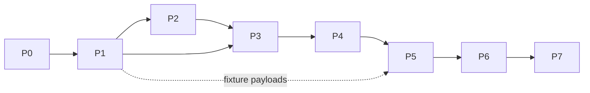

# Nebula Browser UI: Build Plan

This document plans the implementation of the Nebula browser UI in `web/`. Section 1 states its purpose and scope.

## Contents

- [1. Purpose and scope](#1-purpose-and-scope)
- [2. Constraints inherited from the architecture](#2-constraints-inherited-from-the-architecture)
- [3. Implementation choices](#3-implementation-choices)
- [4. App architecture](#4-app-architecture)
- [5. Schema-driven forms](#5-schema-driven-forms)
- [6. Feature areas](#6-feature-areas)
- [7. Mock backend](#7-mock-backend)
- [8. Phased delivery](#8-phased-delivery)
- [9. Testing](#9-testing)
- [10. Risks and open items](#10-risks-and-open-items)
- [11. Later milestones](#11-later-milestones)

## 1. Purpose and scope

`ARCHITECTURE.md` Section 13 fixes what the browser UI is: a React + TypeScript app served by the FastAPI server, with react-three-fiber for geometry, vtk.js and Plotly for results, forms generated from `.proto`, a fixed viewer catalogue and a typed-port node graph editor (D28, D50, D87). It does not say how to build it. This document fills that gap: library choices left open by the decision log, code structure, a mock backend so UI work is not blocked on the C++ and Python processes, a phase order and a test plan.

Scope is the v1 platform of ARCHITECTURE.md Section 18.1 (D160). Later milestones are noted only, in Section 11.

This document adds no decisions. It cites ARCHITECTURE.md sections (written "A§n") and the decision log (Dnn). Every choice made here is an implementation detail (not a decision) and must not contradict a logged decision; where one would, the decision log wins.

### 1.1 Requirements traceability

Every UI bullet of `requirements.md` maps to the parts of this plan that build it.

| `requirements.md` bullet | Built by | Phase | Milestone |
|---|---|---|---|
| UI: Web based | App shell, API client, token bootstrap (4.1, 4.2, 6.1) | P0, P1 | v1 |
| UI: Design geometry | Libraries, geometry editor, circuits (6.2, 6.3) | P2 | v1 |
| UI: Setup calculation | Regions, scenarios, conductor networks, workflow editor, schema-driven forms, run submission (5, 6.4, 6.5, 6.6) | P1, P3, P4 | v1 |
| UI: View results | Viewer catalogue, view-job lifecycle, comparison (6.7, 6.8) | P5, P6 | v1 |
| UI: Multiple projects | Project browser, import/export, templates (6.1) | P1 | v1 |
| UI: Single project with multiple calculations | Project-scoped routes for many workflows, runs and studies (4.1, 6.5, 6.6, 6.9) | P3, P4, P6 | v1 |
| UI: Can be full design to simulation or each separate step | Workflow templates for full chains; one-node graphs fed by stored-output and input-dataset nodes (6.5) | P3 | v1 |
| UI: Same or different geometry multiple calculation in a project | Reference picker with pinned / latest / draft states on every workflow input port (4.4, 6.5) | P1, P3 | v1 |

## 2. Constraints inherited from the architecture

These rules come from the decision log. The UI plan restates them only to make them checkable; ARCHITECTURE.md is normative.

| Constraint | Consequence for `web/` | Source |
|---|---|---|
| React + TypeScript; three.js via react-three-fiber for geometry; vtk.js for results; Plotly for plots | Fixed rendering stack | D28, A§13.3 |
| One schema in `proto/`, TypeScript generated by Buf | No hand-written wire types; `web/` consumes generated code | D25, A§17.4 |
| Plugins ship no frontend code | Config forms are generated from descriptors; results use the fixed core catalogue plus optional view descriptors | D87, A§7.8 |
| Plugin FileDescriptorSets layered over core descriptors, one pool per plugin version | The browser builds the same registry from `/plugins` | D54, D133, A§5.4 |
| Arrays never travel inline | Results arrive only as view payloads over `/ws/views`, or as dataset references | D25, D39, A§13.1 |
| View payloads are FP32 presentation data with a local origin offset | Viewers apply the offset; payloads are never fed back as inputs | D156, A§2.3 |
| Token arrives in the URL fragment, is held in memory, and is sent as a header (REST) or WebSocket subprotocol | No cookies, no localStorage, no query-string tokens | D90, D137, A§16.1 |
| `/version` is checked at connect | UI refuses to run against an incompatible server | D137 |
| Single user; no identity in data or API | No login, user menu or per-user state | D11, D16 |
| Drafts carry a revision; conditional updates return 409 on conflict; entity-change events reach every client | Every draft edit sends the revision and handles 409 | D148, A§3.3 |
| References are `pinned`, `latest` or `draft` | One shared reference picker | D107, A§4.2 |
| State changes travel through the acknowledged event log; progress is best-effort | Run state from WebSocket is authoritative; progress may drop frames | D106, A§3.5 |
| Units are SI (temperatures in eV); every numeric field carries a unit tag | Unit labels come from the schema; the UI does no unit conversion of stored values | D46, A§5.7 |
| View payloads served with fixed Content-Type, `nosniff`, restrictive CSP; glTF may not reference external URIs | The bundle must run under a strict CSP | D117, A§13.6 |
| TypeScript unit tests are part of the platform tests | `web/` tests run through the task runner | D157, A§15.5 |

## 3. Implementation choices

Implementation detail (not a decision): the libraries below are recommended for the parts the decision log leaves open.

| Concern | Choice | Reason |
|---|---|---|
| Build tool | Vite, TypeScript strict mode, ES modules | Fast dev server; static bundle the FastAPI server can serve (D90) |
| Package manager | pnpm workspace member `web/` | Required by D91 |
| React | React 18 with function components and hooks | Stable baseline for react-three-fiber and React Flow |
| Protobuf runtime | `@bufbuild/protobuf` (protobuf-es) with `protoc-gen-es` through Buf | Generated types for core messages, plus a runtime `createFileRegistry` from FileDescriptorSets, which the plugin forms of Section 5 need |
| Wire encoding | Protobuf JSON mapping over REST and WebSocket | Readable in devtools and in MSW fixtures; protobuf-es handles it from the same types |
| Server state | TanStack Query | Caching, invalidation and retries for REST resources |
| Push updates | One WebSocket manager (Section 4.3) that writes into the TanStack Query cache | One source of truth for entity and run state |
| Local UI state | Zustand | Selection, camera, panel layout; no server data |
| Routing | React Router; project-scoped routes `/p/:projectId/...` | Bookmarkable views within a single launch |
| Node graph | React Flow (`@xyflow/react`) | Custom node and edge types, port handles, validation hooks |
| Geometry viewport | `@react-three/fiber` with `@react-three/drei` | Mandated by D28 |
| Result viewers | `@kitware/vtk.js` for 2D contour, 3D field, Poincaré and mode structure; `react-plotly.js` with `plotly.js-dist-min` for 1D profile, spectrum, time trace and convergence | Mandated by D28; split follows A§13.6 |
| UI kit | A headless component library (for example Radix primitives) with project CSS | Accessible primitives without a design-system lock-in |
| Unit and component tests | Vitest and Testing Library | Vite-native |
| API mocking | Mock Service Worker (MSW) for REST and WebSocket | Same handlers in the browser, Vitest and Playwright |
| End-to-end tests | Playwright | Drives the built bundle against the mock and later against `nebula serve` |
| Lint and format | ESLint (typescript-eslint, react-hooks) and Prettier | Standard |

## 4. App architecture

### 4.1 Directory layout

Implementation detail (not a decision): directory names are illustrative.

```text
web/
├── package.json, vite.config.ts, tsconfig.json, playwright.config.ts
├── index.html                 # no inline scripts (CSP, D117)
└── src/
    ├── app/                   # entry, router, providers, connection gate
    ├── gen/                   # Buf output (not edited by hand)
    ├── api/                   # token, REST client, per-resource query hooks
    ├── ws/                    # WebSocket manager and channel adapters
    ├── schema/                # descriptor registry, annotation readers
    ├── forms/                 # schema-driven form engine (Section 5)
    ├── entities/              # draft/version/reference hooks and widgets
    ├── features/
    │   ├── projects/          # 6.1
    │   ├── libraries/         # 6.2
    │   ├── geometry/          # 6.3
    │   ├── regions/ scenarios/ conductor-networks/   # 6.4
    │   ├── workflows/         # 6.5
    │   ├── runs/              # 6.6
    │   ├── results/           # 6.7
    │   ├── comparison/        # 6.8
    │   ├── studies/           # 6.9
    │   └── plugins/ settings/ # 6.10
    ├── viewers/               # one component per catalogue row (A§13.6)
    ├── components/            # shared presentational components
    └── mocks/                 # MSW handlers, scripted scenarios, fixtures (Section 7)
```

Features depend on `api/`, `ws/`, `entities/`, `forms/` and `viewers/`, never on each other, except through routes.

### 4.2 Connection and API client

| Piece | Behavior | Source |
|---|---|---|
| Token bootstrap | On load, read the token from `location.hash`, keep it in a module-scoped variable, then remove it from the address bar with `history.replaceState`. Without a token, show a screen that tells the user to open the URL printed by `nebula serve` | D137 |
| Connection gate | Call `/version` before rendering the app; on mismatch, show the server and UI build identities and stop | D137 |
| REST client | Thin `fetch` wrapper: adds the token header, sets JSON content type, decodes with protobuf-es, maps errors to typed results (401/403, 404, 409, 422 validation, 5xx) | D90, D137 |
| Query hooks | One module per resource of A§13.2 exposing `useX` / `useXMutation` hooks with stable query keys `[projectId, kind, id, ...]` | A§13.2 |
| Draft updates | Every draft mutation sends the draft revision it was based on. On 409 the hook stores the server's current draft and opens a conflict dialog: keep server version, or re-apply the local change on top of it | D148 |
| Stale responses | Responses tagged with a revision older than the one held are dropped (A§3.3) | D148 |
| Reload | A browser reload loses the in-memory token; the user reopens the printed URL. This follows D137 and is stated in the UI | D137 |

### 4.3 WebSocket manager

One manager owns a connection per channel of A§13.2: `/ws/projects/{p}/entities`, `/ws/runs/{r}`, `/ws/queue`, `/ws/telemetry`, `/ws/views` (and `/ws/studies/{s}` in M3). Each connection sends the token as a subprotocol value (D137).

- Reconnect with exponential backoff; after reconnect, refetch the affected queries, because events missed while disconnected are not replayed to the browser.
- Entity-change events update the query cache only when their revision is newer than the cached one (D148).
- Run and queue state events overwrite cached state; progress events append to bounded ring buffers per run (logs, residuals) and may be dropped under load (D106, D44).
- `/ws/views` is request/reply: the manager tags each request with a client ID and resolves the matching reply (Section 6.7).
- Channels open on demand (a route that needs them subscribes) and close when unused, except the entity and queue channels, which stay open while a project is open.

### 4.4 Entity layer

Geometry, Component, Region, Scenario, ConductorNetwork and Workflow share the draft/version model of A§4.2 (D56). One generic layer serves all of them:

| Hook or widget | Purpose |
|---|---|
| `useDraft(kind, id)` | Current draft and revision; debounced conditional save; conflict state |
| `useVersions(kind, id)` | Version list with content hashes and head pointer |
| `ReferencePicker` | Picks `pinned` (a version), `latest` or `draft`; defaults per A§4.2: `pinned` when a version exists, else `draft` (D107) |
| `StalenessBadge` | Shown when a pinned reference has a newer head version; offers one-click re-run (D101, A§4.4) |
| `ProvenanceTags` | "rebuilt" (D62), "mixed builds" (D130), "viewable, not reproducible here" (D100, D149) |
| `FailureReason` | Typed reason chip: `oom`, `nan`, `diverged`, `plugin_error`, `geometry_failed`, `crashed`, `supervisor_lost` (A§3.7) |
| `Quantity` | Number with unit label from the schema unit tag (D46) |

## 5. Schema-driven forms

Config forms for solver steps, adapters, PostOps, components and other extension configs are generated from `.proto` descriptors (D87, A§13.5). First-party modules use the same path (D111).

**Descriptor registry.** At connect, `schema/` builds one registry for core descriptors (generated code embeds them) and one registry per plugin version from the FileDescriptorSets returned by `/plugins`, each layered over the core registry, including core custom options (D54, D133). Lookups go by fully qualified message name; plugin packages are namespaced by plugin ID and major version, so v1 and v2 of a plugin coexist (D133).

**Field-to-widget mapping.**

| Field shape | Widget |
|---|---|
| Numeric scalar | Number input with unit label; bounds from annotations (A§5.8) |
| `bool` | Toggle |
| `string` | Text input |
| Enum | Select, labels from enum value names or UI hints |
| `oneof` | Variant selector, then the selected variant's fields |
| Nested message | Collapsible group |
| `repeated` scalar | Inline list or a table for numeric arrays small enough to be config (arrays sized by mesh never appear; D25) |
| `repeated` message | Table or list of groups, with add, remove and reorder |
| Entity reference | `ReferencePicker` (Section 4.4) |
| Dataset reference | Picker over committed outputs or input datasets |

**Annotations.** UI-hint field options select widgets, grouping, order, defaults and visibility (D87). Unit tags drive labels (D46). Bounds drive advisory validation. Fields annotated as design variables are marked so the study editor can offer them (D81; Section 6.9).

**Validation.** Client-side checks are advisory and give fast feedback; the FastAPI server is authoritative (A§13.1). Server validation errors map back to field paths and render inline.

**Unknown or newer schema.** Fields the registry cannot render (for example an unknown custom option) fall back to a raw read-only JSON view rather than being dropped.

## 6. Feature areas

Each area lists its screens, the API it uses, and its acceptance criteria. All are v1 (A§18.1, D160).

### 6.1 Shell and project browser

- **Shell**: top bar with project switcher, queue indicator (running and queued counts, GPU usage from `/ws/telemetry`) and plugin status; left navigation for the areas of A§13.3.
- **Project browser**: list from the global registry; create from a concept kit starter or saved template; open; export snapshot; import with validation errors shown; save project as template (D100, D86, D113).
- **API**: `/projects`, `/templates`, `/version`, `/ws/queue`, `/ws/telemetry`.
- **Done when**: a user can create a project from each reference concept kit (tokamak, simple mirror, stellarator; D98), reopen it, export it and import it back; an import with mismatched builds marks its Runs "viewable, not reproducible here".

### 6.2 Libraries

- Project and user-global component and material libraries; import into the project by copy, showing the provenance link to the source entry (D88).
- **API**: `/projects/{p}/components`, `/projects/{p}/materials`, `/library/components`, `/library/materials`.
- **Done when**: importing a library component creates a project copy whose detail view links its source.

### 6.3 Geometry editor

- **Layout**: assembly tree (components, circuits) | 3D viewport | property panel with the generated component form.
- **Viewport**: react-three-fiber renders tessellations from `/tessellation` (A§3.3); selection syncs with the tree; symmetry replication shown; camera state in Zustand.
- **Edit loop**: form change → debounced conditional PATCH → new tessellation for that revision → replace the mesh; older replies are dropped (D148).
- **Symmetry metadata**: mandatory editor section (axisymmetric, `N_fp`; D94, D113).
- **Circuits**: create circuits, assign current-carrying components, set turns, series grouping and symmetry replication; stable circuit IDs shown (D114). Filament circuits flagged when not closed (D145).
- **Versions**: version list, draft-vs-head indicator, STEP export (D27).
- **API**: `/projects/{p}/geometries/{g}`, `/components`, `/tessellation`, `/step`, `/ws/projects/{p}/entities`.
- **Done when**: a reference-concept geometry can be edited, its viewport updates per edit, a concurrent SDK edit raises the conflict dialog, and STEP export downloads.

### 6.4 Regions, scenarios and conductor networks

- **Regions**: editor per Region type (points, line, plane, box grid, cylindrical or toroidal grid, component surface, mesh volume, step-output surface) with 3D placement over the selected geometry in react-three-fiber (D89, D160).
- **Scenarios**: waveform editor keyed by circuit of a chosen geometry version (Plotly with draggable points or a table), plasma targets via generated forms, ConductorNetwork reference; solved scenarios listed as versions with their producing Run (D66, D110, D114).
- **Conductor networks**: passive elements (component references, electrical data, thickness, discretization), circuit topology, power supplies and feedback, built on geometry circuits (D71, D128).
- **API**: `/regions`, `/scenarios`, `/conductor-networks`.
- **Done when**: a field calculation's inputs (geometry, region, scenario with coil currents) can be authored end to end without the SDK.

### 6.5 Workflow editor

- **Canvas**: React Flow with a custom node per node kind of A§13.4 except `optimize` (M3): solver step, adapter, `coupled` composite (as a group node with convergence criteria), fan-out, PostOp, objective, stored output, input dataset.
- **Palette**: extension list from `/plugins`, grouped by calculation type and sub-contract.
- **Ports**: typed by sub-contract (for example `Equilibrium.Axisym2D`); the editor blocks connecting mismatched sub-contracts and offers matching adapter nodes (D55). Time-series edges show their time base (D92).
- **Inputs**: every port bound to Geometry, Region, Scenario or ConductorNetwork uses `ReferencePicker` (D107). Stored-output nodes pick a run, an output name and a content hash (D22, D26). Input-dataset nodes upload or select an ingested HDF5 dataset (D144).
- **Node config**: side panel with the generated form (Section 5).
- **Validation**: a "Validate" action calls the server; results (port mismatch, missing traits against the project concept and geometry symmetry, circuit errors, rank-count limits) render on the offending nodes and edges (D64, D113, D114, D116).
- **Templates**: start from a concept kit default workflow or a standard chain (D50, D86); a single calculation is a one-node graph (D50).
- **Done when**: a user builds both a full chain (geometry → field → T1 equilibrium → stability) and a single stability step fed by a stored equilibrium output, and the server accepts both.

### 6.6 Run submission, queue and run detail

- **Submit dialog**: GPU count (default from the manifest hint; bounded by installed GPUs and the solvers' supported rank counts), determinism mode (deterministic by default), summary of drafts that will be minted (A§13.5, D102, D116, D142, D77). A full cache hit shows the Run as completed immediately (A§3.4).
- **Queue view**: shared across projects (D100); reorder, cancel; GPU subset per Run; Preparing state shown (D102, D121).
- **Run detail**: state timeline and attempts (build, hardware, achieved determinism class; D130, D129); provenance panel (A§4.3); per-step status; live structured logs with filters; convergence residual plots (Plotly); GPU telemetry for the Run's GPUs (D44).
- **Actions per A§3.7 and A§14.1**: pause, resume (Paused, or Failed with a transient reason and a checkpoint), cancel, discard, re-run, re-run with edited workflow (D141). Buttons are enabled only for valid states.
- **API**: `/runs`, `/runs/{r}/outputs`, `/queue`, `/ws/runs/{r}`, `/ws/queue`, `/ws/telemetry`.
- **Done when**: the scripted mock scenarios of Section 7 (success, cache hit, `oom` then resume, `diverged` then re-run) play through the UI with correct states and enabled actions.

### 6.7 Results and the viewer catalogue

- **Output list** per Run and step, with output kind, sub-contract and content hash; live Runs show outputs as they commit (D122).
- **Viewer choice** by output kind and Region type (D87, D89), refined by plugin view descriptors.
- **Viewers**: one component per catalogue row of A§13.6: 1D profile, spectrum and time trace (Plotly); 2D contour, 3D field, Poincaré and mode structure (vtk.js). Each takes a decoded payload and view parameters; none fetches arrays directly.
- **View requests**: changing view parameters (slice plane, isovalue, field-line seeds, decimation) sends a `/ws/views` request; the viewer shows the previous payload with a pending indicator until the reply arrives; cached replies return fast (A§3.6, D39, D143).
- **Time series**: a shared time slider for time-series outputs (D146).
- **Origin offset**: applied when building vtk.js and three.js scenes (D156).
- **Done when**: every catalogue viewer renders its fixture payload, and parameter changes round-trip through the mock view channel.

### 6.8 Comparison

- Select Runs in a project and a shared Region (D104).
- Views: scalar table across Runs with tolerance flags (D43); overlaid 1D profiles; difference field (a view job, rendered by the 2D or 3D viewer); linked 3D views sharing one camera store.
- **API**: `/comparisons`, `/ws/views`.
- **Done when**: two fixture Runs compare in all four views and out-of-tolerance quantities are flagged.

### 6.9 Studies: parameter scans

v1 includes parameter scans as fan-out Studies (A§12.4, A§18.1).

- **Editor**: base Workflow version, variables picked from design-variable-annotated fields with ranges or point lists (D81), per-study concurrency limit (default: GPU count; D142).
- **Points table**: one row per point Run with its override vector, state, staleness and key metrics; rows link to run detail (D109).
- **API**: `/studies`, `/runs`.
- **Done when**: a 2-variable scan over a field workflow shows all point Runs progressing in the queue and a filled table.

### 6.10 Plugins, settings and storage

- **Plugins**: core and plugin manifests, versions, ABI fingerprint, `.so` hash, smoke V&V status per GPU model (D45, D61, D140).
- **Settings**: read-only view of the TOML config; per-project strict cache switch (D90, D78).
- **Storage**: project size against cap, evict derived artifacts, delete primary results after the server's dependency check lists affected references (D79, D141).
- **API**: `/plugins`, `/settings`, `/projects/{p}/storage`.

## 7. Mock backend

Implementation detail (not a decision): the UI is built against a mock until the FastAPI server and supervisor exist, then against both.

- **MSW handlers** for every REST resource of A§13.2, backed by an in-memory store that enforces draft revisions (409 on conflict) and mints content-hash versions on run submission.
- **WebSocket mock** for every channel, with the token subprotocol checked.
- **Scripted scenarios** replay the flows of A§3.4 to A§3.7 with configurable timing: queued → preparing → running → outputs committed → completed; full cache hit; `oom` with checkpoint → resume; `diverged` → re-run with edited workflow; `supervisor_lost`; concurrent entity edit from "another client".
- **Fixtures**: entities built with the generated protobuf-es types so they stay schema-correct; one fake plugin FileDescriptorSet with UI hints, unit tags and bounds; small payloads per catalogue viewer (vtk.js polydata, glTF without external URIs, Plotly JSON).
- **Modes**: `pnpm dev` runs against the mock by default; an environment flag proxies to a running `nebula serve` instead.

## 8. Phased delivery

Each phase ends with a demoable slice and its tests passing against the mock.

| Phase | Content | Depends on |
|---|---|---|
| P0 Scaffold | `web/` package in the pnpm workspace; Vite, TS strict, ESLint, Prettier; Buf TS generation into `src/gen/`; Vitest, Playwright, MSW; task-runner targets for build, test and e2e (D91, D157); FastAPI static-serving contract (bundle path, `index.html` fallback) | — |
| P1 Platform | Token bootstrap, `/version` gate, REST client, WebSocket manager, entity layer, descriptor registry and form engine, shell, project browser | P0 |
| P2 Geometry | Libraries, geometry editor, circuits, STEP export | P1 |
| P3 Setup | Regions, scenarios, conductor networks, workflow editor | P1; P2 for geometry-backed placement and circuits |
| P4 Execute | Submit dialog, queue, run detail, live progress, crash and resume actions | P3 |
| P5 Results | Output list, viewer catalogue, view request lifecycle, time slider | P4 |
| P6 Compare and scan | Comparison, scan studies, staleness re-run, plugins, settings and storage | P5 |
| P7 Hardening | E2E against real `nebula serve`; strict-CSP check of the bundle; accessibility pass (keyboard, contrast, labels); performance on large tessellations and payloads; bundle splitting (lazy-load vtk.js, Plotly and three.js per route) | P6, and a running server and supervisor |

P2 and the forms part of P3 can proceed in parallel once P1 lands. Viewers in P5 can start early against fixture payloads.



## 9. Testing

All tests run through the task runner as part of the platform tests (D157, A§15.5).

| Level | Tool | Coverage |
|---|---|---|
| Unit | Vitest | Token bootstrap and URL scrubbing; REST error mapping; revision and 409 handling; stale-response dropping; WebSocket reconnect and event ordering; reference-picker defaults (D107); form generation from core descriptors and from the fake plugin FileDescriptorSet (widgets, units, bounds, `oneof`, unknown-option fallback); port-type compatibility checks |
| Component | Vitest and Testing Library with MSW | Each feature area's main screens; enabled actions per Run state; conflict dialog; staleness badge |
| Viewer | Vitest with fixture payloads; Playwright screenshots for WebGL viewers | Every catalogue row of A§13.6 renders; origin offset applied; time slider |
| End to end, mock | Playwright with MSW scenarios | One test per flow of A§3.3 to A§3.7 plus project create/export/import |
| End to end, real | Playwright against `nebula serve` with the supervisor's stub launcher (A§15.5) | Same flows with real FastAPI, SQLite and event log; added in P7 |
| Codegen | Task runner | Buf TS generation succeeds and the app type-checks against it |

## 10. Risks and open items

| Risk or open item | Effect | Mitigation |
|---|---|---|
| protobuf-es registry layering may not match the server's per-plugin-version pools exactly (custom options, namespacing) | Plugin forms render wrongly or miss hints | Prototype the registry in P1 against the fake plugin FileDescriptorSet before building forms; share test descriptors with the server's codegen tests |
| vtk.js and Plotly size and CSP behavior (workers, `eval`, inline styles) | Large bundle; CSP violations | Lazy-load per route; test under the production CSP in P7; pick builds without `eval` |
| Large tessellations and payloads | Slow viewport and viewers | Instancing for symmetry replicas; decimation is the server's job (D39); measure in P7 |
| WebSocket events missed during reconnect | Stale UI state | Refetch affected queries on reconnect (Section 4.3) |
| In-memory token lost on reload (D137) | User must reopen the printed URL | Clear reconnect screen; keep routes so the same view reopens |
| No sizing targets in the architecture (D161) | No pass/fail performance budget | Record measured baselines in P7; treat them as provisional |
| Exact JSON shapes of REST resources are not yet defined (A§13.2 paths are illustrative) | Mock may drift from the server | Generate request and response types from `proto/`; switch e2e to the real server in P7 |

## 11. Later milestones

Noted only; not planned in detail.

| Milestone | UI additions | Source |
|---|---|---|
| M2 | None beyond new sub-contracts, solver configs and outputs, which arrive through descriptors and the fixed catalogue; no new viewer components (D87) | D99, A§18.2 |
| M3 | Study editor for optimizers (objectives, constraints, Optimizer choice), expression editor with server type checks (D156), convergence dashboard on `/ws/studies/{s}`, promote-iterate action, read-only display of Study-generated `optimize` workflows | D103, D80, D110, D123, A§12.7, A§13.7 |
| M4 | Wall-load and thermal-structural outputs through the catalogue | D99 |
| M5 | Queue and run detail show node placement for multi-node Runs | D99, A§14.5 |
